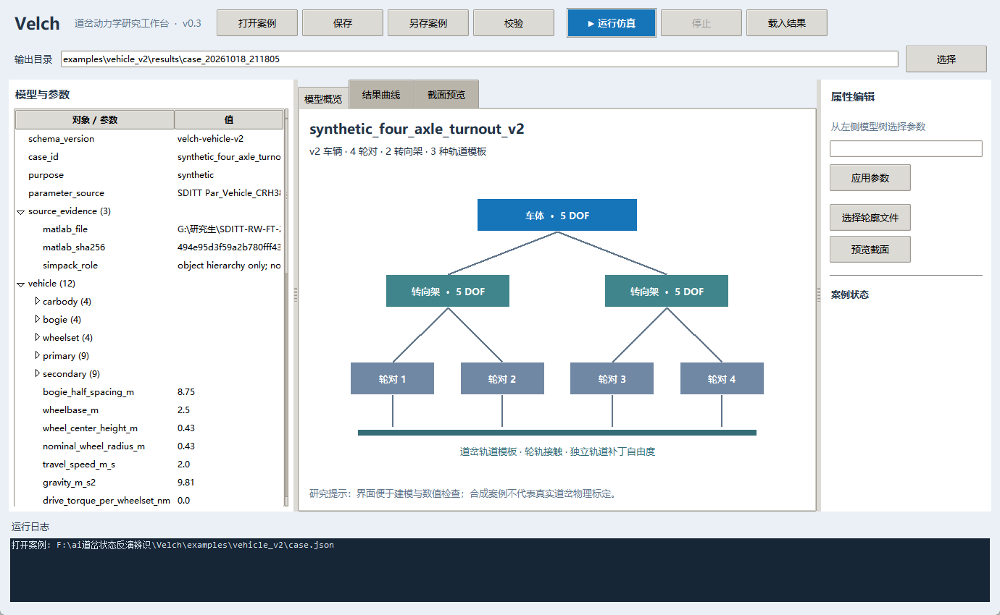

# Velch 道岔车辆动力学研究软件（v0.4.0）

Velch 是一个**独立实现、可运行的降阶正向求解器**。v0.2 新增“车体—前后转向架—4 轮对—道岔钢轨”联合模型：车辆 35 自由度，轨道按每个轮对的候选截面补丁增加自由度。v0.1 的单轮对求解器继续作为较小的核对算例使用。两个版本的车辆纵向速度均由外部规定。

v0.3 增加 Windows 桌面工作台，提供模型树、参数编辑、输入校验、案例另存、仿真运行、停止、结果曲线与日志。v0.4 为 v2 车辆案例增加刚性、局部柔度和独立模态轨道选项，以及 Simpack 道岔截面目录只读导入。界面调用同一套 Python 求解器。



## 打开桌面界面

在 PowerShell 中进入本目录，安装本地包并启动：

```powershell
cd 'F:\ai道岔状态反演辨识\Velch'
python -m pip install -e .
velch-gui .\examples\vehicle_v2\case.json
```

也可以安装已生成的 v0.4 wheel：`python -m pip install .\dist\velch_turnout_dynamics-0.4.0-py3-none-any.whl`。

本机可直接双击 [启动Velch界面.cmd](启动Velch界面.cmd)，默认打开四轴车辆演示案例。它使用当前 `python` 命令和本目录 `src` 代码；需已有 NumPy、SciPy 和 Tkinter。

如果 `velch-gui` 尚未进入当前终端的 PATH，可以直接运行：

```powershell
python -m velch.gui .\examples\vehicle_v2\case.json
```

已建立虚拟环境的用户也可以安装本地构建的 wheel，再运行该环境的 `Scripts\velch-gui.exe`。Windows Python 需要包含 Tkinter（`python -m tkinter` 可检查）。界面使用标准库 Tkinter，没有新增 UI 依赖。

工作步骤：打开案例 → 左侧选择具体参数 → 右侧修改并应用 → 校验 → 运行仿真。选中 `profile.file` 时，可在右侧更换轮廓文件并预览截面。若参数尚未保存，运行时会在案例旁生成带时间戳的运行快照，保留原始案例。结果页可选择任意 CSV 列绘图；记录数很大时抽样显示并尽量保留局部峰值，完整数据仍在 `history.csv` 中。另存案例到其他目录时，界面将相对轮廓路径改为原资源的绝对路径；若要迁移到另一台机器，需要同步轮廓文件并重新指定路径。

界面目前属于研究工作台，不含 Simpack 的 3D 建模器、完整元件库或实时三维动画。输入校验表示算例结构和资源可读取；动力学物理有效性仍需独立标定与对照。

**当前通过的是合成算例的数值检查，尚未完成真实道岔的几何/材料标定或与 Simpack、实测数据的物理验证。** 车体与转向架采用小转角降阶坐标；轴箱并入轮对。它不能代替完整 3D 多体车辆、柔性轨道有限元、齿轮齿条啮合或状态反演求解器。第二版的来源、方程、Simpack 只读连接证据与限制见 [车辆模型说明](docs/VEHICLE_V2_DESIGN_AND_EVIDENCE.md)。

## 快速运行（Windows PowerShell）

在 `F:\ai道岔状态反演辨识\Velch` 中：

```powershell
python -m pip install -e .
python examples\make_vehicle_v2_case.py
velch run-vehicle examples\vehicle_v2\case.json --output examples\vehicle_v2\output
python diagnostics\vehicle_v2_checks.py
python examples\make_synthetic_case.py
velch run examples\synthetic_transfer\case.json --output examples\synthetic_transfer\output
python -m pytest -q --basetemp .pytest_tmp
python diagnostics\final_review.py --prr "H:\总的齿轨项目\总和1\直逆_修改降低值后设计 -上坡度\RACK_RAILWAY_VEHICLE - XNEW - M\database\Profile_Mileage_ATG_57.85.prr"
```

不安装时可执行：

```powershell
$env:PYTHONPATH='src'
python -m velch run examples\synthetic_transfer\case.json --output examples\synthetic_transfer\output
```

两种求解都输出 `history.csv` 与 `manifest.json`。前者包含时间、各轴里程、车辆和轨道状态、接触力与活动标志；后者包含算例与轮廓 SHA-256、坐标顺序、单位、求解器设置和质量门。求解失败返回非零退出码；不会出现交互式 `input()`。

## 单轮对基础内核与源代码对应关系

| Velch 模块 | 职责 | 与 SDITT MATLAB 的关系 |
| --- | --- | --- |
| `profiles.py` | TXT/CSV/PRR 轮廓、SI 单位、哈希、里程插值与同里程事件 | 对应截面里程表和 `Get_Profile_P1_Through_210624.m` 的流程；**独立解析与选择规则** |
| `contact.py` | 图形截面候选、法向/切向力 | 用 `Multi_Con_250812.m:417–418` 的正侵入 (3/2) 幂结构与 `:997–1006` 的三次饱和多项式；修复零蠕滑 `0/0` |
| `model.py` | 明确的 SI 参数、自由度、输入来源与算例契约 | 替代主 MATLAB 脚本内分散的硬编码和隐式工作区依赖 |
| `solver.py` | 轮轨作用反作用、质量/支承/重力组装、DOP853/Radau 积分、质量门 | 参考 `WR_Force_ModalFT.m` 与 `Integration_Park.m` 的**模块分层**，不复制其矩阵或积分公式 |
| `cli.py` | 无交互执行、截面检查、结构化错误与输出 | 便于批处理及以后接 MCP/反演控制器 |

Simpack 2021x 只读逆向结果说明“任务入口 → 方法分发 → 状态推进 → 结果/停止状态”的实现层次；它**没有**给出可信的内部轮轨接触公式。本软件未调用私有 Simpack 函数，也未把本模型说成 Simpack 数值等价。相关本机证据位于 `..\simpack-mcp-2021x\docs\SIMPACK_SOURCE_GUIDE_TURNOUT_V1.md` 和 `..\SDITT_analysis\SDITT_REA_CODE_AUDIT_V1.md`。

## 关键方程和单位

令 (q=[y_w,z_w,\phi_w,\theta_w,y_{r1},z_{r1},\ldots])，各自由度按质量对角阵 (M) 满足 (M\ddot q=Q_{support}+Q_{gravity}+Q_{contact}+Q_{drive})。轮对纵向位置 (x(t)=x_0+Vt) **由外部规定**，没有求解车辆纵向平动。

接触几何在同一横向坐标 (y) 比较轮下表面和轨上表面，近似法向侵入量为

\[
\delta=\max\!\left(0,\frac{z_r(y)-z_w(y)}{\sqrt{1+(\partial z_r/\partial y)^2}}\right).
\]

每根钢轨只取一个最大侵入候选；多根轨可以同时承载。此“图形截面”假设不覆盖倒扣、复杂轮缘多点接触。PRR 原始点列如同一 `y` 有多个 `z`，轨面取最大 `z`、轮下表面取最小 `z`；这是一项**显式简化**，不是 Simpack 的轮廓搜索方法。

法向弹力使用 (F_e=\frac43 E^*\sqrt{R^*}\delta^{3/2})，其中 (E^*\) 单位 Pa、(R^*\) 单位 m；它是有效半径的简化 Hertz 模型，与 SDITT 椭圆接触/STRIPES 并不等价。法向阻尼另定义 (F_d=c_n\sqrt\delta\,\dot\delta)，总力截断为 (F_n=\max(0,F_e+F_d))。`c_n` 的单位为 N·s·m⁻³ᐟ²，由算例显式提供；此式不是从 SDITT 的 Hu–Guo 阻尼直接移植。有效半径目前是**输入参数**，没有从 PRR 曲率自动可靠地计算。该 Hertz 球面有效半径形式也见 [CompuTiX 的接触模型文档](https://computix.gitlabpages.inria.fr/computix/db/d6e/group__Hertz.html)；[Project Chrono 的接触接口](https://api.projectchrono.org/classchrono_1_1_ch_default_contact_force_torque_s_m_c.html)同样明确要求侵入量和有效曲率半径作为输入，而不意味着两者算法等价。

纵向/横向线性蠕滑需求为 (P_x=-C_x v_{slip,x}/V_{ref}\)、(P_t=-C_t v_{slip,t}/V_{ref}\)，其中 (V_{ref}=\max(|V|,V_{floor})\)。令 (P=\sqrt{P_x^2+P_t^2}\)、(L=\mu F_n\)。当 (P=0) 或 (L=0) 时切向力**严格为零**；否则若 (P\le3L)，大小取 (L[(P/L)-(P/L)^2/3+(P/L)^3/27]\)，大于此范围取 (L\)，方向沿 (P_x,P_t)。此多项式直接对应 SDITT `Multi_Con_250812.m:997–1006` 的计算形状，但当前只使用两个蠕滑分量，没有复现其完整 Kalker 系数、旋转蠕滑或 FASTSIM。

所有算例值在 JSON 中使用明确的 SI 单位和来源字段。`examples/synthetic_transfer` 的质量、刚度、模量、摩擦系数及速度是**透明的演示参数**，不能当作 07(009) 道岔实测值。

## 截面与真实数据

```powershell
velch inspect-profile "H:\...\database\Profile_Mileage_ATG_57.85.prr" --format prr --surface rail_top
```

已在 H 盘现有 PRR 上实测只读解析：原始 1998 点经 `rail_top` 图形包络变为 1448 个唯一横坐标点，其中 550 个重合横坐标点被折叠。读入成功**不等于**该 PRR 在 Velch 中已完成坐标对齐或动力学验证。配置真实轮廓前，必须确认文件 `type`、`units.len`、左右手坐标、轮对中心与轮廓原点、轨距、里程原点、支承参数、轮对状态和接触材料。遇到同里程不同截面，`ProfileSeries` 在未指定 `event_branches.before/after` 时拒绝计算；不会把两份截面平均。

当前仅支持数值列为 `y,z` 的 TXT/CSV、单位为 `m` 的 PRR；TXT/CSV 可在算例里标 `m` 或 `mm`。对于真实 H 盘模型的 5 个同里程不同 PRR 事件，分支规则仍需从工况和官方结果核对；Velch 不会自行猜测活动截面。

### 刚性与柔性轨道案例

v2 车辆案例可选择三种轨道：`rigid` 固定轨道（0 个轨道自由度）、`local_compliant`（每个轮轨补丁独立的横/竖弹簧质量，当前缺省）和 `modal`（由独立模态交换 JSON 驱动的降阶柔性轨道）。生成刚性和模态演示案例：

```powershell
python examples\make_track_model_cases.py
$env:PYTHONPATH='src'
python -m velch run-vehicle examples\vehicle_v2\case_rigid.json --output examples\vehicle_v2\output_rigid
python -m velch run-vehicle examples\vehicle_v2\case_modal_synthetic.json --output examples\vehicle_v2\output_modal_demo
```

`track_modes_synthetic.json` 是合成占位数据，只用于演示求解器接口，绝非 Simpack 或有限元导出结果。Velch 目前可以从 `.spck` 读取被引用的 PRR 几何目录，但不能导入并运行 Simpack 的刚性/柔性轨道动力学模型，也不能直接解析 `.fbi/.fem` 模态数据。需要由可信来源导出并核实模态质量、频率、归一化、振型坐标后，才能替换占位文件开展工程分析。

查看真实 `.spck` 只读截面目录：

```powershell
velch inspect-simpack-track "path\to\main_model.spck" --model-root "path\to\model-root" --output diagnostics\simpack_track_catalog.json
```

本机 H 盘模型目录扫描到 192 条截面引用、190 个唯一 PRR、0 个缺失引用和 5 个同里程异截面位置。当前扫描未识别模态文件引用，不代表可以断言模型没有柔性体；导入结果仍需人工确认截面分支和坐标约定。

架构和模块边界见 [v0.4 软件架构说明](docs/SOFTWARE_ARCHITECTURE_V0_4.md)。现有 Python 求解器不在运行时调用 MATLAB；MATLAB 文件只作为方程结构和参数来源。Simpack 逆向分析所得对象层级也不等于完整恢复其内部求解方程。

可借鉴的开源轮轨接触代码、许可及适用于 Velch 的改进顺序见 [轮轨接触算法调查](docs/OPEN_SOURCE_WHEEL_RAIL_CONTACT_SURVEY_2026-10-19.md)。

CONTACT 原生 DLL 已在本机编译并通过 module 3 球面 Hertz 探针；构建、解析基准与车—道岔求解接入门见 [CONTACT 接入记录](docs/CONTACT_NATIVE_INTEGRATION_2026-10-19.md)。当前车辆动力学计算尚未切换到 CONTACT。

## 验证与现有限制

`tests/` 包含无接触严格零力、零蠕滑有限性、摩擦上界、PRR 单位/类型、同里程事件、轮轨反力以及完整合成运行。`diagnostics/step_convergence.json` 对最大步长减半后比较轮对末态与各轨峰值；`diagnostics/static_energy_probe.json` 检查固定截面、零阻尼、零摩擦极限的机械能变化。合成算例质量门和输入哈希在 `examples/synthetic_transfer/output/manifest.json`。

`diagnostics/final_review.json` 汇总两种运行的质量门、输入哈希、CSV 完整性、步长与能量探针、wheel 包内容、Simpack 模型关系只读证据，以及可选的真实 PRR 解析。旧版 wheel 位于 `dist/`；v0.4 使用本地源码安装步骤，不要拿旧 wheel 当作 v0.4。

目前 v2 已有降阶车体、转向架、轮对与线性悬挂耦合，但没有完整 3D 多体车辆、钢轨 FEM/模态导入、支承非线性、轮缘多点接触、纵向车辆动力学、齿轮齿条分段啮合、状态反演优化器或与实测的误差验证。这些属于后续独立模块，不以现有合成算例合格来宣称实现。
