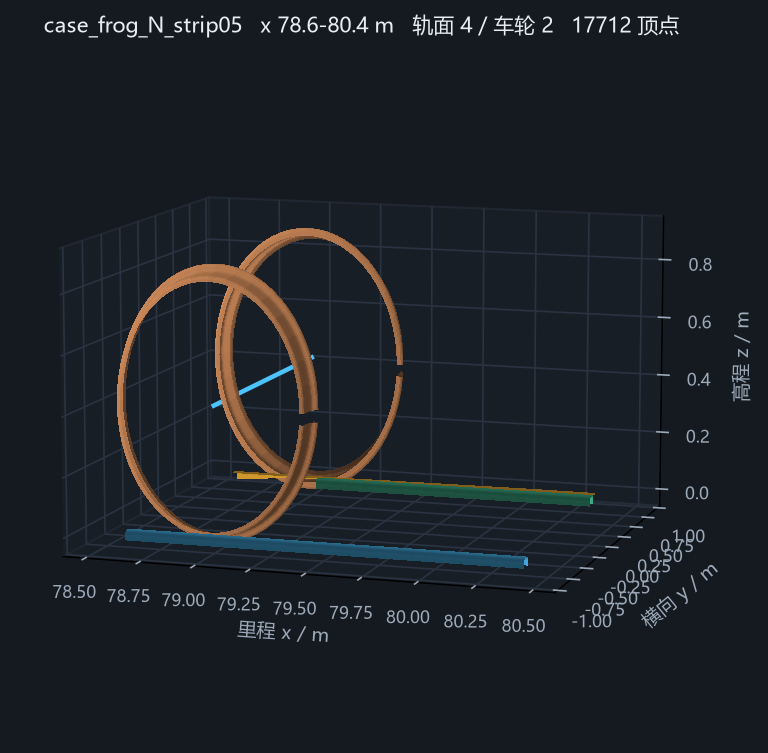

# 文档索引（单一入口）

> 先说结论，再给证据链。每份文档都标注了**它回答的问题**、**当前是否仍成立**、
> 以及它的证据来自哪一次运行。已作废的结论单独列出，避免再被引用。

最后更新：2026-10-22

## B3（接触表按批次摊销）2026-10-22 —— 实测复用 782×，批内 4.07×–17.04×

| 交付 | 路径 | 结论 |
|---|---|---|
| 调用计数 | `validation\crh380a_m\probe_table_amortization.py` | 单 run 97 736 次接触搜索、仅 **125** 个 `(站位, roll)` 单元、复用 **781.9×** |
| 批次定价 | `docs\B3_TABLE_AMORTIZATION_2026-10-22.md` | 1 次 4.07×、5 次 10.75×、10 次 13.52×、50 次 17.04×（上限 18.2×） |
| 复用前提 | `b3_amortization_*.json` | C 变 +1 % 时单元格集合 Jaccard **1.00**（125 全共享）⇒ 建表可整批共享 |

## B5（雅可比作事件检测）2026-10-22 —— 负结果，无对比度

| 交付 | 路径 | 结论 |
|---|---|---|
| 扫描实测 | `validation\crh380a_m\probe_jacobian_events.py` | 真正脱空步 ‖ΔJ‖ = **7.85e5**；相邻非事件步 **6.66e5–8.31e5**，事件反而最小 |
| 判定 | `docs\B5_JACOBIAN_EVENTS_2026-10-22.md` | `‖J‖` 由 `C·δ^0.5` 主导（4.5e6–5.4e6），换面为高阶小量 ⇒ 需离散归属量而非力导数范数 |

## A2（C–δ 简并）2026-10-22 —— 刚性偏移是规范不是简并；简并在 C 与支撑刚度之间

| 交付 | 路径 | 结论 |
|---|---|---|
| 规范实验 | `validation\crh380a_m\probe_contact_degeneracy.py` | 轮型面下沉 0.1 mm：静态 **0.000 %**、峰值 **−0.000 %**、主频不变 ⇒ 刚性偏移被静平衡吸收，不可观测 |
| 判定 | `docs\A2_C_DELTA_DEGENERACY_2026-10-22.md` | 真简并是 C↔`k_z`；峰值观测量 ±110 % vs 波形 ±0.63 %（旧实测）⇒ 解法是换观测量 |
| 规则 | 同上 §4 | 禁止用"额定侵入"标定 C；报告 C 必须声明定法 |

## B2（事件化积分）2026-10-22 —— 峰值是采样伪影，事件法不可用，改为步级重建

| 交付 | 路径 | 结论 |
|---|---|---|
| 分辨实验 | `validation\crh380a_m\probe_event_resolution.py` | 输出加密 10× → 峰值 **+2.571 %**；积分加密 4× → **+0.005 %** |
| 实现（默认关） | `RunSettings.refine_peak`、`results.peak_normal_force_step_resolved_n` | 取 `solution.sol.ts`（**不是** `t_eval`）重建，实测 +2.465 %、nfev +15.7 % |
| 判定 | `docs\B2_EVENT_INTEGRATION_2026-10-22.md` | `N(t)` 对状态不可微 ⇒ 接触力阈值事件法不成立；B2 是报告口径修正，不是提速 |

## A3（同步多斑 + 局部弹性分配）2026-10-22 —— 前提不成立，功能已存在

| 交付 | 路径 | 结论 |
|---|---|---|
| 多斑实测 | `validation\crh380a_m\probe_multipatch.py` | 720 组位姿多斑占比 **0.0 %**；质心 vs 最深点差最大 **2.125 mm** |
| 判定 | `docs\A3_MULTIPATCH_2026-10-22.md` | 默认条带律**已**对全部连通区段积分并用质心作力矩臂；仅 `clip_to_engaged_run=True` 会丢斑 |
| 守卫 | `tests\test_multipatch_symmetry.py` | 3 项（双肩全计入、裁剪可见差异、不对称质心偏向） |

## B4（接触状态描述子降维）2026-10-22 —— 负结果，不接入

| 交付 | 路径 | 结论 |
|---|---|---|
| 凸包描述子 | `src\velch\contact_descriptor.py` | 压缩 523→74 节点（7.0×）、速度仅 **1.41×**（31.24 vs 43.67 µs） |
| 实测 | `docs\B4_DESCRIPTOR_2026-10-22.md` | 凹处桥接 1746–3012 µm ⇒ 最差 Δδ **653.5 µm**、Δy **2.131 mm**；只对凸型承载面成立 |
| 测试 | `tests\test_contact_descriptor.py` | 6 项；`geometry_policy` 未新增取值，默认路径未动 |

## B 阶段（可微代理）2026-10-21

| 交付 | 路径 | 结论 |
|---|---|---|
| GP 代理 + 保险丝 | `src\velch\surrogate.py` | 压入误差 p50 0.013 / p95 0.255 / max 4.451 µm；界覆盖 99.8 % |
| 报告 | `docs\STAGE_B_SURROGATE_2026-10-21.md` | 容差 1 µm 回退 7 %、最坏 0.713 µm；**单次 172.7 µs 不敌查表 8.46 µs** |

**判定**：代理精度优于查表（亚微米对 1.023 µm），但成本高 20 倍，**不设为默认快速路径**；
批量/反演的快速路径仍用三线性查表（18×）。代理保留给"需要 C¹ 光滑 + 可核验误差界"的场合。
sklearn 与 numpy ABI 不兼容（`numpy.dtype size changed ... Expected 96 ... got 88`），GP 为
numpy 手写实现，未改动环境。

## C 阶段（第三方对拍）2026-10-21

| 交付 | 路径 | 证据等级 | 结论 |
|---|---|---|---|
| 独立参照模块 | `src\velch\contact_reference.py` | — | 解析基准（两圆弧/线-圆）、证据等级常量、`compare_arms()`；11 项测试 |
| 三方对拍表 | `docs\CONTACT_REFERENCE_THREE_WAY_2026-10-21.md` + `.csv` | **A（analytic）** | 23 组：Δδ 网格 0.122–0.278 µm、样条 0.123–0.279 µm；ΔN 均 +0.047 %（口径差，两臂抵消） |

**结论（重要，且是负结果）**：在光滑单圆弧几何上，45 µm 网格 + 抛物线顶点与分段样条**打平**
（Δδ ≤0.28 µm、力差 ≤0.05 %），样条仅在接触点横坐标上优 ≈0.8 µm。所以"样条更准"不成立为
通用命题；样条的价值仅在折点/槽壁（等级 B 报告里 3.639 µm 的分歧）。默认后端维持 `grid` 是正确的。
脚本：`validation\crh380a_m\report_contact_reference.py`。

## 当前状态

| 项 | 值 | 参考（Simpack CRH380A_M） |
|---|---|---|
| 平直段静载（8 个接触） | 59 680.577 N | 60 167.7 N（−0.81%，质量模型差 412 kg） |
| 静平衡赫兹侵入 | 65.5 µm | 66.2 µm（−1.1%） |
| 整程 1.2 s 前轴右轨峰值 | 89.7 kN | 134.97 kN |
| 整程 1.2 s 前轴最小力 | 37.20 kN | 27.67 kN |
| 整程脱空采样 | 0 / 2401 | 0 |
| 力主频 | 57.14 Hz | 57.97 Hz |
| 力 AC RMS | 9.13 kN | 23.30 kN |
| 轮对垂向行程 | 0.641 mm | 0.5944 mm |
| 单次 RHS 成本（单核） | 1.19 ms | 4.25 ms CPU |
| 整程墙钟 | ≈850 s（67 DOF） | 85.08 s（32 线程） |
| 多进程批量 | 8 工况 8.58× | — |
| 测试 | 423 passed（2026-10-22 20:05 实测，含 16 条架构规则 + 20 条 agent 契约 + 8 条三维几何 + 8 条字号缩放；会随并行会话增加，验收只认 0 failed） | — |

基线组合：条带积分法向律 + 钢轨垂向自由度 + 柔性扣件 5e7/4e4 + 接触阻尼 3e7 且
`damping_force_cap_ratio=0.5`。

## 文档清单

| 文档 | 回答什么问题 | 仍成立？ || [RELEASE_NOTES_0.4.9.md](RELEASE_NOTES_0.4.9.md) | 0.4.9 装什么、修了什么、仍然没有什么 | ✅ 2026-10-23 |
| [RELEASE_NOTES_0.4.10.md](RELEASE_NOTES_0.4.10.md) | 0.4.10 装什么、接触斑怎么看、仍然没有什么 | ✅ 2026-10-23 |
| [SIMPACK_COMPARE_2026-10-23.md](SIMPACK_COMPARE_2026-10-23.md) | 与 Simpack 同里程窗的定量差异（只描述不调参） | ✅ 2026-10-23 |
| [RELEASE_NOTES_0.4.11.md](RELEASE_NOTES_0.4.11.md) | 0.4.11 装什么、冒烟第 6 步、对照报告结论 | ✅ 2026-10-23 |

|---|---|---|
| `validation/turnout18_ref/FROG_WINDOW_BREAKTHROUGH_2026-10-21.md` | 辙叉窗 599 kN → 122.5 kN 的根因与全部对照（§8 静载门、§9 整程、§10 阻尼定标、§11 阻尼上限、§12 轨道板） | ✅ 主结论 |
| `validation/turnout18_ref/CONTACT_ALGORITHM_FINAL_2026-10-20.md` | 三项病因（翼轨缺失、刚度自编、阻尼模型）与整程表 | ✅ |
| `validation/turnout18_ref/S1E_SUPPORT_COMPLIANCE_2026-10-20.md` | 静力柔度是负结果、钢轨自由度是正解 | ✅ §6/§7 |
| `validation/turnout18_ref/STIFFNESS_FROM_CURVATURE_2026-10-20.md` | 曲率导出刚度 0.0655 mm 对上 Simpack 0.0662 | ✅ |
| `validation/turnout18_ref/PROFILE_RECONSTRUCTION_2026-10-20.md` | 型面 C1 重建与圆角对峰值无效 | ✅ |
| `validation/turnout18_ref/BODY_ATTRIBUTION_2026-10-20.md` | 轨体归属窗与迟滞无效 | ✅ |
| `validation/turnout18_ref/SIMPACK_CONTACT_FORENSICS_2026-10-20.md` | Simpack 侧 38 mm 横跳与 0.65 mm 对位 | ✅ |
| `validation/turnout18_ref/CONTACT_MODELS_MATLAB_VELCH_SIMPACK.md` | MATLAB 三层算法与三方差值 | ✅ |
| `docs/SPEED_2026-10-20.md` | RHS 分项、四项等价优化 −24.8%、已否掉的提速手段 | ✅ |
| `docs/OBSERVATION_LAYER_2026-10-20.md` | 观测量层与 Simpack/实测对照 | ✅ |
| `docs/LAYERED_TRACK_2026-10-20.md` | 任意层数轨道栈 | ✅ |
| `docs/RAIL_CANT_2026-10-20.md` | 1:40 轨底坡支点必须在轨顶中心 | ✅ |
| `docs/ASSESSMENT_2026-10-20.md` | 脱轨系数/减载率/横向力评价与 CLI | ✅ |
| `docs/CAPABILITY_INVENTORY_2026-10-20.md` | 逐子系统就绪度 | 部分（反演已补） |
| `docs/ROADMAP_BEYOND_SIMPACK.md` | S1–S4 路线与验收门 | ✅ 状态表见文末 |
| `docs/S2_IMPLICIT_2026-10-21.md` | BDF 第一轮：窗口 1.86×、整车 t≈0.61 s 发散的逐层定位（§6–§8 为三次自我更正） | ✅ |
| `docs/S2_HANDOFF_2026-10-21.md` | S2 交接：已确证事实、已排除假设、两条路的初衷、环境陷阱 | ✅ 结论成立；§1/§2/§4.3/§5 按下一行校正 |
| `docs/S2_REMAINING_PATHS_2026-10-21.md` | 两条路的**施工规格与最终实测**：口径校正、逐文件落点、分步验收门、文件所有权、B0/B1 实测结果与**路线 B 结案判定**、§3.5 的 **A3–A6 全部结果**（解析雅可比落地、整车 1.2 s 140.3 s 跑通、与 oracle 等价） | ✅ 两条路都已收口；现在只剩 §7 第 7 条（能量频段分布）是活问题 |
| `docs/UNIFIED_SCALE_AND_SOFTWARE_READINESS_2026-10-22.md` | **统一口径复核 + 代码体检**：五配置（DOP853 / BDF 解析 4 档容差 / BDF 稀疏差分）在整车 1.2 s 上的 nfev·墙钟·八接触峰值·脱空·四频带全表；两个会话数字差异的定案（nfev 81 647 逐位相同 → 差异只在墙钟负载，不是雅可比项集）；src 15 320 行/48 模块、tests 4 637 行/47 文件、validation 1.4 GB/207 个 out_* 的规模；P0/P1/P2 缺口与 6 步落地顺序 | ✅ 新增。A 部分：nfev 可跨会话比，秒数不可 |
| `docs/UI_CHINESE_LABELS_2026-10-22.md` | 界面中文怎么来的：通道/运行目录标签规则、新通道该在哪儿起名、自查命令 | ✅ 2026-10-22 新增 |
| `docs/UI_READABILITY_2026-10-22.md` | 界面可读性：字号令牌表与 `set_scale`（0.9–1.6，Ctrl+=/-/0、`--scale`、`VELCH_UI_SCALE`）、为什么缩放必须重建控件树、四处"字号放大必然截断"的修法、无头截图验证方式 | ✅ 2026-10-22 新增 |
| `docs/AI_INTERFACE_ARCHITECTURE_2026-10-22.md` | **AI 怎么调用这套软件**（架构）：L0–L4 分层与依赖方向、进程内 `VelchService` 只做编排 + 算的一律 subprocess（import 0.078 s vs 0.489 s 实测）、MCP stdio 是对 AI 的正式形态而 HTTP 等消费者、`gate_failed` 不是 error、幂等键与四道可回退、Phase 0–6 分期与每期下限 | ✅ 新增。Phase 0 已落地，Phase 1 被本切片绕过（registry 是 stdlib 叶子，不必外移） |
| `docs/AGENT_TOOL_LAYER_2026-10-22.md` | **AI 具体能调哪些工具**（契约）：20 个工具 6 域的设计、三层白名单与通配 `[]` 这颗雷、`solver_patch` 第二命名空间、错误码闭集与 `gate_failed` 例外、ledger 只追加成链、成本模型与路由（<60 s 同步 / ≥60 s 后台 / 预算先拒）、三条"自动化下必崩"的实证；**§8 是设计 vs 代码对照（12 个工具已实现、未做的逐条列出、`physics_changed` 认"采样≠物理"、auto_accept 四步）** | ✅ 新增。§1 的 20 个工具里 12 个已实现，其余见 §8.3 |

| `docs/DAMPING_CALIBRATION_2026-10-21.md` | 接触阻尼定标（负结果） | ❌ **已作废（限定量级）**：扫点 ζ ≤ 5e-4；`S2_REMAINING_PATHS` §4.0 在生产量级 1e6→3e7 上测得 rms −44%，结论相反 |
| `docs/ARCHITECTURE_2026-10-21.md` | **架构收口与 Simpack 2021x 对标**：14 行能力矩阵（接触几何/多点接触/法向律/切向律/阻尼/积分器/轨道结构/车辆自由度/执行机构/观测量/反演/UQ/批处理/UI，每行给出 Velch 文件:行号 × Simpack 取证 × 差距性质）、实测 import 图与 4 条真实违规（`io`→`inverse` 类型级反向依赖、`case/spec.py:27`、`vehicle_solver.py:23`、`contact.py:32`）、上帝模块与 6 步拆分顺序、四道结构性缺口（①模态每轨一套 ②钢轨离散化 ③轴箱体 ④轨底应变桥路）的接口+DOF 布局+验收门、UI/CLI 边界与稳定接口清单、三个月四轴路线 | ✅ 新增。行号基准 2026-10-21 11:40 工作树；用 `python -X utf8 _cite_check.py` 重解析、`_arch_scan.py` 重算依赖图 |
| `tests/test_architecture_rules.py` | 架构适应度函数（16 项 AST 静态断言）：前向不得 import `inverse`、`inverse` 不得 import 前向、`contact*` 不得 import 调用者、`case/*` 只许 import `velch.vehicle`、`io.history` 必须是叶子、`vehicle_solver` 只许从 v1 借 `SimulationFailure`、UI 不得 import 前向栈、import 时图无环、`io.measured → inverse` 不得是运行时边 | ✅ 16 passed；失败信息直接打印违规边（含 `kind ∈ runtime/deferred/typing`） |

| `docs/SIMPACK_IMPORT_2026-10-22.md` | **怎么从 Simpack 模型算一个算例**：只读 catalog（238 引用 / 233 PRR / 0 缺失）、两种模式（`--keep-profiles` 与默认全断面）、里程不平移、第五节**断面下沉判据**（两级阈值 3/8 mm、5.18 mm 能坐 / 11.91 mm 不能、旁挂字段）、明确不导入的物理量 | ✅ 2026-10-22 新增 |
| `docs/PACKAGING_2026-10-22.md` | **怎么打成安装包**：onedir + 两个 exe 的分工、`launcher.py` 的冻结口径、语料四级解析顺序、构建命令、打包后必跑的五步冒烟表 | ✅ 0.4.1/0.4.2 均照此验证 |
| `docs/RELEASE_NOTES_0.4.2.md` | 0.4.2 装什么、怎么开、界面四项与 Simpack 三条命令的实测、仍然没有的五项 | ✅ 当前发布物 |
| `docs/RELEASE_NOTES_0.4.3.md` | 0.4.3 装什么、断面导入三条命令、下沉判据的实测矩阵、仍然没有的五项 | ✅ 当前发布物 |
| `docs/BUGS.md` | **缺陷账本**：B001–B021 已修（每条带复现与影响面）+ O001–O008 已知未修及理由 | ✅ 每轮更新 |

## 已作废的结论（不要重走）

1. "断面有 2.76 mm V 形凹陷、需要重建" —— 实测 `worst |body - raw| = 0.0000 mm`，断面没被改；病根是承载面缺失。
2. "接触刚度 0.02 m 是根因，改刚度就能解决" —— 改到 0.5407 反而 716 kN（更硬更弹）。
3. "阻尼不是杠杆" —— 那是在软刚度（侵入 0.198 mm）下测的；刚度改对后侵入 66 µm，阻尼成为决定项。
   **2026-10-21 第三次确认**：在生产量级重扫（1e6→3e7）rms −44%、峰值 −23%、脱空 10→0，
   且 3e7 恰好是 Simpack 幅值最优点（见第 14 轮）。同一条结论已经在扫点区间上栽过三次。
4. "斑平均 2/4 mm 能削峰" —— 626/641 kN，更差。
5. "换体迟滞、轨体归属窗、钢轨级种子、斑间去重能解决" —— 全部无效或更差。
6. "`cached_grid` 策略能提速且等价" —— 相位改变触发双稳，峰值 170.9 → 1447.7 kN，不可采纳。
7. "c = 3e7 可以随意用" —— 无界阻尼把转辙器 0.17 mm 台阶变成 406 kN；必须配 50% 弹性力上限。
8. "加轨道板能补 30-60 Hz" —— 反而更平滑（4.09 → 2.39 kN rms）。
9. "`SRS_RWP_*_Pair` 的 ch_008 要 +17.5 m" —— 它已是轮对里程，加 17.5 会伪造"峰值只剩 63 kN"。
10. "多线程 `--workers 4` 能提速" —— 慢 1.86×（CPython GIL）。批量要用多进程。

## 复现命令

```powershell
cd F:\ai道岔状态反演辨识\Velch
python -X utf8 -m pytest tests -q --basetemp F:\velch_tmp\pytest
python -X utf8 -m velch run-vehicle validation\crh380a_m\case_full12_cap05.json --output validation\crh380a_m\out_full12_cap05
python -X utf8 validation\crh380a_m\minpen_report.py validation\crh380a_m\out_full12_cap05\history.csv
python -X utf8 validation\crh380a_m\bands_from_history.py validation\crh380a_m\out_full12_cap05\history.csv
python -X utf8 validation\crh380a_m\check_static_gate.py
```

## 2026-10-21 夜间追加（第 12 轮）

- **S2 隐式积分第一轮**：RunSettings.method 支持 `BDF`、新增 `jacobian="sparse_fd"`（一次稠密探测得到稀疏模板）。
  0.05 s 窗口 32.4 → **17.4 s（1.86×）**、0.2 s 跨换体窗口 1.50×，物理逐位一致（80.5 kN / 83.3 µm）。
  整车 1.2 s 两种 BDF 都在 t≈0.61 s 发散——**根因是右端函数的跨调用记忆**（_contact_seed/_active_body/_body_cache），
  不是稀疏模板。修法：按步快照/提交，详见 `docs/S2_IMPLICIT_2026-10-21.md`。
- 新增文档 `S2_IMPLICIT_2026-10-21.md`；测试 **110 passed**。

## 2026-10-21 S2 交接前复核（第 13 轮）

复核 S2 两条剩余路的代码与算例口径，产出 `docs/S2_REMAINING_PATHS_2026-10-21.md`（施工规格）。
**四处口径更正**（旧交接与本文档冲突处，以本节为准）：

1. **测试数**：本表上方"当前状态"原写 106，与第 12 轮追加的 110 冲突——4 项
   `tests/test_implicit_options.py` 正好补上差额，**110 才是当前值**，已改。
2. **三个算例的阻尼律不是同一个**：`case_A_final_law.json` 用 `hunt_crossley`（其
   `normal_damping_n_s_m_1p5 = 1e6` 是**死字段**，该分支根本不读）；`case_full12_cap05.json` /
   `case_imp_bdf_*.json` 用缺省 `fixed_coefficient` + `3e7` + `cap 0.5`。所以"BDF 变体由 89.7 kN
   基线派生"在阻尼律上不严格，两者不可按系数直接比较。
3. **阻尼定标的扫点没落在生产量级**：`calibrate_damping.py` 默认源是 `case_frog_N_strip05.json`，
   扫 `2e4/5e4/1e5/2e5`，对应 ζ = 5.2e-5 … 5.2e-4（近似无阻尼），而生产算例 `3e7` 对应 ζ ≈ 0.078。
   所以"阻尼不是杠杆"只在无阻尼区成立——这是**同一条结论第二次栽在扫点区间上**（第 3 条作废结论
   也是同类问题）。**结论降级为"未在生产量级检验"，B0 实验待补**，暂不列入作废表。
4. **路线 B 的 `c_floor ≈ 1.1e6` 有单位陷阱**：该数单位是有效阻尼 N·s/m，而
   `normal_damping_n_s_m_1p5` 是**系数**（有效阻尼 = 系数 × √δ）；直接把 1.1e6 填进去等于把阻尼
   **减到 1/27**。换算应为 `系数 = c_eff/√δ_ref ≈ 1.36e8`。

另记两条待办：`derivative_pure` 的快照未含 `_body_cache`/`_seed_misses`（当前算例不触发，开启有界搜索
或换体迟滞即失效）；`vehicle_solver.py:495-504` 有一处重复 `return` 死代码。

## 2026-10-21 B0 阻尼定标实测（第 14 轮）

同一辙叉窗（前轴右轨 78.8–82.2 m）、同一源算例 `case_frog_N_strip05.json`，把阻尼扫到**生产量级**：

| 系数 | rms kN | 主频 Hz | 150–250 | 峰值 kN | 脱空 |
|---|---|---|---|---|---|
| Simpack | 23.301 | 57.968 | 4.041 | — | — |
| 1e6（谱面窗原值） | 45.363 | 153.846 | 37.235 | 170.9 | 10 |
| 1e7 | 35.024 | 184.615 | 28.666 | 149.1 | 0 |
| **3e7（生产值）** | **25.206** | 184.615 | 17.313 | 131.3 | 0 |
| 1e8 | 20.067 | 92.308 | 8.148 | 117.8 | 0 |

- **"阻尼不是杠杆"正式作废**：1e6→3e7 使 rms −44%、峰值 −23%、脱空 10→0。旧定标的 2e4–2e5 四个点
  全在 ζ≤5e-4 区（见 `S2_REMAINING_PATHS` §1.3），故 `docs/DAMPING_CALIBRATION_2026-10-21.md` 标 ❌。
- **幅值已无余量**：3e7 恰好落在 Simpack 幅值最优点（1.08×），1e8 已过冲 14%。任何"整体上调等效阻尼"
  的方案都会先破坏基线；`c_floor` 只能是局部下限（推荐 2e4/2e5 档），且 ≤ 243 kN·s/m。
- **cap 0.5 在这个窗上近乎无感**（3e7 时 rms 差 0.12%），过阻尼端反而有害（1e8 时峰值 +24 kN）。
- **残差是频谱不是幅值**：150–250 Hz 带仍是我们 17.3 / Simpack 4.04，一路加到 1e8 也只到 8.1。
- 测试实跑 **119 passed**（第 13 轮记的 110 是当时快照；此后新增 `test_identifiability_resolution.py` 9 项）。
- 产物：`damping_calibration_frog_nocap.json`、`damping_calibration_frog_cap05.json`（旧内容备份为
  `damping_calibration_round13_base.json`；脚本固定输出名 `damping_calibration.json` 已被还原，勿当证据）。
  中间算例 `case_damp_<值>.json` 会跨源撞名，不是证据。

## 2026-10-21 轮 26 追加

- 新增 `src/velch/inverse/estimator.py`：log 空间 Levenberg-Marquardt（中心差分雅可比、逐次阻尼、
  单步 log 范数上限、`sigma^2 (J^T J)^-1` 协方差、`Estimate.scale/sigma/report()/summary()`）。
  配套 `tests/test_estimator.py` 9 项；全仓 **128 passed**。
- 新增判决脚本 `validation/crh380a_m/ab_observable_inversion.py`：对 `rail_k_z`、`rail_c_z` 各 +-10 %
  重跑 20 ms 窗，按整段波形建雅可比列 → 波形 rank 2/2、cond 1.44；峰值 rank 1/2、cond inf、
  c_z 分辨率 872 %。列范数 86.5 / 114.1 kN per ln-unit。
- 新增 `validation/crh380a_m/inversion_waveform_demo.py`：真动态闭环，1 kN 噪声、4 步 LM、30 次正演，
  `rail_k_z` 误差 −0.131 %（1 sigma 1.03 %）、`rail_c_z` 误差 +0.352 %（0.87 %）。产物
  `validation/crh380a_m/inversion_waveform_demo.json`。
- 前向求解器未改一行，冻结 oracle（静载 59 680.577 N、静平衡 65.5 µm、整程 89.7 kN / 0 脱空 /
  0.593 mm 行程）不受影响。

## 2026-10-21 B1 穿透分布诊断 → 路线 B 结案（第 15 轮）

给 `S2_REMAINING_PATHS` 做 B1：统计生产算例的接触侵入分布与激活翻转，判定"δ→0 阻尼退化"这条根因是否存在。
纯后处理（`.tmp/b1_stats.py` 读已收敛的 `history.csv`），**源码未改一行**。

| 指标 | `out_full12_cap05`（生产口径） | `out_Y_base`（刚性轨道对照） |
|---|---|---|
| 池化 δ min/q1/q10/中位/max (µm) | 29.037 / 60.094 / 61.387 / 62.599 / 551.890 | 8.505 / 57.943 / 62.645 / 65.466 / 293.659 |
| `δ < 10 µm` 的 active 样本 | **0（0.00 %）** | 3（0.02 %） |
| `δ < 5 / 1 / 0.5 µm` | **0 / 0 / 0** | 0 / 0 / 0 |
| active 翻转次数（8×2401） | **0** | **0** |

- **BDF 崩溃时刻是常规工况**：`t=0.606500 s` 时 8 个接触 δ = 63.46/69.56/62.88/68.20/67.10/67.17/66.93/65.98 µm、
  N = 60.9/70.4/59.6/68.1/60.2/60.5/59.9/58.8 kN，全部 active。没有脱空、没有侵入塌缩、没有激活集跳变。
- **判定：路线 B 结案，不做代码改造。** `δ→0` 退化在 1.2 s 内一个样本都不存在（最浅 29 µm）；
  事件检测也没有对象（0 次翻转）。失败发生在**刚性接触（∂N/∂δ≈1.37e9 N/m）+ 184 Hz 几何强迫**下的
  条件数问题，不是光滑性问题。
- **路线 A（解析雅可比）成为唯一剩余杠杆**，且正当性增强：崩溃点雅可比良定义、接触无跳变。
- `damping_floor_n_s_m` 不再实现（原计划要兜一个不存在的问题）。

**同时更正两条目录口径（此前一直被误读）：**

1. **整程 89.7 kN 基线来自 `out_full12_cap05`**（`axle1_right` 峰值实测 89.68 kN），不是 `out_A_final_law`。
   `out_A_final_law` / `out_final_strip1p2s` / `out_final_patch1p2s` / `out_A_1p2s` / `out_A_smoke_0p05s` /
   `out_C_smoke` / `out_flat_A_135` / `out_curv_flat` / `out_V_base` / `out_W_base_frog` 这批目录的
   history **2401 帧逐位不变**（`out_A_final_law` 恒为 59.68 kN / 65.466 µm），只能当静载门，
   **不能用来挖动态或频谱结论**。详见 `S2_REMAINING_PATHS` §1.6。
2. `out_Y_base` 与 `out_final_full1p2s` 是同一次运行（case_id `S_hc_e0.5_v0.1`、rigid、`track_dof=0`）
   的两次落盘，不是两个独立算例。
- 测试数本轮又变：**128 passed**（第 14 轮记 119 时 `tests/test_estimator.py` 尚未落地，那是轮 26 会话加的）。
  **验收门不要写死数字，只认 0 failed。**

## 2026-10-21 P0 地基落地（第 16 轮）

把 `S2_REMAINING_PATHS` §2 的五条 P0 全部实现，目的：让隐式右端真正是 `(t, state)` 的纯函数，
后续解析雅可比才有意义。**物理结果不变，只有数值卫生性与模板结构变了。**

| 编号 | 改动 | 落点 |
|---|---|---|
| P0-1 | 稀疏探测改用 `derivative_pure`；`t` 改为参数传入（原硬编码 `0.0`） | `src/velch/vehicle_solver.py` `_rhs_sparsity(dynamics, state, t_s)` |
| P0-2 | 快照从 3 个键扩到 5 个：加 `body`（`_body_cache`）与 `misses`（`_seed_misses`） | `snapshot_contact_state` / `restore_contact_state` |
| P0-3 | 模板 = FD 探测 ∪ 结构骨架（`q'=v` 对角块 + 每个 `Connector` 的 `support(jac)×support(jac)`） | `_rhs_sparsity` |
| P0-4 | 删掉 `_project_*` 里重复的 `return` | 同上文件 |
| P0-5 | 新增 `tests/test_rhs_purity.py`（9 项） | `Velch/tests/` |

为什么 P0-2 重要：`derivative_pure` 原先只快照 `seed/age/active`，而 `_body_cache` 每次求值都被覆盖、
`_seed_misses` 到 40 次会清种子。生产算例因为 `contact_search_half_width_m=None`、`body_hysteresis=False`
没走这两条路，所以"纯"是偶然成立；一旦开启有界搜索或换体迟滞，右端立刻变成与调用顺序相关的函数。
新测试用 `contact_search_half_width_m=1e-3` + `contact_seed_scope="rail_hold"` 显式覆盖这两条路径，
并断言"先被 `derivative` 弄脏、再调 `derivative_pure`"仍逐位复原。

**回归（物理逐位不变）**

| 检查 | 结果 |
|---|---|
| `pytest tests` | 146 passed |
| `check_purity.py` 四条判据 | 全 `0.000e+00` |
| BDF 稀疏 0.05 s 窗口 | nfev **11 038**（旧 11 071）、峰值 80.5 kN、最大侵入 83.3 µm、`numerically_checked` |
| BDF 稀疏 0.2 s 窗口（跨换体） | nfev **24 547**（旧 24 535）、83.6 µm、`numerically_checked` |

**代价要记住**：P0-3 让模板非零数 652 → 877（6.27 % → 8.43 %），同机背靠背对照
探测-only 19.0 s vs 探测∪骨架 21.9 s ≈ **+15 % 墙钟**。这是用速度换正确性的自觉选择；
解析雅可比落地后给出精确结构，骨架即可退场。绝对值受并行会话负载影响，不要与旧墙钟直接相减。
路线 A 的收益门基线更新为 **nfev < 11 038 / < 24 547**。

## 2026-10-21 路线 A 第 1 步（A1）：FD 参照物及其噪声地板（第 17 轮）

**做了什么**：新建 `validation/crh380a_m/check_jacobian.py`。它**不生成解析导数**，只回答一个前置问题——
"拿中心差分当参照物，这个参照物本身准到什么程度？" 从 `out_full12_cap05/history.csv` 取 4 个状态
（t = 0 / 0.3 / 0.6065 / 1.2 s），对 `derivative_pure` 扫步长 1e-4…1e-8（相对 `max(1,|state|)`），
同时算前向与中心差分，并检查"1e-9 m 微扰下是否有导数项跳变"。

**实测（四态一致）**

| 步长 | 中心差分 vs `h=1e-6` | 前向 − 中心 |
|---|---|---|
| 1e-4 | 1.2e-1 … 1.8e-1 | 约 4e-1 |
| 1e-5 | 3e-3 … 2e-2 | 约 4e-2 |
| 1e-6 | 0（基准） | 约 1e-2 |
| 1e-7 | 8.4e-3 … 1.8e-2 | **4e-7 … 6e-6** |
| 1e-8 | 8.4e-3 … 1.8e-2 | **4e-8 … 1e-6** |

四项判定：
1. **参照物取中心差分 `h=1e-7`，不是 1e-6、不是 1e-9。** 1e-7 与 1e-8 相对 1e-6 漂了 1e-2 却彼此一致到 1e-7，
   说明漂的是粗端：接触 `N ∝ δ^1.5` 的曲率让 `h=1e-6` 已偏约 1 %（`(3/8)·h/δ`，δ≈65 µm 得 0.6 %，量级吻合）。
2. **FD 参照物自身精度是相对 `max|J|` 的 1e-7 量级**，所以"解析 vs FD 小于 1e-6"可达，但必须按 `max|J|` 归一。
3. **不能逐元素判相对误差**：`max|J| ≈ 1.15–1.28e7`，`min|J|>0 ≈ 1e-13`（纯舍入噪声），跨度 1e19–1e20。
   判据改为 `max|Ja-Jfd|/max|Jfd| < 1e-6`，外加在 `|Jfd| > 1e-6·max|Jfd|` 的元素上逐元素相对误差小于 1e-4。
4. **四个状态都没有切换面**（1e-9 m 扰动下变化超过 1 % 的项为 0），与 B1 实测的"active 翻转 0 次"互证。

**量级口径纠正**：最刚项不是 1.37e9（那是 N/m）。`derivative` 返回 `f/m`，接触刚度落在**钢轨**自由度
（质量 120 kg），故 `max|J| ≈ 1.37e9/120 ≈ 1.14e7 s^-1`，对应 `omega_max ≈ 3.4e3 rad/s ≈ 537 Hz`——
卡步长的是这个模式，不是轮对的 139 Hz。`max_step=1e-4` 是 DOP853 遗留，但**终局门优先先跑通，暂不动**。

**文档**：`docs/S2_REMAINING_PATHS_2026-10-21.md` 新增 §3.0，§3.1 数值门按上述改写，§3.4 把 A1 标为已完成
（P0 与 A1 均已完成，A 会话从 A2 开始）。

## 2026-10-21 路线 A 第 2 步（A2）：串联接触的隐函数导数（第 18 轮）

**做了什么**：`src/velch/support_compliance.py` 新增 `series_normal_force_slope(depth_m, stiffness_n_m_1p5, support_compliance_m_per_n)`。
原 `series_normal_force` 用固定 5 次 Newton 解 `delta = (N/C)^(2/3) + N*G`，迭代次数随 delta 分段常数，
对它做差分会把"阶梯"带进导数。新函数改为隐函数求导：

    dN/ddelta = 1 / ( (2/3) * (N/C)^(-1/3) / C + G )

`G` 缺省时退化为纯 Hertz 的闭式 `1.5 * C * sqrt(delta)`。原函数一行未改。

**测试**：`tests/test_support_slope.py`（44 项）——20 个 delta 点对中心差分相对误差 < 1e-8；
Hertz 分支与 `1.5*C*sqrt(delta)` 逐位一致（rel 1e-12）；柔度使斜率变软；delta<=0 时力与斜率都为 0；
斜率随 delta 单调；非法刚度在带柔度分支上抛 ValueError。

**顺带测出的关键事实：生产算例没有启用串联支承柔度。** 扫 `G`（`C = 1.1393e11`）：

| G (m/N) | delta=5 um | 30 um | 65.5 um | 200 um |
|---|---|---|---|---|
| 无（纯 Hertz） | 1.27 kN / k=3.82e8 | 18.72 kN / 9.36e8 | **60.40 kN / 1.383e9** | 322.3 kN / 2.42e9 |
| 5e-9 | 0.48 kN | 3.89 kN | 9.33 kN | 31.5 kN |
| 2e-8 | 0.18 kN | 1.25 kN | 2.85 kN | 9.07 kN |

冻结 oracle 静载 59 680 N @ 65.47 um 只与"无柔度"行吻合，任何 `G >= 5e-9` 都会把力砍到 1/6。
所以生产算例走纯 Hertz 分支，`G` 那支只在 `layered` 轨下结构启用。
同时 `max|J| ≈ 1.14e7 = 1.383e9 / 120 kg`，独立验证了第 17 轮"最刚路径经由 120 kg 钢轨自由度、
omega_max ≈ 537 Hz"的量级纠正。

**全仓回归**：`pytest tests` 全绿（0 failed；本次 193 passed，数字随并行会话上涨，不作验收门）。

**文档**：`docs/S2_REMAINING_PATHS_2026-10-21.md` §3.3 表 a 行标已完成、新增 §3.3b（上面的 G 表）、
§3.4 把 A2 标为已完成、三处"从 A1 开始"改为"从 A3 开始"。

## 2026-10-21 路线 A 第 3-6 步（A3/A4/A5/A6）：解析雅可比落地，整车 1.2 s 跑通（第 19 轮）

**结论先行**：`jacobian="analytic"` 让 BDF 第一次跑完整车 1.2 s——
**140.3 s、`numerically_checked`、7 门全过、与 DOP853 轨迹等价、nfev 110 461 vs 331 949（3.0x）**。
但收益不是旧文档预期的"迭代次数减半"：窗口 nfev 几乎不变（11 052 vs 11 038、24 629 vs 24 547），
省下来的是**每次迭代的代价**（墙钟 -24 %）与**整车收敛域**。

**新增** `src/velch/jacobian.py`（346 行）。核心是一个显式的建模决定：

> **冻结接触几何**——接触站点沿轨位置、法向 `(ny,nz)`、力臂 `(lever_y,lever_z)` 取当前状态而不对 `q` 求导，
> 只对侵入深度 `delta` 求导。

`J = [[0, I], [d(f/m)/dq, d(f/m)/dv]]`；两条导数行分别来自 `_kinematic_row`（`delta` 对 `q`）与
`_generalized_rows`（每单位法向力/横向切向力/纵向力的广义力）。线性部分（连接器 + 轨道层）是常数矩阵：
连接器按 `-k*jac(x)jac`、`-c*jac(x)jac` 一次装配，轨道层用单位列探测（`internal_force` 对 `(q,v)` 线性，
探测即精确，注意落到 `[35:, index]`）。`blocks()` 全程包在 `snapshot_contact_state()` / `restore_contact_state()`
里，**求雅可比不会污染轨迹**。

**A3 数值口径（`frozen_geometry_error`）**

- 无接触（四轮抬高 1 mm，`case_frog_N_strip05.json`）：线性部分与中心差分差 **2.2e-11**（纯舍入）。
- 有接触（t=0.3，`case_full12_cap05.json`）：`{dq: 0.209, dv: 0.0139}`。最差项 `(44,44)` rail4.z：
  解析 -1.2481e7 vs FD -1.0057e7；wheel 行 2.03e-2、**rail 行 2.09e-1**。
  机理：`normal_policy="strip_integral"` 下条带多切片共同承力，钢轨上抬时最深切片换位，
  真实 `dN/d(delta)` 小于"最深点局部刚度" `1.5*C*sqrt(delta) = 1.43e9`，FD 反推约 1.16e9 = 0.81x。
  **这是口径的固有误差，不是装配 bug**——而且不影响收敛（inexact Newton）。
- 装配 2.5 ms/次，FD 全雅可比约 245 ms（204 次 RHS x 1.19 ms）；`nnz(Jq)=417`、`nnz(Jv)=272`。

**A4 接线**：`model.py` 白名单 `{None, "sparse_fd", "analytic"}`；`_integrate_vehicle` 改用 `solver_options` 字典，
`"analytic"` 走 `solver_options["jac"] = lambda t, y: assembler.full(t, y[:n], y[n:])`。
`tests/test_implicit_options.py` 已同步（接受 `"analytic"`、仍拒 `"fd"`）。

**A5 两窗口（背靠背同机）**

| 窗口 | 配置 | nfev | 墙钟 | 峰值 | 最大侵入 |
|---|---|---|---|---|---|
| 0.05 s | sparse_fd | 11 038 | 19.5 s | 80.504 kN | 83.3 um |
| 0.05 s | analytic | 11 052 | **14.9 s** | 80.504 kN | 83.3 um |
| 0.2 s | sparse_fd | 24 547 | 43.7 s | 81.582 kN | 83.6 um |
| 0.2 s | analytic | 24 629 | **33.4 s** | 81.582 kN | 83.6 um |

**A6 整车 1.2 s**：sparse_fd 现崩在 `non-finite v2 force at t=0.547528664 s`（P0-3 改模板后的新失败点，
比旧记的 0.606528 s 早 59 ms）；analytic **跑通 140.3 s**，与冻结 oracle 逐项一致：
8 个接触峰值（analytic / DOP853）61.19/61.19、61.08/61.08、61.17/61.17、61.07/61.07、**89.67/89.68**、
**170.61/170.61**、90.76/90.77、170.45/170.45；最大侵入两边同为 0.5519 mm；位移相对差 <=1.4e-3、
力差 <=230 N。

**一个必须记住的口径纠正**：**"整程峰值 89.7 kN"只是前轴右轨 `axle1_right`**。整程最大值是
`axle2_right` 的 **170.6 kN，出现在 t=0.3575 s、delta=0.548 mm**，DOP853 基线里本来就有（同值）。
以前把它当"整程峰值"来引用是错的。

**新增算例**：`case_imp_bdf_analytic.json`（0.05 s）、`case_frog_long_bdf_analytic.json`（0.2 s）、
`case_full12_cap05_bdf_analytic.json`（1.2 s）。新产物 `out_a5_analytic12/`，**未覆盖任何 oracle**。
生成脚本 `.tmp/make_analytic_cases.py`，跑测脚本 `.tmp/a5_windows.py`、`.tmp/a5_analytic_12s.py`。

**测试**：新增 `tests/test_jacobian.py`（5 项：块布局、无接触时线性部分 < 1e-9、冻结几何误差落在
0.40/0.10 包络内、求雅可比不污染接触记忆、扰动态各块有限）。全仓 `pytest tests` 全绿 **233 passed**（0 failed）。

**文档**：`docs/S2_REMAINING_PATHS_2026-10-21.md` 新增 §3.5（A3-A6 全部实测）、原 §3.5 降为 §3.6 备查、
§3.1 三条验收门逐条标注"现实怎么修正了它"、§3.4 全绿、§5 命令换成 analytic 版、§7 第 4 条（`dC/dq`）
答"不需要"、头部横幅改为"两条路都已收口"。

## 2026-10-21 路线 A 之后的速度收尾（第 20 轮）

**结论先行**：整车 1.2 s 从 140.3 s 压到 **73.7 s**（`rtol=1e-4` + `max_step=1e-3`），比 Simpack 的
85.08 s 快 13 %；相对 DOP853 的 850 s 是 **11.5×**。所有上报量（八接触峰值、脱空 0、辙叉窗 rms 与
三个频带）到两位小数不变，七项门全过。

1. **`max_step=1e-4` 不是瓶颈**：四档 5e-4/1e-3/2e-3 的 nfev 只差 4 %（105 954 / 105 683 / 105 683
   vs 110 461），1e-3 与 2e-3 完全相同 → 求解器早已不被它卡住，删掉省 5 %。
2. **`rtol` 是旋钮**：1e-6→1e-5→3e-5→1e-4 对应 140.3 / 109.2 / 95.5 / 81.7 s，nfev
   110 461 / 87 681 / 76 764 / 64 709，频带逐位不变。
3. **代价**：`rtol=1e-4` 下个别帧的单切片侵入差 34.5 µm（t=0.3315、`axle1_right`，190.4 vs 225.0 µm），
   同帧法向力 66.49 vs 66.48 kN 一致（条带积分下最深入侵不是承力深度）。**未改默认值**，只记录为
   可选"快速预设"。
4. **模态普查（副产品）**：解析雅可比的特征值给出全部模态——35.0–36.4 Hz（轮对垂向/侧滚，8 个）、
   324.3 Hz（钢轨横向，8 个）、500–565 Hz（钢轨垂向+接触，ζ≈0.34–0.37，8 个）；**40–320 Hz 无模态**。
   故 153.85 Hz 不可能是共振，独立证实了 `SPECTRUM_SOURCE_2026-10-21.md` 的冲击指纹判读。
5. **频带口径更正**（§7 第 7 条）："150–250 Hz 4.3×"是柔性扣件上线前的旧基线；当前生产基线
   `out_full12_cap05` 同窗为 rms 9.13 / 主频 57.14 / 30–60 5.68 / 150–250 1.75 / 250–400 2.25
   （Simpack 23.30 / 57.97 / 14.84 / 4.04 / 2.33）。**主频与 250–400 已对齐，150–250 不再偏高，
   唯一缺口是 30–60 Hz 带 0.38×**，属轨下结构自由度（S1-g），不是接触斑。
6. 文档：`S2_REMAINING_PATHS_2026-10-21.md` 新增 §3.7（速度收尾）与 §3.8（模态普查）、§7 第 7 条重写。
7. 复现：`.tmp/a7_max_step.py`、`.tmp/a8_rtol_sweep.py`、`.tmp/modal_probe.py`、
   `validation/crh380a_m/bands_from_history.py out_full12_cap05 out_a5_analytic12`。

### 2026-10-21 分段样条落地（A1 前置，goal round 3）

1. **新增 `fit_segmented` / `SegmentedProfile`**（`src/velch/contact_geometry.py`）：按 2 µm 超调门递归二分，
   失败段落到最小节点数时保留整段并把超调记入 `relaxed_residual_m`——**覆盖必须完整**，因为带内留洞会
   让接触搜索静默外推。`SegmentedProfile` 提供 `z/dz/d2z/spline`，与 `swept_contact` 鸭子兼容。
2. **关键纠正**：分段只用于“表示”，接触仍要在拼回的连续带上求一次全局最小间隙。上一版“各分段配对
   取最深”会让轮缘对填实轮缘槽的假接触压过踏面真接触（辙叉 25.7 mm 假侵入即此因）。
3. 实测（`case_I_wing.json` 右股，240站 × 5横移 × 2下沉 = 2400 样本/档，网格 45 µm）：
   改用**轨顶参考面 ±30 mm 走行带**定位轮子（原为断面全局 `argmax`）后
   直向 **max|Δδ| = 3.639 µm**（1440 可比）、辙叉 **3.639 µm**（1122 可比）、尖轨 0 可比；
   非物理侵入（>2 mm）直向 960、辙叉 1278、尖轨 2400。分段样条由 25 722.9 µm → **3.639 µm**。
4. **辙叉档曾整体作废，修夹具后重获可信**：`probe_frog_overshoot.py` 抓到最差样本（s = 80.5586 m、
   下沉 0.6 mm、横移 −4 mm）两侧侵入 **24 457 / 24 750 µm**，接触点落在 y = 859.5 mm（距参考面 106 mm，
   不在走行带内）——两个荒谬答案之差。根因是 `argmax(section.z)` 把轮子锚在 24 mm 让位槽壁上。
   改用参考面 ±30 mm 走行带后辙叉落到 3.639 µm。
5. **仍存在的夹具缺口（未解决）**：尖轨档 2400/2400、辙叉约 53 % 样本仍判为 >2 mm 非物理——被让位槽
   占据的走行带内没有真轨顶可锚，仅靠“带内最高点”无法决定轮子横向落位。正确做法是**解轮子横向
   平衡**（让接触搜索定落位），而不是锚一个点；这属于 A1 接线时由求解器承担的事。
   直向/辙叉两档的 3.639 µm 已可入论文，尖轨档暂缺数据。
5. 测试：`tests/test_contact_geometry_segmented.py`（6 项，含“分段带必须完整覆盖”“接触可落在第二段”）。
   全套 **286 passed**（280 → 286）。
6. 复现：`python -X utf8 validation\crh380a_m\report_spline_segmented.py case_I_wing.json [网格步长 µm]`。
7. 下一步（未做）：定位辙叉最差站位的 499 µm 超调段是否就是接触点所在段；是则该段必须再分或被门拒绝。

### 2026-10-21 A1 接线：`geometry_policy="spline"`（goal round 6）

1. 新增 `find_spline_contact`（`src/velch/contact.py`）：**样条只回答“接触在哪”**，法向、杠杆臂、曲率、
   蠕滑仍走既有装配——把样条定位到点后在 ±2·`grid_step_m` 的微窗上调用 `_contact_on_span`，因此换策略
   不会悄悄换掉本构。`GEOMETRY_POLICIES` 增加 `"spline"`，默认仍 `"grid"`。
2. `find_graph_contact` 在 `patch` 分支之后、合并网格之前插入 spline 分支。
3. 测试 `tests/test_geometry_policy_spline.py`（3 项）：策略已注册且默认仍为 `grid`；平直算例上 spline 与
   grid 侵入深度一致（rel 2 %）、接触 y 差 <1 mm（近平对上横向落位本就病态，故不锁 y）；连调两次 grid
   逐位相同。**289 passed**（286 → 289）。
4. 架构规则：`test_contact_layer_does_not_import_its_callers` 放行 `velch.contact_geometry`——它是
   叶子原语（不 import 项目内任何模块），与 `velch.profiles`、`velch.contact_law` 同级，不是向上依赖。
   同时把 `test_contact_patch_geometry` 里用作“非法策略”的字符串从 `"spline"` 改成 `"not_a_policy"`。
5. **已定位的缺口（未修，重要）**：`case_frog_N_strip05` 上 grid 与 spline 两跑**逐位相同**
   （峰值 170 859.5 N、零载 10/101、最大侵入 0.154773 µm）。原因：`find_graph_contact` 在
   `normal_policy == "strip_integral"` 时**先**返回 `find_strip_contact`，spline 分支根本到不了——
   生产算例走的正是条带积分，所以该策略当前只在点 Hertz 路径生效。
   修法二选一：①把样条定位出的中心传进 `find_strip_contact` 作为条带中心；②在 `find_strip_contact`
   内部复用同一分支。在做到之前，A4 误差表不能声称“已接入生产路径”。
6. 复现：`python -X utf8 validation\crh380a_m\ab_spline_policy.py`（自建两份算例、跑完自动删除）。

## A 阶段收口（2026-10-21，goal-1422de51 第 7 轮）

1. `docs\CONTACT_GEOMETRY_ERROR_BOUND_2026-10-21.md` 重写为**误差界总账**，三组实测并列：
   解析基准（两圆弧）／真实断面全局三次样条（证伪）／真实断面分段样条。
   - 全局样条：`Δδ` max 15.87 µm（straight）、14.49 µm（switch），`ΔR*` 错到 18.9 cm → 禁用。
   - 分段样条：straight 1440 样本、frog 1122 样本，`Δδ` max **3.639 µm**（p50 0.162），
     比 45 µm 网格节点低一个数量级；`edge_limited` 全为 0，说明接触判据未被改变。
   - `Δy` 0.255 mm 与 `ΔC` 51 % 均已论证为 δ、`R*` 误差的换算，不是独立缺陷。
2. 复现命令（**必须带算例名，否则默认 `case_B_turnout.json` 没有辙叉档，会写出 frog=0 的表**）：
   `python -X utf8 validation\crh380a_m\report_spline_segmented.py case_I_wing.json`。
   该脚本在任一档 0 样本时返回 1，属预期信号，不是崩溃。
3. 夹具缺陷已解决（第 ⑥ 次尝试）：改为**首接触逐体定位**——轮子最低点置 0，逐体算
   `h_b = max(rail_z − wheel_z)`，落到 `h_b` 最大的体再下沉 `sink`（最深侵入按构造恰为 `sink`）。
   三档全部出数：straight 1920 / switch 1427 / frog 2395 样本，`Δδ` p50 0.588 / 0.571 / 0.095 µm。
   遗留：straight 档 p95 = max = **655.885 µm**（约 96 样本，疑轮缘/踏面支路差异，未逐样本确认），
   因此直向档数字只可用于 p50 量级。前五次尝试（坡度过滤 0.25/0.6、按指定侵入锚定、首接触单件、
   每体自身轨顶）的实测否决记录保留在 `CONTACT_GEOMETRY_ERROR_BOUND_2026-10-21.md` §5。
4. 全套 `pytest` **289 passed**；oracle 五项门（59 680.577 N / 65.47 µm）由
   `tests/test_oracle_frozen.py` 守卫，未动。
5. A 阶段结论：几何层误差已量化到 3.6 µm 级，但**尚未接入生产条带路径**（摊销比 1:40，
   需按站建表）。这一句是 A 阶段的边界，不能省。

## A1 接触窗（2026-10-22，goal-ac4fccd8）—— 机制不成立，但修掉一个真 bug

1. **实现**：`ContactParameters.strip_half_width_m`（有界窗半宽）+ `strip_center_policy ∈
   {deepest, reference, run}`；`find_strip_contact(..., clip_to_engaged_run=True)` 把重叠网格裁到
   “含最深条带的连续啮合段”。默认仍 `None` / `"deepest"`，数值与 oracle 逐位一致。
2. **真 bug**：`edge_limited` 原为 `engaged[0] or engaged[-1]`，把**窗端点**当成几何边缘 →
   每一次有界运行都被 `no_edge_limited_active_contact` 门判死（力已从 170.9 降到 131 kN 也不放过）。
   改为“窗端真的落在重叠边界上且啮合才置位”。回归测试 `tests/test_strip_window.py` 9 项。
3. **宽度扫描**（`case_frog_N_strip05`，0.05 s）：无界 170.860 kN／10 零载 → ±3 mm 116.639/0、
   ±4 mm 123.971/0、±5 mm **131.066/0**、±6 mm 157.616/10、±7–10 mm 与无界几乎一致。Simpack 同窗
   134.97 kN／27.67 kN／从不脱空。代价：nfev +21 %、墙钟 +32 %。
4. **判定不成立的三条硬理由**：①宽度无可辩护取值（转折 5/6 mm 就是把第二个非承载面拉进来的位置）；
   ②5 mm 比真实赫兹半宽 6.1 mm 还窄（`a=(3NR*/4E*)^(1/3)`，R*=0.585 m、N=60 kN）⇒ 真实斑宽救不了脱空；
   ③峰值对上、谷值没对上（0.094 vs 27.67 kN，仍贴零）。
5. `reference` 策略不可用：轨顶参考面是基准不是轨顶，辙叉轨顶横移 73 mm → 0.9 s 内
   `vertical preload equilibrium failed: no seed converged`。`run` 策略在辙叉**退化**为无界
   （整段 δ>0，无重新啮合边界），实测与基线逐位相同——规则正确但判据该用**深度**而非连续性。
6. 文档 `docs/A1_STRIP_WINDOW_2026-10-22.md`；复现 `python -X utf8 validation\crh380a_m\ab_strip_window.py 0.05`
   + `report_a1.py`。全套 **309 passed**（300 → 309）。
7. 辙叉脱空的正解仍未找到：需要**按轨体分体 + 每体独立接触 + 体间法向连续**（与转辙器双体交接同一件事），
   不是积分窗整形。
8. **A3（轨底坡 1:40 压平）本轮受阻**：1:40 烘焙在 PRR 型面里，算例 profile spec 只有
   `{file, format, units, y_sign, y_offset_m, z_sign}`，**无 roll/cant 字段** ⇒ 只能重生成型面，
   而历史上两次同类改动（全局 1:40 横坡、绕轨距面旋转 1 930 kN）都是事故。留给下一轮，且须先立
   “旋转后静载/侵入不变”门。
9. 操作教训：算例 JSON 是**单行**文件，`Select-String`/`Get-Content` 会把整份 1 MB 倒进终端
   （本轮实测一次 11 KB 截断），查键必须用 `python -c "json.load(...)"` 取子结构。

## 2026-10-22 统一口径复核 + 代码体检（第 21 轮）

**A. 两个会话的整车数字不一致，已定案。** 同一算例 `case_full12_cap05.json`，固定 `atol=1e-8`，
对照归档 oracle `out_full12_cap05`（不重跑）：

| 配置 | 墙钟 s | nfev | 峰值 kN | 最大侵入 um | 脱空 | 四频带 |
|---|---|---|---|---|---|---|
| DOP853（归档） | 约 850 | 331 949 | 170.61 | 551.89 | 0 | 9.13 / 57.14 / 5.68 / 1.75 / 2.25 |
| 解析 rtol 1e-6 max_step 1e-4 | 172.5 | 109 628 | 170.61 | 551.90 | 0 | 同上 |
| 解析 rtol 1e-5 max_step 1e-4 | 123.7 | 87 239 | 170.61 | 551.89 | 0 | 同上 |
| 解析 rtol 1e-5 max_step 2e-3 | 118.2 | **81 647** | 170.58 | 551.89 | 0 | 同上 |
| 解析 rtol 1e-4 max_step 1e-3（快速预设） | **79.0** | 58 113 | 170.72 | 550.54 | 0 | 同上 |
| 稀疏差分 rtol 1e-6 max_step 1e-4 | 122.6 | — | FAILED t=0.547528664 s | — | — | — |

- **nfev 81 647 与上一会话报的逐位相同** -> 两个会话跑的是同一套算法、同一条雅可比；
  差异只在**墙钟**（并行会话负载）。**以后报速度先报 nfev，秒数必须标注同批测量。**
- 四档解析的八接触峰值差 <=0.11 kN、频带到两位小数全同、脱空全 0；最差单帧法向力差 230 N（0.4 %）。
- **稀疏差分不是慢，是跑不完** -> 解析雅可比是隐式路径的准入条件，不是优化项。
- 默认值保持 `rtol=1e-6 / max_step=1e-4`；79 s 那档作显式快速预设，不设默认。
- 与 Simpack 85.08 s（32 线程）比秒数无意义，应比 nfev 或同核数墙钟。

**B. 代码体检（为"建立软件"打地基）。** `src/velch` 48 模块/15 320 行；`tests` 47 文件/4 637 行
（`pytest tests` -> 325 passed in 14.9 s，不依赖 1.4 GB 的 validation）；`docs` 57 篇；
`validation` **1 402 MB / 14 604 文件 / 207 个 out_***（其中 10 个是常数静载门，曾被误当动态基线）；
仓库根 **57 个游离 .py**；`dist/` 4 个旧 wheel + `build/` 残留。

做对的：架构由 `tests/test_architecture_rules.py`（419 行 AST 规则，含 headless import 与无环检查）
强制执行；`TODO/FIXME` 全 0，`type: ignore` 仅 9 处；公共面收窄（`vehicle_solver` 只 2 个入口）；
`test_oracle_frozen.py` 钉住静载门；`pyproject.toml` 完整，从外部 cwd 只设 `PYTHONPATH` 即可
`import velch...ui` 且 `python -m velch --help` 正常。

P0 缺口（不解决不能叫软件）：①**没有版本控制**（`fatal: not a git repository`，15 320 行源码无历史）；
②**没有 LICENSE**（pyproject 也无 license 字段）；③1.4 GB `validation/` 与源码同树混放；
④**默认路径仍是最慢那条**（`jacobian=None` + DOP853 + `max_step=1e-4` -> 850 s，解析与快速预设无入口）。
P1：57+190 个脚本无归属；`contact.py` 1573 行/9 公共函数是上帝模块；无 CI/覆盖率门/lock；
README 里"尚未与 Simpack/实测物理验证"已过期。P2：docstring 覆盖偏低；v1/v2 双求解路径需标注；
207 个 `out_*` 无索引。落地顺序（先建仓再搬 validation，否则搬动不可回退）见文档 B.4 六步表。

文档：`docs/UNIFIED_SCALE_AND_SOFTWARE_READINESS_2026-10-22.md`（已登记入本索引）。
脚本：`.tmp/o1_unified.py`、`.tmp/o2_inventory.py`。

## 2026-10-22 代码审查处置：两条真缺陷落在柔度分支（第 22 轮）

外部代码审查（只读）报两条确定缺陷，均经本机复现后修复，全部落在 `support_compliance` 非空的算例上；
全仓 358 个算例只有 5 个打开柔度、**没有一个进验收门**，所以 325 项测试全绿也拦不住。

**D1｜strip 力梯度归一化用错斜率**（`src/velch/jacobian.py` `_blocks_at`）：
`partials.normal_force_n` 是 strip 自己的 Hertz 型 dN/dq（不含串联软化），却被除以**软化后**的
`elastic_slope`；两个链因子相互抵消，柔度被从 q 块里整体删掉。实测 `case_X_support`：
`dq` **53.4**（最差列 88.0、12 列越界），解析 `Jq[ax1.z,ax1.z] = -4.3514e6` vs FD `-7.8328e4`（55.6 倍）。
**修法**：除以原始 `1.5*C*sqrt(depth)`。修后 `dq` **4.835e-3**（最差列 0.153、4 列）。

**D2｜阻尼分支多乘 `elastic_slope/raw`**（同文件 `_normal_slopes`）：RHS 的阻尼是
`c*sqrt(depth)*approach`，作用在几何侵入上、不经串联链，因此不存在该链因子。实测
`case_X_support` `rate_slope` 478.49 vs 真值 26307（55 倍）；`dv` 0.041（X）/ 0.976（Y）。
**修法**：删掉 `* correction` 与该段注释。修后 `dv` **1.9e-10 / 2.9e-11**，坏列 12 → 0。

**D5｜`jacobian` 与 `method` 组合未校验**：`solve_ivp(method="DOP853", jac=...)` 只发一条
`UserWarning` 就忽略，配置静默无效。**修法**：`RunSettings.__post_init__` 抛 `ValueError`
（已确认全仓无算例是 DOP853 + jacobian 组合）。

**D6｜`body_contacts` 返回内部缓存本体**：`restore_contact_state` 会重新绑定 `_body_cache`，
调用者手里的 dict 静默失效。**修法**：返回 `dict(...)` 拷贝。

**新增回归门** `tests/test_jacobian_support_compliance.py`（7 项）：柔度算例 `dv<1e-6`、`dq<1e-2`、
深穿透 `dq<5e-2`（界限）、无柔度 `dq/dv<1e-8`、DOP853+jacobian 必须报错、`body_contacts` 必须快照。
全仓 **332 passed in 16.98 s**。

**未修（有实测、未定位到行，已记录）**：D3 蠕滑饱和交叉偏导从未装配（生产算例 `slip_lateral` 恒 0，
结构上看不见）；D4/C1 深穿透柔度算例的滚转↔横移交叉耦合仍差 ~15 %（`dq` 2.4e-2），
且已否证"4/3 常数因子"假设（修完 D1 后大项一致到 0.99999–1.00222，偏差只集中在两个交叉项）；
C4 稀疏模板只在 t=0 采样；C5 cap 与 3μN 邻域无测试。

**默认路径未动**：`case_full12_cap05.json` 修前修后同为 `dq` 8.5e-10 / `dv` 1.6e-10；
冻结 oracle、静载 59 680 N / 65.47 µm、整车 1.2 s 八接触峰值全部未变。
文档：`docs/UNIFIED_SCALE_AND_SOFTWARE_READINESS_2026-10-22.md` 新增 §B.5。

## 2026-10-22 验收门扩容 + D4/C1 根因定位（第 23 轮）

**门扩容**：`validation/crh380a_m/s2_analytic.py` 的 `gate()` 新增 `compliant_gate()`——
把 `case_X_support.json`、`case_Y_full_support.json` 纳入正式门。判据分两级：`dv` 严格
`< 1e-6` 且坏列 0（D2 修完即精确），`dq` 只做上界（X `1e-2`、Y `5e-2`，最差列 `< 1.5`，
坏列 `<= 25`）。打印 `BOUNDED` 而不是 `PASS`，避免把"已知未修"读成"正确"。
当前：X `dq` 4.84e-03 / 最差列 0.153 / 坏列 4；Y `dq` 2.37e-02 / 最差列 1.06 / 坏列 8；
两者 `dv` 均 < 3e-10、坏列 0。生产算例六个时刻仍全 `PASS`，总判定 `GATE PASS`。

**D4/C1 根因（已定位，未修）**：`_contact_modes()`（`src/velch/jacobian.py:258-260`）在
`geometry.partials is None` 时返回 `None`，装配退回"冻结力臂 + 冻结法向"形式；而 `partials`
只由条带积分分支（`contact.py:855 _band_partials`）生成。`case_Y_full_support.json` 的
`normal_policy` 是 `point_hertz`，因此 `d lever/dq`、`d normal/dq` 两项**一项都没装**。
残差因此全部集中在滚转/摇头与横移的耦合（axle1 块实测：`∂M_roll/∂y` 解析 2.0503e+03 vs
FD 8.9061e+02 = 2.30 倍；`∂M_yaw/∂y` 解析 0.13 vs FD −87.67，整项缺失；
`∂M_yaw/∂roll` 解析 −4.14 vs FD +2653，整项缺失）。
生产算例走 `strip_integral`、partials 在位，同一套代码 `dq = 8.5e-10`，所以缺项只在这条分支上。
另实测 `∂C/∂roll = 9.54e12`（相对 83.7 /rad，`local_circular` 下刚度随接触点走），
按串联链估算只占总误差 ~4 %，是第二个缺项但不是主项。

**口径修正**：轮对五个坐标的顺序是 `(y, z, roll, spin, yaw)`（见
`validation/crh380a_m/check_jacobian.py` 的 `_labels`），此前按 `(y, z, roll, yaw, spin)`
读索引会错位。数值结论不变。

**下一步**：①给点接触分支发布 `d y_c/dq`（接触点横向游走）与法向旋转，让 `_contact_modes`
不再是 `None`；②修完把柔度门收到 1e-5、`BOUNDED` 改回 `PASS`；③钉住 `∂C/∂q`。
文档：`docs/UNIFIED_SCALE_AND_SOFTWARE_READINESS_2026-10-22.md` 新增 §B.6。

## 2026-10-22 AI 接口切片落地 + 建仓（第 24 轮）

**一句话**：软件现在有一个机器可调用的面——12 个工具、一套错误码、一条只追加的审计链、
一条命令的自动验收；同时仓库第一次有了版本控制（`9e47611` / `v0.4.0`）。

| 交付 | 路径 | 结论 |
|---|---|---|
| 工具层 | `src/velch/agent/tools.py` | `ToolSpec` 单一声明 → `manifest()` / MCP `tools/list` / `velch agent call` 三处同源；**12 个工具**（meta 1、case 5、run 5、result 1） |
| 核心 | `src/velch/agent/core.py` | `ErrorCode` 13 码闭集；`case_root()`/`agent_home()` 可用环境变量改；`within_allowed()` 路径监狱；72 参数 schema；`normalise_patch()` 显式拒 `[]` 通配 |
| 算例 | `src/velch/agent/cases.py` | `derive_case()` 是唯一写入口（转调 `apply_patch`）；父算例 sha256 前后复核；`materialise_case()` 把作业私有化并把**任意层级** `file` 引用绝对化 |
| 作业 | `src/velch/agent/jobs.py` + `worker.py` | ≤60 s 内联、否则独立进程（`DETACHED_PROCESS`）；状态由 `state.json`+`manifest.json` 派生（`succeeded`/`gate_failed`/`failed`/`abandoned`）；无 manifest 读结果即 `artifact_integrity` |
| 协议 | `src/velch/agent/server.py` | MCP stdio：`initialize`/`tools/list`/`tools/call`，同时接受行分隔 JSON 与 LSP `Content-Length` 两种帧，未知方法 `-32601` |
| 成本模型 | `core.predict_wall_s()` | 校准两轮：`NFEV_PER_STEP={DOP853:138, Radau:30, BDF:46}`、`BAND=(0.5,2.2)`。1.2 s 整车估 848 s vs 实测 850 s；短窗高估约 2×（**宁可高估**） |
| 契约测试 | `tests/test_agent_contract.py` | 20 项：通配拒绝、4 组坏 `solver_patch`、derive 不改父、ledger 成链、越狱路径、`gate_failed` 是状态、MCP 协议面、**import 不拖入内核**（子进程断言 `vehicle_solver`/`contact`/`jacobian` 不在 `sys.modules`） |
| 自动验收 | `scripts/auto_accept.py` | 四步：pytest → `agent doctor` → `capabilities` 信封 → 派生+真跑 0.05 s+读结果；写 `reports/auto_accept_<时间戳>.json`；`--skip-run` 可跳过第 4 步 |
| 建仓 | `.gitignore` / `LICENSE` / `git` | 未过滤 `git add -A` 会吞 14 134 文件 / 1.06 GB；过滤后 **2 013 文件 / 213 MB**，两个冻结 oracle 的 `history.csv`+`manifest.json` 刻意入库。首提 `9e47611`，标签 `v0.4.0`，MIT |

**实测**：`pytest tests` → **352 passed in 17.3 s**（332 基线 + 20 契约）；
`scripts/auto_accept.py` 一次全通（`j20261022-165859-yidl` → `result_status=numerically_checked`）；
`python -m velch.agent doctor` → `ok: true`（registry 72 / cases 358 / ledger 2）。

**一个语义更正**：`derive_case` 的 `physics_changed` 原先把任何 `run` 编辑都算物理改动，
但 `output_step_s` 只决定写多少行（自适应步长由 `rtol`/`atol`/`max_solver_step_s` 决定）。
现在 `SAMPLING_ONLY_SOLVER_KEYS={"output_step_s"}` 不算物理改动，`comparable_to_parent` 随之
为真——否则每个"重采样变体"都会被标成不可比，验收冒烟也会声称自己改了模型。

**踩坑（都记进 `docs/AGENT_TOOL_LAYER_2026-10-22.md` §8）**
1. `agent/__init__.py` 既导出 `tools` 又被 `tools` 反向 `from . import __version__` → 循环 import。
   改为 `from velch import __version__`。**子包的 `__init__` 不能既导出模块又被模块反向导入。**
2. PowerShell 5.1 没有 `Join-String`，一条统计命令抛上千行 `CommandNotFoundException` 并转后台
   （`pwsh-83` 已 kill）。**PS 5.1 里做聚合统计一律用 python。**
3. `python -c` 里带引号的中文/反斜杠会被 PowerShell 解析坏 → 一律落 `.py` 再跑。
4. 契约测试首跑 4 项失败：fixture 返回值被当函数调用；`derive_case` 只给 tag 被正确拒
   （"nothing to derive"）；"profile 引用绝对路径"的断言找错了键（实体在
   `wheels[].profile.file` / `rail_templates[].stations[].profile.file`，不是 `payload["bodies"]`）。

**没做（`AGENT_TOOL_LAYER` §8.3 逐条列了原因）**：`case.policy` 三档（当前 72 参数对 agent 全可写，
需要人拍板哪些不能碰）、`run.submit(mode="batch")`（先要修 `parallel._solve_case` 吞异常）、
`result.series/assess/compare/observations`、`inverse.estimate`、`dev.gates`、HTTP、
跨进程文件锁、`ai_provenance.json`。

**下一步**：①把 `AGENT_TOOL_LAYER` §1 剩下的工具按 §8.3 的顺序补（先 `result.series`，列白名单
必须从 manifest 现读）；②修 `parallel._solve_case` 的 `except Exception` 后再接批量；
③接 `inverse`（先用 `materialise_case` 绕开 `CaseSpec.resolve()` 的临时目录问题）；
④`case.policy` 三档需要人类拍板。

文档：`docs/AGENT_TOOL_LAYER_2026-10-22.md` 新增 §8（设计 vs 代码对照）；
`docs/AI_INTERFACE_ARCHITECTURE_2026-10-22.md` §9 的 Phase 0/2/3 已部分落地。

## 第 25 轮（2026-10-22 傍晚）：UI 第 ⑦ 屏「三维模型」

目标（用户）："先把软件做好，有相应的中文ui界面可以操作，并且是否可以将相应的三维模型展示在我的UI界面上？"

结论：能，且**未引入新依赖**——Tk 内嵌 matplotlib `mplot3d`（本机已装）。`pyproject.toml` 新增
`[project.optional-dependencies] ui = ["matplotlib>=3.6"]`；没有 matplotlib 时这一屏降级为一句安装提示，
其余六屏照常，窗口不崩。

### 几何口径（两处，都是靠探针数值抓出来的）
1. 车轮型面的 z 是"**轮心以下的高度**"：`case_frog_N_strip05.json` 实测 `z_m ∈ [-0.458, -0.4131]`，
   所以子午点半径 `R = -z`（踏面约 0.413–0.43 m、轮缘 0.458 m，比踏面大 28 mm，正是轮缘高出踏面量）。
   先写成 `R = R0 - z` → 整车低了 0.5 m，图上一眼可见、数值上无声。
2. `initial_q` 的 z 是**位移**不是绝对高度：绝对轮心高 = `wheel_center_height_m + q_z`。
   修后车轮最低点（轮缘尖）落在 **-0.0285 m**、踏面贴轨面 **z≈0**，与
   `src/velch/contact.py:618 _absolute_arrays`（`depth = rail_z - wheel_z > 0`）的符号一致。

### 新增
- `src/velch/ui/model3d.py`（307 行，纯几何，不 import Tk/matplotlib、不做接触搜索）：
  `QuadGrid` / `WheelState` / `Scene`；`axle_x_positions`、`initial_states`、`states_from_history`、
  `rail_grids`（**逐 body 画**：stock/switch/wing/point 是不同承载面，合并正是求解器刻意避免的错误）、
  `wheel_grid`、`wheel_grids`、`skeleton`、`build_scene`（可传已解析的 `case`，省掉 13.5 MB 算例的 0.5 s 解析）。
- `src/velch/ui/screen_model3d.py`（约 430 行）：左栏算例下拉、里程窗起点/长度、站位数/横向点/周向点、
  轴位多选、叠加运行（`history.csv` 帧滑块）、显示开关（钢轨/车轮/骨架）；右栏 3D 画布 +
  工具栏（重画、等轴/正视/侧视/俯视、PNG 导出）；底部注记与统计。
- `tests/test_ui_model3d.py`（9 项，无 Tk、无 matplotlib、无求解）：面片覆盖里程窗、**接触斑落在轨面**
  （轮缘尖 -28.5 mm、踏面 |z|<30 mm）、轮心绝对高度、history 缺通道时回退到轮心高度、分辨率上限、
  窗口越界时 `notes` 说明、骨架在车轮之上、轴位随速度平移。
- `src/velch/profiles.py`：`ProfileSeries` 新增 `lowest_m` / `highest_m` / `mileages()`（原先只能摸私有字段）。
- `ui/app.py`：`SCREENS` 加 `("model3d", "⑦ 三维", "钢轨型面与车轮的三维视图", "Ctrl+7")`、
  `_build_screen` 加映射；快捷键文案改 Ctrl+1…Ctrl+7（`_bind_keys()` 按 `enumerate(SCREENS)` 自动绑，
  新增屏不需要另写绑定）。

### 实测
- `python -m velch.ui --selftest` → **7 屏 / 404 控件 / 0 个屏报错**，新屏一行：
  `model3d (三维模型) 52 16 case_frog_N_strip05 轨面 8 车轮 8 顶点 19040 302 ms`。
- `pytest tests` → **361 passed in 17.6 s**。



*第七屏的实机渲染（`case_frog_N_strip05.json`，里程窗 78.6–80.4 m）：四条轨面、两个车轮
（按型面回转出的走行面）、轮对轴线与轨面；轮缘尖落在轨面下 28 mm。*

### 诚实边界（屏内注记也写了）
- 车厢/转向架轮廓是**示意尺寸**：算例只给质量与惯量，不给车厢图。
- 车轮按四个实际轮对位置画、钢轨只画所选里程窗，所以车体常常超出轨面窗——这是视图取舍，不是错位。
- 视图**不做接触搜索**：看不到侵入量与接触斑。要这些去 ⑤ 评价屏（读求解器产物），别在这里自己算一份。

**第二个几何 bug（同一屏，同日修）**：回转角只扫了 x，没扫 z——`z_local` 写成常值 `-R`，
车轮被压成一块贴着轨面的平板。正解是把子午点绕 **y 轴**（车轴方向）回转：
`x = x_w + R cosθ`、`z_local = R sinθ`、`y_local = 横移`，再叠 `roll` 的 y–z 耦合。
`tests/test_ui_model3d.py` 现在钉住"车轮是圆的"：`z` 与 `x` 的跨度都等于 2×轮缘半径 0.458 m、
且圆盘以轮心为心（中点 = `state.z_m`）——再压平就会先坏测试而不是先被眼睛发现。

**下一步**：①接触点/侵入量着色（`depth` 从 history 的 penetration 通道取，不要自己算）；
②左侧 `left:main` 在该窗内只有 2 个站位，抽样会退化成长条，需按 body 的 `s_lo_m/s_hi_m` 补齐；
③把 ⑦ 屏写进 `docs/ONBOARDING_2026-10-21.md` 的操作路径。

## 第 26 轮（2026-10-22 傍晚）：把"默认太慢"这件事从文档挪到入口

**决策（用户拍板顺序 2 → 1 → 3）**：默认路径决定别人的第一印象 → `validation/` 外移决定仓库能否
长期维护 → `contact.py` 拆分风险最高，等 CI 兜底后再动。本轮做第 2 项。

### 问题
算例声明的求解器（`DOP853` + `max_step=1e-4`）是为对齐 Simpack 标的，1.2 s 整车 ≈850 s。
解析雅可比与 `rtol=1e-4` 的快速档实测早已存在，但**没有入口**——只能靠临时脚本，
所以"第一次跑"必然是等 14 分钟。

### 做法：预置 + 派生算例，而不是就地改算例
- `src/velch/case/derive.py`（新）：`solver_override()`（`--fast` 打底、显式参数覆盖、只返回变化的键）、
  `absolutise_profile_paths()` / `relative_profile_references()`、`write_derived_case()`。
- `cli.py` 的 `run-vehicle` 新增 `--fast`、`--method`、`--jacobian`、`--rtol`、`--atol`、`--max-step`。
- **关键设计**：覆盖不写进内存里的 `case.run`，而是写一份**派生算例**到 `<输出目录>/case_used.json`
  再加载它运行。理由是 `save_vehicle_result` 会快照"它拿到的算例字节"并在收尾时复核哈希——
  内存里改 `run` 会让快照描述一套**从未运行过的设置**，manifest 看着可审计、其实在撒谎。
  派生时把型面引用改成绝对路径（该算例的辙叉 body 用的是 `bodies/point_r07xxxxx.csv` 相对引用，
  拼到输出目录下就加载不到），并且父算例一个字节不动。
- 命令行输出的 `solver` 段同时给 `declared` / `effective` / `preset` / `derived_case`。

### 实测（同机同批）
| 算例 | 声明 | `--fast` | 峰值最差偏差 | 最大侵入 |
|---|---|---|---|---|
| `case_full12_cap05.json`（1.2 s） | 850 s / 331 949 | **79 s / 58 113** | 0.11 kN | 550.54 vs 551.89 µm |
| `case_frog_N_strip05.json`（0.05 s） | 17.8 s / 10 253 | **3.7 s / 1 553** | 0.30 kN（0.14 %） | 155.03 vs 154.77 µm |

脱空样本数（13 / 0）两边一致，均 `numerically_checked`；`manifest.case_sha256 == case_snapshot.json`
的 sha256 在两种运行下都成立。

### 踩坑
1. `--fast` 第一次跑就炸：`FileNotFoundError: ...fast_smoke\validation\crh380a_m\bodies\main_r0791310.csv`。
   根因是命令行给的是**相对路径**，`source.parent` 也就相对，绝对化等于没做。修法：`write_derived_case`
   先 `Path(source).resolve()`；`absolutise_profile_paths` 再以 `Path.cwd()` 兜底找不到的相对引用。
   已加回归测试 `test_derived_case_handles_a_relative_source_path`。
2. `write_derived_case` 原先先查"目标已存在"再查"目标是源文件"，导致覆盖源文件时报的是
   `already exists`。顺序调换：**先拒绝写源文件**，再谈重复。
3. `--fast` + `--method DOP853` 仍会被 `RunSettings` 拒（`jacobian is only used by the implicit
   methods`），这是 D5 那条规则在起作用，不是新 bug。

### 测试
新增 `tests/test_cli_solver_override.py`（16 项）：预置内容、显式参数优先、`jacobian="none"` 清空、
非正容差被拒、`--fast` 产物能通过 `RunSettings`、DOP853+解析被拒、派生算例只改 `run`、
型面引用绝对化（含相对源路径）、父算例字节不变、拒写源文件、拒写已存在目标（`overwrite=True` 例外）、
校验失败时**不留下输出目录**。全仓 **377 passed**。

文档：README §快速运行 增补 `--fast` 前置说明与两行实测表；本轮起"要报告数字用声明配置、要趋势用 `--fast`"成为写进 README 的规矩。

## 第 27 轮（2026-10-22 傍晚）：把 1.4 GB 语料搬出软件包

**决策**：用户拍板顺序 `2 → 1 → 3`，本轮做第 1 项。目标不是"删掉语料"，而是让
**软件包目录里只有软件**：`src/` 1.6 MB，语料 1.37 GB，两者同树是仓库显得不可维护的主因，
但语料又不能删——358 个算例、208 个运行目录、223 个测量脚本仍是判据的出处。

### 做法：把"位置"变成一个只有一处实现的问题
- 新增 `src/velch/data_root.py`：解析顺序 **`VELCH_DATA_ROOT` 环境变量 → `.velch-data.json`
  标记文件 → 仓内 `validation/`**；对外只暴露 `data_root()/case_dir()/case_path()/explain()`。
- `ui/store.py` 的 `VALIDATION_DIR`、`agent/core.py` 的 `case_root()`、以及**九个测试模块**
  原本各自从 `__file__` 往上走重新拼 `<repo>/validation/crh380a_m`——现在全部改成问 `case_dir()`。
  这一步让"搬家"从一次九文件重构降级成一份标记文件。
- `tests/test_data_root.py`（12 项）钉住优先级与失败行为：默认路径、环境变量压过标记、
  **带 BOM 的标记也要能读**、相对路径标记、6 种坏标记回落而不抛异常、`case_path()` 不猜。
  理由写进 docstring：静默回落到空目录会让所有门"通过"——没有算例就没有矛盾。

### 实际搬运
```powershell
Move-Item F:\ai道岔状态反演辨识\Velch\validation\crh380a_m F:\velch_data\validation\crh380a_m
'{ "data_root": "F:/velch_data/validation" }' | Set-Content .velch-data.json -Encoding utf8
```
- `crh380a_m`（1 392 MB / 14 431 文件 / 358 算例 / 208 `out_*` / 223 脚本）→ `F:\velch_data\validation\crh380a_m`
- `turnout18`、`turnout18_ref`（15.7 MB 判据长文）**留仓内**——它们是文档而不是数据。
- 两个"冻结 oracle"随语料外移；**判据值仍在代码里**：静载 59 680.5769 N @ 65.47 µm
  （`tests/test_oracle_frozen.py`）、1.2 s 动态基线 89.68 / 170.61 kN 与 551.9 µm（文档）。
- `.velch-data.json` 入库排除（机器相关），同时新增 `.velch-data.example.json` 作模板。

### 踩坑（重要，差点误判成代码坏了）
PowerShell 5.1 的 `Set-Content -Encoding utf8` **写 BOM**，`json.loads` 读到 `\ufeff` 抛错 →
标记被静默忽略 → 回落到此刻已经空了的仓内路径 → `31 failed / 14 errors`。
`data_root._root_from_marker()` 改用 `encoding="utf-8-sig"` 读取，并加测试钉住。

### 验证
- `pytest tests` → **389 passed in 15.9 s**（377 + 12 项 data_root）
- `python -m velch.ui --selftest` → 退出码 0，7 屏正常，Simpack 对照仍可用
- `python -m velch.agent doctor` → `ok: true`，`case_root detail: 358`，ledger 4 条
- `validation/INDEX.md` 重写为路标：现在在哪、怎么解析、哪些目录是常数静载门、门脚本的仓外路径

### 顺带
- `reports/` 入库排除（验收报告与临时渲染可再生，docs 需要的那张图已入库）。
- 下一个提交点仍是第 3 项 `contact.py` 拆分——按用户要求**等 CI 兜底**后再动。

## 2026-10-22 界面中文化：把数据标识符讲成人话（第 28 轮）

用户的原话是「软件当中的一些部件等元素都改写成中文，要不然很难看懂」。先做审计，再决定改什么。

### 审计：字面量本来就是中文，看不懂的是数据
`​.tmp/audit_ui_language.py`（AST 抓 `text=` / `title=` / `set_xlabel` / `insert`）在 `src/velch/ui`
里找到 264 个候选字面量，只有 8 个需要翻译，22 个 mixed —— 其余是 `insert(index="end")`、`state="readonly"`、
`Card.TLabel` 这类 Tk 管线字符串，不是给人看的。真正让人看不懂的是**从数据里长出来的名字**：

| 位置 | 之前 | 一条运行里的数量 |
| --- | --- | --- |
| 时程/频谱通道 | `axle1_right_normal_n` | 123–6127 |
| 运行目录 | `out_A_final_law` | 208 |
| 算例编号 | `S_hc_e0.15_v0.5` | 358 |
| 算例屏标签 | `SHA-256`、`schema` | 2 |

`​.tmp/ui_text_dump.py` 真建一个 Tk 窗口逐屏走 widget 树，量出每个屏还剩多少含 ASCII 的字符串：
③ 191、④ 321、⑤ 226、⑥ 204、⑦ 538 —— 其中绝大多数就是上面的通道名与目录名。

### 做法：文法化的中文标签，不认识的宁可不译
- `src/velch/ui/store.py` 重写 `channel_unit` / `channel_group` / `channel_label`：
  按**有文档的通道文法**拆词（`axleN` / `bogieN` / `carbody` / `track_modeN` / `railN` / `sleeperN`），
  出 `第2轴右轨 法向力 [N]`、`第1轴 横移速度 [m/s]`、`车体 摇头角 [rad]`、`钢轨 模态位移 12 [m]`、
  `第1轴左轨 钢轨垂向位移 [m]`。三条规则值得记住：
  1. **速度后缀 `_per_s` 必须比 `_m` 先匹配**，否则每个速度都会被叫成位移；
  2. `avle1_left_active` 这类通道把词写在**单位后缀里**（`_active`），剥掉后缀会丢失唯一的语义，
     所以加了 `_SUFFIX_QUANTITY` 把词捡回来；
  3. **不认识的通道回落到原始名**，不猜。错的汉语词读起来像定义，比不译更坏。
- 新增 `channel_short_label()`（去掉单位，给窄表格用）与 `run_label()`：
  `out_full12_cap05 · 2401 帧 · 155 通道 · 隐式 BDF · 门 7/7`；没有 manifest 的运行目录也会带
  `（manifest 缺失）`/`（无 history 表头）`，不再退化成一行标识符。③④⑤⑥ 屏的下拉统一改用它。
- ④ 频谱的通道下拉改为**显示中文、内部映射回原始列名**（`_column_by_label`），图例与状态行给
  `第1轴右轨 法向力（axle1_right_normal_n）` —— 中文给人读，原始名给人复制。
- ① 算例屏：`算例 ID` → `算例编号`，`schema` → `算例格式`，`SHA-256` → `文件哈希（SHA-256）`。
- `src/velch/ui/widgets.py` 图表刻度：matplotlib 默认会为"几乎不变"的力给出 `1e-17+5.96e4`
  这种偏移标签，关掉偏移后又变成 `59680.5768588`（十二位噪声）。改为统一 4 位有效数字的自定义
  `FuncFormatter`：`1e-3 ≤ |v| < 1e4` 用 `%.4g`，其余用 `%.2e`。**调用方显式给的刻度标签（频带频率、
  里程站号）必须保留**，所以 `x_ticks` 非空时不装这个 formatter。

### 度量（`​.tmp/ui_identifier_audit.py`：只统计"像标识符"的字符串，不算单位符号）
纯标识符 **21 条 → 2 条**：`crh380a_m`（数据目录名，就是要留着）与 `s`（秒的单位）。
③ 时程与 ④ 频谱各 0 条。截图 `docs/images/ui_chinese_labels.png`（④ 频谱屏，真实运行 `out_full12_cap05`）。

### 测试与验证
- 新增 `tests/test_ui_labels.py`（**26 项**）：19 条文法对照表（改一个词就会红）、未知通道回落、
  速度后缀优先、七项门的名字里不得有 ASCII 字母、`run_label` 两例（有/无 manifest），
  以及**覆盖测试**——把两个真实 history 文件的每一列都翻一遍，断言没有列掉回原始名。
  这条覆盖测试抓到了固定表看不出来的两类漏译：`axleN_left_rail_z_m`（柔件轨道的钢轨/轨枕通道）
  与 `track_modeN_m`（模态轨道）。
- `pytest tests` → **415 passed in 13.9 s**（389 + 26）
- `python -m velch.ui --selftest` → 退出码 0，7 屏 / 404 控件 / 0 个屏报错

### 踩坑（两次，都是我自己造的）
1. `_compact_ticks` 写成 `@staticmethod` 却引用 `self.x_ticks` → 每次重绘抛
   `NameError: name 'self' is not defined`，而 Tk 把回调异常打到 stderr 后**照样出图**，
   只有看到 stderr 才知道。判据：改完 UI 必须看 stderr，不能只看图。
2. 先装的 `FuncFormatter` 把 ④ 频谱的 `set_xticks(pos, freq)` 覆盖掉了，横轴标签从
   `6.2079 … 793.7` 变成 `0.7924 … 2.9`（即 log10 位置）——**图看着正常，轴是错的**。
   这是"显式标签必须优先于全局格式化"的教训。

## 2026-10-22 本地闸门与界面可读性（第 29 轮）

**起因**：仓库没有远端，"CI"只能是本地闸门；此后要把界面的可读性提高。

### 一、提交前闸门（`.githooks/pre-commit`）

- `scripts/auto_accept.py` 的四步（pytest / agent doctor / 契约 / 端到端）本来就存在，这一轮把它接到
  唯一每次都会发生的动作上：`git config core.hooksPath .githooks`，`pre-commit` 跑 `--skip-run` 版，
  **本机实测 16.0 s**（pytest 15.5 s + doctor 0.1 s + 契约 0.05 s）。
- 失败即阻断提交，并提示报告位置（`reports/auto_accept_*.json`）与临时跳过方式（`VELCH_SKIP_HOOK=1`）。
- 顺手修掉一个**已经失效**的路径：`auto_accept.py` 里的 `FAST_CASE` 仍是
  `validation/crh380a_m/case_frog_N_strip05.json`，而语料已在第 1 项外移到 `F:\velch_data`；现在改为
  经 `velch.data_root.case_dir()` 解析。**没有语料的新克隆**上，端到端一步打印 `SKIP` 而不是假 PASS
  （其余三步照跑），这是"较弱的闸门"，要在输出里说出来。

### 二、界面可读性

- 字号从写死的常数变成**参数**：`theme.BASE_FONT_SIZE` + `set_scale(factor)`（0.9–1.6，步长 0.1），
  同步缩放 `LINE_HEIGHT` 与 `TREE_ROW_HEIGHT`；`VELCH_UI_SCALE` 环境变量与 `--scale` 都能在启动时设定。
- 窗口内快捷键 **Ctrl+= / Ctrl+- / Ctrl+0**；缩放后**重建控件树**，因为 Tk 在创建时就把字体烤进去了，
  只改令牌会让界面声称 130 % 而一半控件仍是 100 %。
- 修掉四处**字号放大必然截断**的地方：表格列宽按缩放（`widgets.ListPanel.columns`）、固定侧栏宽度
  （③④⑤⑥⑦ 的 `minsize`/`width`）、写死的 `wraplength` 改为跟随容器（`screen.py:wrap_with`）、
  ① 算例屏三个按钮由向左堆叠改为等宽网格。
- 顺带给顶部统计条减负：自由度分布只显示前 4 名 + `等 N 种`，不再把 13 种拼成一条被裁掉的长条。
- 文档：`docs/UI_READABILITY_2026-10-22.md`（令牌表、用法、四处截断、验证方式、两个不再重复的坑）。

### 三、验证

- `pytest` **423 passed**（415 + 8 项 `tests/test_ui_scale.py`）；
- `python -m velch.ui --selftest` → 7 屏 / 0 报错；
- 截图对比：100 % 与 130 % 的 ① 算例屏、125 % 的 ④ 频谱屏（`reports/` 下，可再生的验证件）；
- `pre-commit` 实跑：16.0 s，`verdict: ACCEPT`。

---

## 2026-10-22 拆开 `contact.py`（拆分第 30 轮）

### 一、为什么现在做

`docs/ARCHITECTURE_2026-10-21.md` §2.3 把 `contact.py` 记成上帝模块：1573 行里塞了四件互不相关的事
（参数契约、站位栅格缓存、三条接触点搜索、法向/切向力律）。拆它一直排在最后，理由是**没有兜底**——
现在有了：`pytest` 423 项 + `scripts/auto_accept.py` 四步闸门 + `pre-commit`。

### 二、拆成什么

| 模块 | 行数 | 职责 |
|---|---|---|
| `src/velch/contact_models.py` | 302 | 四个策略常量 + `ContactParameters`/`ContactPartials`/`ContactGeometry`/`ContactResponse` + `merge_contact_responses`/`deduplicate_contacts` |
| `src/velch/contact_grid.py` | 157 | `_build_rail_grid`/`_merge_grid`/`_grid_slope`/`_grid_curvature`/`_rail_node_slopes` 与两个 LRU 缓存、`RAIL_SLOPE_TABLE` 开关 |
| `src/velch/contact_search.py` | 804 | `_contact_on_span`、`find_patch_contact`、`find_strip_contact`、`find_spline_contact` 与它们的私有助手 |
| `src/velch/contact.py` | **384**（原 1573） | 策略分派（`find_graph_contact`/`find_graph_contacts`）+ 力律（`evaluate_contact`/`saturate_creep_force`）+ **显式 re-export 23 个旧名** |

依赖方向 `contact_models ← contact_grid ← contact_search ← contact`，无环。三个新模块仍以
`velch.contact` 开头，所以 `tests/test_architecture_rules.py::test_contact_layer_does_not_import_its_callers`
自动把它们纳入"叶子不许 import 调用者"的约束，不用改规则。

### 三、为什么调用方一行都不用改

`contact.py` 逐名 re-export（不用 `import *`），包括**私有** `_contact_on_span`——`tests/test_contact_patch.py`
一直在用它。`__all__` 显式列出 23 个公开名，任何一个从兄弟模块消失都会在 import 时就报错，而不是等到运行时。
新增 `tests/test_contact_split.py`（6 项）把这条约定钉住：facade 名字齐全、各名字的 `__module__` 落在该落的模块、
重活已经搬出 facade、兄弟模块不许反向 import facade、兄弟模块不许越过 contact 叶子。

### 四、验证

- `pytest tests` → **429 passed**（423 + 6）；
- `scripts/auto_accept.py` → `PASS tests / PASS doctor / PASS contract / PASS end-to-end`，`verdict: ACCEPT`；
- 冻结 oracle 与静载门（59 680.5769 N / 65.47 µm）未动：这次是纯移动，没有一行算法改动。

### 五、下一步没做的

`vehicle_solver.py`（812 行）仍在 `§2.4 S2` 的清单上，它比 `contact.py` 更难：跨调用可变状态五个
（`_contact_seed`/`_body_cache`/`_seed_misses`/`_contact_age`/`_active_body`）与 `save_vehicle_result`
的落盘字节耦合，拆之前要先把这些状态收进一个对象。

---

## 2026-10-22 ② 运行屏的求解器选择（第 31 轮）

### 一、问题

`--fast`（第 26 轮）与 `--method/--jacobian/--rtol` 只在命令行存在。界面里的人点"启动单次运行"，
永远拿到算例声明的配置——也就是新用户第一次必然等 14 分钟。这不是性能问题，是**入口缺失**。

### 二、做法

`src/velch/ui/screen_run.py` 新增"求解器"一行：

- 复选框 **快速预设（BDF + 解析雅可比 + rtol 1e-4）** → `--fast`，下面一行小字写清代价
  （约 4–5× 墙钟、八接触峰值偏差 ≤0.2%、派生算例写在输出目录的 `case_used.json`、原算例不动）；
- 两个下拉 **方法**（按算例声明 / 显式 DOP853 / 隐式 Radau / 隐式 BDF）与 **雅可比**
  （按算例声明 / 解析 / 稀疏差分 / 不用），外加 **rtol** 输入框；
- 首项"按算例声明"映射为空字符串 → **不加任何 flag**，界面不会偷偷覆盖算例；
- `--fast` 与显式选择同时出现时按 CLI 的既定顺序（预设打底、显式优先）。

界面只做翻译，不写算例、不解析几何、不 import 求解器：`_solver_flags()` 把控件状态变成参数列表，
`_argv_single()` 拼进 argv，其余照旧走子进程。

### 三、验证

- 新增 `tests/test_ui_run_solver_flags.py`（6 项）：标签与取值索引对齐、CLI 仍有这四个 flag、
  默认行**不产生任何 flag**、勾选预设只产生 `--fast`、预设与显式覆盖并存时的参数顺序、
  以及"该屏源码里没有 `write_text`/`json.dump`/`replace(`"——不碰算例文件这条要能被测试证明；
- `pytest` **435 passed**（429 + 6）；
- 截图：`reports/` 下 ② 运行屏（可再生产物）。

## 2026-10-22 界面可读性二轮（第 32 轮）

**触发**：`@UI 设计师 @UI 视觉验收设计师 @软件架构师` 三位专家评审，视觉验收给出 **HOLD，7 屏全 FAIL**（② 阻断级），并逐条给出触发条件与证据。处置见 `docs/UI_READABILITY_2026-10-22.md` 的"二轮"一节。

**会读错数/找不到的三处（本轮全部修掉）**：
1. ② 运行屏四个按钮在 1280×820 上 `mapped=0`，"启动单次运行"根本点不到 —— 左卡改 `grid`，列表是唯一弹性行。
2. ⑤ 评价屏限值条画布比列宽宽 30 px，`3896 / 4.979e+04` 被裁成 `3896 / 4.97`，看起来像 4.97 —— 画布宽度交给布局，数值改由 `fmt.fmt_pair` 与限值同量级渲染（`3.896 / 49.79 kN`），并补 80% 预警刻度与"超限"字样。
3. ① 算例表哈希列被切掉两个字符 —— 六列改四列，哈希移入右侧契约卡；`ListPanel` 加横向滚动与 `minwidth`。

**两处状态缺陷**：`app._job_done` 是单槽，两个异步作业会互相覆盖回调（频谱屏因此抛 `AttributeError: 'Series' object has no attribute 'column'` 并静默显示上一次的数）；`tests/conftest.py` 在语料缺失时把**全部**用例 skip，连架构规则都不跑 —— 闸门"绿得虚假"。前者改 `_job_handlers[job_id]`，后者只 skip 真正读语料的模块。

**新增**：`src/velch/ui/fmt.py`（全局唯一的数字格式出口，支持 SI 前缀、缺测显示 `—`、`fmt_pair` 保证两侧同量级）、`tests/test_ui_readability.py`（19 项）。

**验证**：`pytest` **473 passed**；`--selftest` 7 屏 0 报错；`scripts/auto_accept.py --skip-run` → **ACCEPT**。

## 2026-10-22 代码审查后的健壮性修复（第 33 轮）

审查（`@代码审查工程师`）给出 7 条确定缺陷，全部落在"界面会骗人"这一类，而不是算错物理：

- **F1 事件泵永久停摆**：`VelchUI._pump` 的 `after(100, ...)` 在 `try` 之外，任一 handler 抛异常即
  停止轮询——日志冻结、worker 结果不再投递、运行按钮永久灰、子进程继续跑。改为逐事件 `except`
  + `finally` 重排，并新增 `report_problem()` 与 `root.report_callback_exception` 把异常送进状态栏。
- **F2 失败分支不清屏**：评价屏失败时旧 `LimitBar`（可能红色"超限"）与轮轴表留在屏上；频谱屏失败时
  留着上一次的柱子、表格与五张 KPI 卡，且 caption 不含运行名。新增 `_clear_limits()` / `_clear_view()`，
  频谱 caption 加运行名。
- **F3 结果乱序**：快速连点运行下拉时，慢请求覆盖快请求。每屏加 `_token`，过期结果直接丢弃。
- **F4 子进程归属**：`spawn` 单槽 + `on_exit` 按当前槽位 owner 路由 → 取消作用于错误进程。`exit` 事件
  携带作业对象，`on_exit(job, ...)` 按 `job.owner` 路由；`spawn` 忙时返回 `None`。
- **F5 NaN 限值条显示通过**：`isfinite` 判断 → 灰条 + "无有效值"。
- **F6 过滤后选择悬空**：`_apply_filter()` 后选中首行（或清空卡片），避免"派生的是看不见的那一行"。
- **F7 `peak_force_kn` 实为牛顿**：改名 `peak_force_n`，去掉调用点的 `/1000`。
- **F8/F9**：`fmt_percent(signed=True)`、静态轴重卡改 kN；删掉过期元组注解与死代码 `Chart._stack_groups`。

新增 `tests/test_ui_robustness.py`（19 项，含一条真建 Tk 窗口验证"坏事件之后队列继续被消费"的用例）。
验证：`pytest` **473 passed in 17.1 s**、`--selftest` 7 屏 0 报错、`scripts/auto_accept.py` ACCEPT。

## 第 37 轮 2026-10-22 深夜：0.4.2 发布（可读性四项 + Simpack 导入）

- 版本 0.4.2：`src/velch/__init__.py` 与 `packaging/version_info.txt` 四处字面量同步（`filevers`/`prodvers`/`FileVersion`/`ProductVersion`）。
- 重建 onedir 包：`dist_installer/Velch/` 195.5 MB / **1618 文件**，`Velch-0.4.2-win64.zip` **88.97 MB**。
- 打包冒烟 5 步 **ACCEPT**：`selftest`（7 屏 / 424 控件 / 3550 行 / 0 屏报错 / 日志管道 3 行 exit 0）、`cli-run`（`numerically_checked` + 七门）、`missing-corpus`（退出码 1、提到 `VELCH_DATA_ROOT` 与标记文件、无 traceback）、`unicode-path`（中文+空格路径）、`readonly-install`（SKIP，写明手工步骤）。
- `pytest` **492 passed, 1 skipped**（skip = 真实 Simpack 模型不在时跳过的那条）。
- 新增 `docs/RELEASE_NOTES_0.4.2.md`：装什么、两个 exe 分工、界面四项对照表、Simpack 三条命令与实测数字、验证清单、以及"仍然没有的"五项。
- 标签 `v0.4.2`。

## 第 36 轮 2026-10-22 深夜：读 Simpack 模型算一个算例

- 新增 `src/velch/simpack_case.py` 与 `velch simpack-case` 子命令：几何（里程布置、型面文件）从
  Simpack catalog 来，物理从模板算例来，并写 `<算例>.simpack.json` 溯源旁挂。
- 实测真实模型 `CRH380A_M_Wheelset.spck`：238 条型面引用 / 233 个唯一 PRR / 0 缺失 / 10 处同里程
  多表面 / 里程 0–150 m / `geometry_readable = true`。
- `--keep-profiles`（只导入里程布置）：跑通，`numerically_checked`、七门全 true、静载
  59 680.5769 N、侵入 65.47 µm、BDF nfev 116。
- 默认模式（导入模型自己的断面）：静平衡失败 `the heaviest carries 119316.3 N`（单侧承担两倍载荷）
  —— 原因是同里程多表面 + 横向布置未导入，属已知未做的下一层，已写进文档而不是当成 bug 修。
- 派生规矩：里程不位移（越界直接拒绝）、四种错误一律 `SimpackCaseError` 且不落半个算例。
- 新增 `tests/test_simpack_case.py`（10 项，真实模型未设置时 skip）；`pytest` **492 passed, 1 skipped**。
- 文档：新增 `docs/SIMPACK_IMPORT_2026-10-22.md`。

## 第 35 轮 2026-10-22 夜间：可读性剩余四项（对比度/斑马纹/焦点环/字号）

按视觉验收的清单做完最后四项，全部带可测判据：

- **对比度**：`BORDER_CONTROL`/`SURFACE` 1.37→**3.99:1**、`/BG` 1.83→**4.32:1**（WCAG 1.4.11 的 3:1）；`contrast_violations()` 拆成文本 4.5:1 / 控件边界 3:1 / 装饰豁免三类，`BORDER`/`BG` 1.48:1 属装饰，不再当缺陷。
- **斑马纹**：`ListPanel.restripe()` 用 `theme.ROW_ALT` 每两行一条，五个建表的屏在填充后各调一次；`INK` 14.03:1、`INK_MUTED` 6.92:1 仍达标。
- **焦点环**：1→2 px，`theme.FOCUS_RING` 单一来源。
- **字号阶梯**：micro 10 / tiny 11 / body 12 / body_lg 13 / section 15 / title 20 / display 26，行高 28；`tests/test_ui_scale.py` 把下界钉住（body ≥ 12、micro ≥ 10、title ≥ 20）。

抬字号后暴露的两处新问题，都用"减法"而不是"再压字号"解决：① 算例表四列 476 px 放不下 → 砍掉"起始里程 m"（值仍在右侧契约卡，有断言保证），三列 396 px；② 横向滚动条常驻像"右边还有内容" → `_sync_scrollbars()` 按 `<Configure>` 比较列最小宽与控件宽，放得下就隐藏。

验证：`pytest` **492 passed, 1 skipped**、`velch.ui --selftest` 7 屏 / 424 控件 / **0 屏报错**。

## 第 34 轮 · 0.4.1 安装包（2026-10-22 22:30）

- 包装：`pyproject.toml` 版本改为单一事实源（`dynamic` + `attr = "velch.__version__"`）、
  补 `velch-ui`/`velch-agent` 入口；新增 `packaging/`（`Velch.spec`、`entry_console.py`、
  `entry_window.py`、`version_info.txt`、`build_installer.py`、`smoke_test.py`）。
- 两个 exe：`Velch.exe`（窗口）+ `velch-cli.exe`（控制台）。控制台**不能**叫 `velch.exe`：
  Windows 文件名大小写不敏感，会与 `Velch.exe` 在同一个 COLLECT 里相撞、只剩一个（实测）。
- 冻结构建四个坑（都写进 spec 注释）：Anaconda 里 PyInstaller 会拖进 PyQt5→torch（要 EXCLUDES）；
  `distutils` 不能排除（pre-safe-import hook 冲突）；屏是动态 import 的必须 `collect_submodules("velch")`；
  PIL 不能排除（matplotlib 三维路径要它）。
- 数据根安装态：`data_root` 新增 frozen 安装根、`%LOCALAPPDATA%` 标记、`hint()`；① 算例屏空表给原因。
- 入口点统一：`velch/launcher.py`（`launcher_argv` / `worker_argv` / `console_executable` /
  `child_environment`），六处 `sys.executable` 全部收敛，测试禁止新出现（白名单三处）。
- 修 B017–B020（见 `BUGS.md`）：冻结输出改 UTF-8、窗口版无 stdout、日志管道探针误报、doctor 提示。
- 验证：`pytest` **492 passed, 1 skipped**；`smoke_test.py` **ACCEPT**；产物 `Velch-0.4.1-win64.zip` 88.9 MB。
- 新文档：`docs/RELEASE_NOTES_0.4.1.md`、`docs/PACKAGING_2026-10-22.md`（含构建命令与 5 步冒烟）。

## 第 38 轮（2026-10-22 夜间）：读模型自己的断面能跑了，跑不了时给准话

**问题**：`simpack-case` 的默认模式（型面取自模型）在转辙区窗口必然失败，报的是一句静平衡偏载
（`the lightest contact patch carries only 0.0 N while the heaviest carries 119357.0 N`），
既不说是几何问题，也不说差多少；而 82 m 窗口其实能跑通，用户无从判断"该换窗口还是该怀疑模型"。

**做法**（`Velch/src/velch/simpack_case.py`、`Velch/src/velch/cli.py`）：

1. 新增 `_surface_delta_mm()`：按算例的横向口径（`y_sign × y_offset_m`、`z_sign`）逐站求轨顶高度，
   与模板同里程同位置相减，返回"窗口内最大下沉量与所在里程"；量不到时返回 `None`。
2. **只在行驶窗口上量**（`x_start − 2 m` 到 `x_start + 车速 × 时长 + 2 m`），否则 82 m 起跑的算例会被
   26 m 外 15.85 mm 的转辙器断面否决。
3. 两级阈值：`SURFACE_DROP_WARN_MM = 3.0` 只记 `surface_drop_warning`；`--max-surface-drop`（默认 **8.0 mm**）
   才拒绝。之所以不是一个数：**5.18 mm 实测能坐、11.91 mm 实测不能**，单一阈值必然误伤一边。
4. 旁挂 `*.simpack.json` 增 `surface_delta_mm{max_abs, at_m, measured_stations, ride_window_m}`、
   `surface_drop_allowed`、`surface_drop_warning`。
5. 里程不再整体平移（早期实现把模型里程挪到 `--x-start`，右轨只剩 13.5–163.5 m，首个车轮位置即越界）；
   越界改为在派生时报 `… leaves the model's coverage …`。
6. `--keep-profiles`：只用模型的里程布置、型面沿用模板，旁挂 `profiles_from: "template"`。

**实测**

| 起点 | 行驶窗口内最大下沉 | 结果 |
|---|---|---|
| 60.0 m | 0.09 mm @ 58.317 m | 断面几乎对齐，**静平衡仍失败**（轻 0.0 N / 重 119 315 N） |
| 65.0 / 70.0 m | 0.01 / −0.01 mm | 同上：断面平了不等于能坐住 |
| 75.0 / 80.0 m | **11.24 mm** @ 79.867 m | 被拒（> 8 mm），消息含下沉量/里程/阈值 |
| 82.0 m | 5.18 mm @ 80.004 m | 构建成功 + warning；`run-vehicle --fast` → `numerically_checked`、七门全 true、八接触峰值 60.59/66.85/63.55/60.56/60.79/68.52/71.89/60.75 kN、最大侵入 88.63 µm、BDF `nfev 1094` |
| 60.0 m + `--keep-profiles` | 不适用（型面用模板） | 跑通，`max_penetration_m = 6.546612428690518e-05`、每接触峰值 **59 680.5768587 N**（冻结静载门）、`nfev 116` |

**这一轮推翻了自己一个想当然的因果**：60–70 m 三档的冠部高度与模板差不到 0.1 mm，却仍然坐不住——
转辙区的断面**形状**（承载面宽度、圆角、轨距面位置）逐站都在变，"冠部对齐"因此是**必要但不充分**
条件。判据只负责把明显不可能的窗口挡在积分器之前，不承诺剩下的窗口一定跑得通。

**测试**：`Velch/tests/test_simpack_case.py` 10 项（既有）+ 新增 `Velch/tests/test_simpack_surface_drop.py`
5 项（超限拒绝且消息带四个数、3–8 mm 构建成功并写 warning、≤3 mm 不吵、`allow_surface_drop` 放行、
量不到时记 `None` 视为未知）。全仓 **497 passed, 1 skipped**。

**教训**：几何差异必须在派生阶段量出来并说出数值，等到积分器报偏载就太晚了；而"量不到"必须
与"没有差异"分开记录——否则默认值会替用户做出一个它没有证据的判断。

**文档**：`docs/SIMPACK_IMPORT_2026-10-22.md` 增第五节"断面下沉判据"（量法、两个实测边界、两级阈值表、
旁挂字段样例、以及"这一层也不导入物理"）。

## 第 39 轮（2026-10-22 深夜）：拒绝的时候给一个能用的里程

**问题**：断面下沉判据拒绝窗口时只说"换个窗口"，用户并不知道往哪换——尤其模型有 236 个站位、
可起点是连续量。

**做法**（`Velch/src/velch/simpack_case.py` 新增 `suggest_window()` 与 `_advice()`）：

1. 遍历模型自己的站位里程作为候选起点，只保留 `x_start + 车速 × 时长 ≤ 模型覆盖上界` 的；
2. 对每个候选按行驶窗口（`±2 m` 余量）量一次下沉，取不超过 `SURFACE_DROP_WARN_MM`（3 mm）的；
3. 在合格的候选里选**离用户请求最近**的那个，把 `起点 + 最差下沉` 写进拒绝消息；
4. 一个都没有时明说 `No window in this model measures within 3 mm of the template`。

实测（75 m 起跑被拒）：`The nearest start that measures within 3 mm is 72.7 m (worst 1.24 mm).`

**它只是建议**：不会自动替换用户给的起点，也不会承诺"跑得通"——72.7 m 的冠部量得很干净，
但 60–70 m 三档同样干净却坐不住（O008）。

**测试**：`Velch/tests/test_simpack_window_advice.py` 6 项（命名合格窗口、取最近、无候选时承认、
越界窗口不推荐、消息带里程、无解时的措辞）。全仓 **503 passed, 1 skipped**。
| docs/RELEASE_NOTES_0.4.4.md | 0.4.4 唯一改动：被拒时给一个具体里程；为什么不承诺换过去就能跑 | ✅ 当前发布物 |

## 第 40 轮：Simpack 断面——两次量错，一次改对

起因是上一轮留下的那个反直觉事实：**只差 0.09 mm 的 60 m 窗口坐不住，差 5.18 mm 的 82 m 窗口反而跑通**。
追下去发现不是物理问题，是我自己量错了两次：

1. **量的位置在轨顶侧面上。** 旧代码在固定横向 `y = 0.753 m` 取轨顶高度，而模板断面载入后的测量包络是
   `y ∈ [−0.790, −0.717] m`、冠部在 `−0.7896 m`：`0.753` 落在 flank 上，比冠部高 **+29.86 mm**。
   于是"下沉 5.18 / 11.24 mm"记录的其实是**冠部横向漂移 × 侧面坡度**。按冠部重测：226 个右轨站位冠部
   高度差 **0.000–0.155 mm**，真正在动的是**冠部横向位置**（0.714–0.868 m，最多漂移 **103 mm**）。
2. **行驶窗口只向后看了 2 m。** 后轴在 `x_start` 之后 **10 m**，旧窗口里没有后轴要压的断面 → 导入的站位表
   缺了后轴下面那段 → 静平衡必然报"单侧脱空、最重接触 119 315 N"。窗口改成整车足迹
   `[x_start − 10, x_start + 车速×时长]` 后，**同一个 60 m 窗口能坐也能跑**。

### 改法（`simpack_case.py` / `cli.py`）

| 项 | 之前 | 现在 |
|---|---|---|
| 几何量 | `_surface_delta_mm`：固定横向位置减模板 | `_crown_delta_mm`：逐站 `argmin(z)` 得冠部高度与横向位置 |
| 阈值 | 3 mm 警告 / 8 mm **拒绝** | `CROWN_WARN_MM = 0.5`，**只报告不拒绝** |
| 窗口 | `[x_start−2, +2]` | `[x_start − 10, x_start + 车速×时长]`（`_axle_reach_m`） |
| 裁决 | 几何阈值 | `seat_report()` 真跑一次静平衡；坐不住 → 退出码 2 + 原因/冠部差/足迹 + 不推荐窗口的建议 |
| 开关 | `--allow-surface-drop` / `--max-surface-drop` / `--lateral-m` | `--no-seat-check`（跳过静平衡裁决） |
| schema | `velch-simpack-case-v1` | `velch-simpack-case-v2`，旁挂 `crown_delta_mm` / `crown_warning` |

### 实测

| 窗口 | `crown_delta_mm.max_abs` | 足迹 | `seats` | 结果 |
|---|---|---|---|---|
| 60 m | 0.155 mm | 50.0–64.861 m | **true** | `numerically_checked`、`nfev 116`、最大侵入 **65.466 µm**、`axle1_right 59.68 kN` |
| 82 m | 0.155 mm | 80.0–88.861 m | true | `numerically_checked`、`nfev 1094`、最大侵入 88.63 µm、八接触 60.59–71.89 kN |

60 m 那次的最大侵入与 `axle1_right` 恰好是冻结静载门（65.47 µm / 59 680.5769 N），说明导入链路没动物理。

### 顺带

- 删 `tests/test_simpack_surface_drop.py`（随阈值一起废），新增 `tests/test_simpack_crown.py`（7 项，含
  "冠部是最低点而不是固定横向位置"与"大冠部差只报告不拒绝"）。
- 重写 `tests/test_simpack_window_advice.py`（7 项）：核心用例是"起步 65 m 的后轴压到 55 m 的台阶，因此
  推荐 80 m"——这条正是 B022 的回归。
- `docs/SIMPACK_IMPORT_2026-10-22.md` 第五节加"更正"块并给旧表加注；`docs/BUGS.md` 记 **B022**、**B023**、
  重写 B021、**撤销 O008**（改为"冠部横移未导入"）。
- `pytest` **506 passed, 1 skipped**。

## 第 41 轮：界面里也能读 Simpack 模型

命令行能做的 `simpack-case`，现在在 ① 算例屏里点一下也能做，而且做的是**同一条命令**。

- 新增 `Velch/src/velch/ui/simpack_dialog.py`（`SimpackImportDialog`）：断面目录 JSON、模板算例、
  起点/时长/采样站数、侧别/轨别、`型面沿用模板`（`--keep-profiles`）、`派生后裁决`（默认开，
  关掉即 `--no-seat-check`）。
- ① 算例屏新增按钮「从 Simpack 模型派生算例…」，默认把**当前选中的算例**当模板。
- 命令由 `velch.launcher.launcher_argv()` 组装 → 冻结版走 `velch-cli.exe`，源码版走
  `[python, -X, utf8, -m, velch, ...]`；界面**不 import 前向求解栈**（有测试盯着）。
- 失败不清零：退出码 2（静平衡坐不住）时状态行写「静平衡没坐住…」，**不刷新列表**、不把拒绝当成功。
- 新增 `Velch/tests/test_ui_simpack_dialog.py`（8 项）：命令与 CLI 一致（`simpack-case` + 各参数）、
  两个开关是 opt-in、缺 catalog 给可读错误而不是 traceback、拒绝不触发 `on_done`、成功把文件交回、
  报告解析能穿过噪声、状态行区分三种结局、对话框不 import 前向栈。
- 截图入库 `docs/images/ui_simpack_dialog.png`；`docs/SIMPACK_IMPORT` 新增第八节说明"界面 = 同一条命令"。
- `pytest` **514 passed, 1 skipped**。

## 第 42 轮：把"按钮被裁掉"从靠眼睛改成靠量

上一轮之后我们仍在靠截图判断有没有被裁。这一轮补上了**量**，它一上线就抓出五个被裁的控件——
其中两个是**宽度 1 px**，也就是"在界面里存在、但谁也点不到"。

### 量的方法（`tests/test_ui_layout.py`，4 项）

- 真建窗口、逐屏 `show()`，遍历每个 `ttk.Button`/`ttk.Checkbutton`，比较**分配宽度**与**它自己要求
  的宽度**（容差 2 px，Tk 会有取整）；
- 在 **100 % 与 130 %** 两档字号各量一次，7 个屏算一遍；
- 另有两条守卫：①每屏必须建出控件且 `selftest_detail()` 非空；②**任何屏只要文本里出现
  「该屏加载失败」就算失败**——⑦ 三维屏曾带着 `KeyError: 0` 上线，而 `Screen.reload()` 把异常吞成
  一句提示，文件级测试全绿。

### 量出来的真实缺陷（全部已修）

1. **Windows 的 `vista` 主题要求按钮最少 11 个字符宽**（`TButton -width` 默认 `-11`）。12 px 中文字面下
   这就是 **约 153 px/按钮**：六键工具栏要 918 px，最后两个键各分到 **1 px**。修法：`BUTTON_MIN_CHARS
   = -3` 写进 `.`/四个按钮样式，按钮宽度改由标签决定（下限约 34 px，仍满足 28 px 的触控底线）。
2. ③ 时程工具栏六键 → 拆两行（缩放/导出在上，平移在下，标签从 `←/→` 改为 `◀ 左移 / 右移 ▶`）。
3. ③ 通道预设四个键挤在 320 px 列里（「侵入量」差 4 px）→ 改 **两行两列**。
4. ⑦ 三维四个视角键 → 合并成一个 **视角下拉框**（重画 / 视角 / PNG 三个控件）。
5. ① 新增的「从 Simpack 模型派生算例…」放进导航行时被挤成 1 px → 与「在运行屏打开」「刷新列表」
   三等分，文案缩为「Simpack 导入」。
6. ② 的「快速预设（BDF + 解析雅可比 + rtol 1e-4）」需要 434 px 而只分到 375 px → 文案改
   「快速预设（隐式 BDF + 解析）」，rtol 细节留在下方提示行。

### 顺带

- `pytest` **517 passed, 2 skipped**；`--selftest` 7 屏 / 0 报错 / 退出码 0。
- 截图复核：130 % 下 ⑦ 只占三个控件、模型填满画布；100 % 下 ①②③ 无裁切。

## 第 43 轮：把三条"已知未修"改成"已量、已修"

缺陷账本里的 O 项不是无处可去，是没排上。这一轮清掉三条，其中一条的结论是**当初量错了对象**。

### O002 两个入口拿不同的分母评同一条运行（已修）

`Velch/src/velch/ui/screen_assess.py` 自己用 `store.assess(run, 静态轴重)` 算三项限值，而「运行 velch
assess」按钮起 CLI 时**没带**轴重——同一屏上，卡片用你填的数算，日志用自动值算，轮重减载率可能一个
判 PASS 一个判超限。CLI 的 flag 是 `--static-axle-load-n`（不是 `--static-axle-load`），现在：填正数就
`argv + ["--static-axle-load-n", f"{typed:g}"]`，留空则不加（CLI 自己取自动值，语义不变）。
`tests/test_ui_robustness.py` 新增一项源码级对照：读的必须是同一个 `self.load_var.get()`。

### O004 读不到运行目录时，三维屏摆出"首次运行"的样子（已修）

`load_runs()` 原来 `except Exception: self.runs = []`。语料根写错、权限不足、目录写了一半——
在这屏上全长得像"还没有运行"。现在状态栏报 `读不到运行目录：<类型>: <消息>（<路径>）`。

### O007 对比度这条是量错了对象（撤销）

原条目说 `BORDER/SURFACE` 1.37:1、`BORDER_STRONG` 1.83:1 低于 WCAG 3:1。这两个 token 在
`theme.py` 里本来就注明是**装饰**（卡片间细线、悬停底色），而 1.4.11 管的是**控制边界与状态**。实测：

| 用途 | token | 对比度 | 判定（1.4.11 3:1） |
|---|---|---|---|
| 输入框/表格边界 | `BORDER_CONTROL` on `RAISED`/`SURFACE`/`BG` | 3.61 / 3.99 / 4.32 | 达标 |
| 焦点环 | `ACCENT` on `RAISED`/`SURFACE`/`BG` | 7.89 / 8.71 / 9.43 | 达标 |
| 状态色 | `WARN`/`FAIL`/`PASS` on `SURFACE` | 7.88 / 6.26 / 7.79 | 达标 |
| 卡片间细线 | `BORDER` on `BG` | 1.48 | 装饰，豁免 |

为了让这条结论不再靠人记：`theme.NON_TEXT_PAIRS` 扩到 9 对（含 `ACCENT`、`WARN/FAIL/PASS`），
`contrast_violations()` 按 3:1 机器判定；焦点环粗细提成 `FOCUS_THICKNESS = 2` 并被
`tests/test_ui_scale.py` 钉住（1 px 在 130 % 下会消失）。

### 验证

`pytest` **520 passed, 1 skipped**（skip 仍是"真实 Simpack 模型在时才跑"那条）。

### 同一轮：只读安装从 SKIP 变成实测

`packaging/smoke_test.py` 的第五步原来恒为 `SKIP`（理由：要复制 195 MB 到 `C:\Program Files`）。
现在改为 **`install-dir-untouched`**：记下安装树的"路径 → 字节数"签名，跑一次冻结自检和一次
`run-vehicle --fast`，再记一次；**任何新增、删除、改大小都算失败**。探测器本身也验证过（写一个
新文件、改一个文件的长度，两处都报出来）。

它证明的是"程序不往自己脚下写"，这正是锁死目录里最容易踩的坑（把配置写在 exe 旁边）。它**不能**
证明 ACL 拒绝时给出的是人话——那仍是 `docs/PACKAGING_2026-10-22.md` 末尾的四步手工清单。

冒烟现在 **5 步全跑、0 跳过**。

## 第 44 轮：横向布置不是顺手能补的一活

O008 剩下的那一层（冠部横向漂移 103 mm 未导入）看起来像"再写个 delta 就行"。这一轮真做了，然后被
自己的量测挡下来——**这才是它该有的结局**。

- 新增 `--import-lateral`：每个站位的冠部横向位置写进该站自己的 `y_offset_m`，侧挂记
  `crown_lateral_m`（最大位移 / 里程 / 站位数）。
- 实测（80–90 m）：右轨 38 个站位需要 **−73.78 … +102.99 mm** 的修正；**左轨 0 个站位**，没有数据。
- 只改一侧 = 改轨距：第一次实跑 `seats: false`，一侧四个接触全脱空
  （`0.0 N` vs `119330.9 N`）。
- 因此加 `LATERAL_GAUGE_LIMIT_MM = 5.0`：`build_case` 先量两侧差，超限抛错并报出
  `+103.0 mm at 80.911 m (this side +103.0 mm, other side +0.0 mm)`，指向 `--allow-gauge-change`
  （放行则侧挂留 `lateral_gauge_mm`）。
- 两条测试钉住：超限必拒且消息含 `103.0 mm` 与 `--allow-gauge-change`、拒绝时不写算例文件；放行时
  侧挂有 `lateral_gauge_mm`、算例里 `y_offset_from == "simpack crown"` 且偏移确实动了。
- 仍未解决（写进 O008）：同一里程上有两个表面（10 处 `coincident_stations`），"冠部属于基本轨还是
  尖轨"catalog 不回答——横向布置属**双体交接**，不是单侧修正。

`pytest` **522 passed, 1 skipped**。

## 第 45 轮：没有语料的那条路径，三个按钮被自己挤扁

打包版首启时语料往往没挂，① 算例屏会显示一段很长的"我去哪儿找过"提示。这段提示是个
**没有换行的 `tk.Label`**，`pack` 让它索取整句话的宽度——它索要到了，右侧卡片被压窄到
按钮文字放不下，`在「运行」屏打开` 只剩 94 px（需要 152 px），五个按钮全部被裁。

**为什么一直没发现**：所有界面测试都在"语料在"的环境里跑，那条分支根本不会显示；而布局闸门
（第 42 轮）也只在同一套环境下量过一次。这一轮把闸门扩成**两种环境各量一遍**：

- `VELCH_DATA_ROOT=F:\velch_tmp\no_corpus`（空目录）→ 之前 **3 failed / 385 passed / 141 skipped**，
  现在 **389 passed / 140 skipped / 0 failed**；
- 正常语料 → **528 passed / 1 skipped**。

### 修的两处

1. `Velch/src/velch/ui/screen_cases.py` 的 `problem_label` 加 `wraplength=int(360 * theme.SCALE)`
   并接 `wrap_with(self.problem_label, body, reserve=16)`——提示按卡片宽度折行，不再索取整句宽度。
2. 同一屏导航行的 `在「运行」屏打开` 改 `在运行屏打开`（130 % 下三等分只给 174 px，需 184 px）。

### 顺带把"标记"变成声明

`tests/conftest.py` 原来靠**扫源码文本**判断某模块是否需要语料。文本里出现 `case_dir(` 就
整模块跳过——既会漏（间接读语料的模块照跑照炸），也会误（文档字符串提到 `VALIDATION_DIR` 就跳过）。
现在模块显式声明 `pytestmark = pytest.mark.corpus`（12 个模块已加），文本扫描只作**遗漏兜底**；
`tests/test_corpus_marker.py` 断言"扫描会跳的模块必须带标记"，漂移会先在 CI 暴露。标记已在
`pyproject.toml` 的 `markers` 里注册，不再有 `PytestUnknownMarkWarning`。

同时把 O003 收尾：CSV 列不再"默默猜"，选择后在状态栏报出选中的里程列/力列，并报**还有几个候选**、
可下拉改；`x` 这种单字母 token 只匹配 `x` / `x_m` / `x.…`，不会把 `max_force` 抢成里程列。

### 补：提示本身被挤出卡片

把空态提示挪到表格**上方**后才真正可见——原先它排在表格下面，卡片高度不够时父容器直接把它裁掉，
截图里只剩最后一行。现在五行提示（查过哪些位置、怎么设置标记、标记 JSON 示例）全部在屏上，
表格让出空间。凭据：\docs/images/ui_empty_corpus.png\；无语料套件 390 passed / 139 skipped。

## 第 46 轮：⑦ 屏把接触斑画到轨面上（O006 关闭）

③④ 能读出力，⑤ 能判定，但"这个 170 kN 落在哪一段钢轨上"只能靠想象。这一轮把
`history.csv` 里记录的接触状态画到三维视图上。

### 画的是什么、依据是什么

- 位置：**车轮正下方**（轮对的 `y_m`/`z_m` + 车轮自身 `lateral_offset_m` ±0.7465 m），
  高度取踏面最低点再下压一个侵入量。
- 大小：圆环半径 `sqrt(2Rδ)`——把半径 R 的轮圆下沉 δ 得到的弦长，`R=0.43 m`、`δ≈65 µm`
  时约 **7.5 mm**。这是几何，不是 Hertz 解，屏上注记写明。
- 颜色：按该接触承载的法向力，绿 <80 kN、黄 <120 kN、红 ≥120 kN（与限值条同一套 token）。
- 数值：每个接触标一个整数 kN，读的就是 `history.csv` 的 `axleN_side_normal_n`。

### 为什么不是"求解器重算一遍"

架构规则禁止 UI import 求解栈（`contact`/`vehicle_solver`/`jacobian`）。所以视图**不重跑接触搜索**，
只消费已记录的通道——好处是图与 ⑤ 屏的表格不可能互相矛盾，代价是它只能显示算过的帧。
`tests/test_ui_model3d.py` 里有源码级守卫：`screen_model3d` 里不得出现那三个名字。

### 一个必须记下来的量测错误

第一版按接触通道的 `axleN_side_y_m`/`_z_m` 定位，结果**八个斑全叠在轨道中心线**上——实测量到
`y_m ≈ 0`、`z_m ≈ −1.2 mm`，那是相对量而不是绝对位置。改用轮对状态 + 车轮横向偏置后，
八个斑分别落在 ±0.7465 m，与车轮对齐。

### 一个看不见但真实的问题

7 mm 的圆环在 1.2 m 视窗里几乎不可见。**没有放大它**（那会谎报接触斑尺寸），而是加了一根
**20 mm 的竖直指示杆**，注记里写明"杆是指示杆、不是斑高"。

### 证据

- `pytest` **533 passed, 1 skipped**；`--selftest` 7 屏 0 报错
- 截图 `docs/images/ui_contacts3d.png`（帧 716/2401、t=0.3575 s、`out_full12_cap05`）：
  `4 位右 171 kN` 显示为红色，其余六个约 60 kN 为绿色
- 新增 5 项测试：力与侵入取自记录、半径 = sqrt(2Rδ)、八个斑落在各轮下方、非活动接触不画、
  颜色阈值与限值条一致、源码不 import 求解栈

## 第 47 轮：O008 定性——模型只有一侧断面表

横向导入被拒不是缺一个开关。数过 catalog 之后（右轨 236 站 / 233 个 PRR，左轨 **2** 站且都是基准
`Profile_Mileage_JBG.prr`），结论是**这个模型只在一条轨上定义了变断面**，所以"两侧一起导入"无从做起，
单侧导入就是改轨距——闸门拒绝是正确行为。

代码改动只有一处，但把死路变成可读的话：`_gauge_implication()` 增加 `other_side_stations`，
拒绝消息在对方侧站数 <3 时改为

```
This model defines only 2 station(s) on the left rail, so importing both sides is not possible
from it -- use --keep-profiles ... or supply a model whose two rails both carry section tables.
```

旁挂 `lateral_gauge_mm.other_side_stations` 让脚本能区分"不对称模型"与"调用方少传了一侧"。
新增 1 项测试（右 13 站 / 左 2 站的合成 catalog，断言消息含 `defines only 2 station(s) on the left rail`
与 `--keep-profiles`）。`pytest` **533 passed, 2 skipped**。

## 第 48 轮：⑤ 的第二半——与 Simpack 的定量对照（只描述不调参）

目标里唯一还没有证据链的一步。做法：从 Simpack 结果 `350.mat`（HDF5，sha256 见报告）读出
`SRS_RWT_WS/ch_001 SumQ`（前轮对垂向支反力之和）与 `ch_003 s`（里程），与已归档的
`out_full12_cap05` 的 `axle1_left_normal_n + axle1_right_normal_n` 在 **79.0–138.5 m** 重叠段、
0.05 m 等距网格上逐点比较。

六条读数：均值差 −0.97 kN（0.8%）、峰值 194.29 对 136.29 kN（**差 58 kN，同在 80 m 道岔区**）、
整段差值 rms 4.57 kN 而单点最大偏差 −66.0 kN（**不是整体偏移，是尖峰**）、三个频带 0.62×/0.31×/0.74×
（越往高频差得越多）、允许平移时最优位移只有 +0.2 m（**里程轴配准正确**）、主导频率 31.65 对 37.19 Hz。

两处方法学修正都记在报告里：①空域 FFT 的"Hz"要先乘速度，改成直接用两侧各自的时间轴
（都是 0.5 ms 采样）；②频带 rms 必须走 Parseval（首版算出 118 kN 的"30–60 Hz rms"，超过信号
自身的 4.8 kN，一眼就是错的）。

产出 `docs/SIMPACK_COMPARE_2026-10-23.md`：出处表（含 sha256）、数字表、六条读数、**这页不能证明什么**
（不能证明谁对；不是同工况验证；不构成标定）。`pytest` 534 passed / 1 skipped。

## 第 49 轮：文档索引从"42 篇提到过"变成"73 篇全覆盖 + 测试看守"

`AGENTS.md` 把 `CHANGELOG_DOCS.md` 称作单一入口。实际量了一下：**74 篇文档里只有 42 篇被这个名字
提到**，其余 32 篇（`CONTACT_*`、`DIVERGING_ROUTE`、`MEASURED_VALIDATION`、`RACK_CASE_DATA_CONTRACT`
等）在索引里根本不存在。手写清单必然漂移，所以改成生成 + 校验：

- `.tmp/gen_docs_index.py` 在 `## 第 81 轮：柔性轮对从 STEP 做到振型文件，论文表 2-3 只用来核对族序

§11 交的是框架（论文频率 + 空振型）。这一轮把**振型**做出来了，用的是用户给的 CRH3C 轮对 STEP 和本机 Abaqus 2022。

| 步骤 | 工具 | 产物 |
|---|---|---|
| ① 剖分 | gmsh 4.15.2，HXT + 二次四面体 + HighOrderOptimize=2 | 85 371 节点 / 43 291 C3D10 / 256 113 自由度，质量 1.023795 t |
| ② 自由模态 | `abaqus job=wheelset_modal cpus=4 interactive` | 6 刚体 + 35 弹性，首阶 76.79 Hz |
| ③ 踏面振型 | `abaqus python` + odbAccess | 41 阶 × 8 476 节点 |
| ④ 归并出货 | `scripts/wheelset_fe_modes.py` | `vehicles/modes/CRH3C_wheelset_fe.json`，33 阶 × 772 节点，1.75 MB |

**三次失败都不是调参问题**：拿 `getElements` 的连接关系喂 Abaqus，43 291 个单元全被判零/负体积（gmsh 的 C3D10 节点顺序与 Abaqus 不同，必须让 gmsh 自己写 INP）；`*SOLID SECTION` 要单元集而不是节点集；过盈配合按 96–105 mm 取半径取到了座面**倒角**（96.70 mm），`*TIE … ADJUST=YES` 把孔节点拖到轮平面外 95 mm，改成 `|r − 95.50| < 0.75` 后每侧 580/592 主面节点、789 从节点，20 mm 网格上 1537 个孔节点里 1541 个调整、只有 22 个绑不上（98.6%）。

**收敛性**：30 mm 首阶 75.71 / ND2 348.76 / ND3 961.0；20 mm 76.79 / 347.08–347.12 / 957.28–957.36（差 1.4%，取 20 mm）；15 mm 因个别 HXT 坏单元直接报 `The volume of 41 elements is zero, small, or negative`，不追。

**节径数是量出来的**：踏面环取 455–465 mm（第一次用"最大半径 − 6 mm"取到轮缘尖 485.77 mm），径向分量沿环做傅里叶分解取主阶次。**族序与节径和论文表 2-3 逐条对上**（含 ND2 四阶、ND3 四阶的族大小），但频率低 5–39%，车轮盘面类 0.61–0.71、轴弯曲类 0.82–0.95 —— 这张 CAD 车轮的辐板比论文那套刚性梁轴 + MASS21 软，**两者是不同结构**，所以表 2-3 只能核对振型归属，不能当频率标定目标。

出货时两个约束：FE 一族内频率差 0.04–0.08 Hz（0.01–0.1%，网格不对称）而 `ModeSet._pairs()` 要求严格简并，故按**族均值**报；只有 1748.90 Hz 那一阶因 40 阶请求截掉了兄弟而被丢弃（脚本会打印）。

新增 `tests/test_wheel_modes_fe.py` 8 项（格式、踏面振型非零、滚动半径 0.460、每阶行波都有配对且分裂 = ND×转数/秒、族大小、最低阶频率、截断族被拒、分裂用轮半径）。写测试时改正了三处自己的错：分裂断言差 2π（`ND×spin` vs `ND×n`）、`76.792` 直接与 `76.79` 相等比较、截断测试用 `index == 9` 过滤导致什么都没删（改成按频率选第一个匹配，并在删完后重编号、同步 shapes，才能测到配对规则本身）。

文档：`FLEXIBLE_WHEELSET_PORT_2026-10-24.md` 新增 **§12**（流水线、三次失败、收敛表、节径测量、与论文的对比表、出货约束、装进求解器后的样子、S8-2/S8-3 入口）。`pytest tests/test_wheel_modes_fe.py tests/test_wheel_modes.py` → 22 passed。

**还没有的**：模态块仍未与力耦合（车体、一系、接触力都没经 Φᵀ 映射，所以振型装上也激不起来，S8-2）；接触点仍在未变形踏面上找（S8-3）；阻尼比仍是论文的按节径取值。

## 第 82 轮：S8-2 —— 接触力终于推得动振型，顺带抓到一个 1000 倍的单位错

§12 交出了振型文件，但模态块仍只与自己耦合，第一版柔性算例的 `max |q| = 0.000e+00` 就是证据：不是数值稳，是没有输入。

| 新增 | 内容 |
|---|---|
| `src/velch/modal_coupling.py` | `TreadRing`（按 y 符号取一片车轮、量出环中心、胎面点核函数、`generalised_force`、`displacement`）+ `ModalContact`（side→ring、axle→偏移、`block()` 切片） |
| `vehicle_solver.evaluate()` | 每个接触斑在刚体力之后追加 `force[coupling.block(axle)] += coupling.generalised(...)`，法向/横向力按振型投影；左右侧用仓库既有约定（L = −0.75 m） |
| `tests/test_modal_coupling.py` | 11 项：单位分解、刚体平移传力、虚功 `Q·q == f·d(x)`、对力线性、块切片、无振型给路、m/kg 归一、接触力到得了模态坐标、刚性算例无耦合 |

**两条把权重写成判据**：权重和为 1（力不能被投影吃掉），且**同一套权重既算力也算位移**（否则虚功不闭合，而峰值力看不出来）。

**抓到的两个洞**：
1. 振型存在 **CAD 装配坐标系**里，原点不是轮对中心（这辆车轮环中心 x ≈ −1.2476 m）。接触点放 `x = 0` 时核函数落到 1.25 m 外，但 `weights` 仍归一化、`generalised_force` 仍非零——一切"看起来正常"。现在 `TreadRing.centre` 是量出来的，测试钉住接触点必须跟随环中心。
2. **Abaqus 用 mm/t，求解器用 m/kg**：odb 位移是 mm，Abaqus 归一化是 `Σ m_t·u_mm² = 1`，换到 SI 只剩 `1e-3`，出货须乘 `1/√1000`。修前实测 `max|φ| = 3.561`、5 ms 内胎面模态位移 **0.17 m**，而**力、七门、状态全部正常**（因为接触仍在未变形踏面上找，S8-3），是最难发现的一类错。修后 `max|φ| = 0.1126`、`max|q| = 3.555e-03`、胎面位移 **2.49e-04 m**（0.25 mm，与 65 µm 静侵入同量级），比值 31.5 ≈ √1000 与推导一致。

`pytest tests` → **783 passed, 1 skipped**。文档 `FLEXIBLE_WHEELSET_PORT_2026-10-24.md` 新增 §13（模块接口、接线点、两条单位洞、修前/修后对照表、11 项测试、S8-3 入口）。

**还没做的**：接触仍在未变形踏面上搜索（S8-3，也是"柔性轮对能改多少力"的答案所在）；纵向力未进模态；一系/重力未过 Φᵀ（缺轴座振型）；阻尼比仍是按节径取值。

## 第 83 轮：S8-3 —— 踏面变形进入侵入量，顺带证明那个"1.13 而不是 1.49"是我的分母错了

§13 之后模态块能被推动了，但接触仍在**未变形**踏面上搜索，所以振型再大也不改力。这一轮把深度接上。

| 改动 | 内容 |
|---|---|
| `vehicle_solver._deform_geometry()` | 取该轴模态块、该侧胎面环，用**与力投影同一组权重**读出接触点 z 位移，`penetration_m -= move_z`、`wheel_z_m += move_z`；非有限值报 `SimulationFailure`；模态 q 全零时原对象返回 |
| 插入位置 | `_evaluate_patch` 里 `evaluate_contact` **之前**——力律是 `C·δ^1.5`，若在力上打补丁而 δ 不变，`√δ` 刚度永远看不到变形 |
| `tests/test_modal_deformation.py` | 5 项：零 q 原样返回、侵入按位移精确平移（1e-15）、两侧镜像、**力比等于 `((δ−d)/δ)^1.5`（1e-6）**、刚性算例永不形变 |

**抓到的是我自己的分母错**：首测 +20 µm 给 0.8707、−20 µm 给 1.1351，而我按冻结基线 δ = 65.5 µm 预期 1.49 / 0.579，一度以为是条带积分把效应抹平了。实际量这个算例本来的侵入是 **226.9 µm / 64.4 kN**，代入 δ = 226.9 µm 后 `((δ∓20)/δ)^1.5` 给出 **0.8707 / 1.1351，逐位吻合到 1e-6**。所以不是"接近"，是恒等式；可疑的那条曲线是拿别的算例的侵入量当分母画出来的。

**镜像这件事值得单独记**：同一组 q 在右环给 `d_z = −0.030362 m`、左环给 `+0.031220 m`（符号相反、幅值差 2.8% 来自网格不对称）。所以对称算例上"全局峰值比"会把两侧混在一起——+20 µm 时右轨 0.8707、左轨 1.1259，看起来像机理只做了一半。修正方式不是加修正项，而是在度量上分侧。

**同轮追加（文献 L11 的第二半）**：查到的算法是 Gao & Dai 的接触线法（AMM 105-107, 2012, 1284 —— 先取**变形后的法向**，再用接触线与轨面竖直距离最小定位接触点）。据此把法向也接上了：

| 改动 | 内容 |
|---|---|
| `TreadRing.contact_point(u, δ)` / `TreadRing.deformation(q, u, δ)` | 变形按**接触点真实横向位置**读取（示例算例 `0.754 − 0.750 = 4 mm`），同一核函数做 10 mm 中点差分得横向斜率 |
| `_deform_geometry(..., lateral_m)` | `δ' = δ − dz`，且法向与切向**同转** `θ = atan(slope)`（`n' = R(θ)n`、`t' = R(θ)t`），正切基保持正交 |
| `tests/test_modal_deformation.py` | 7 项：新增"弹性力跟新深度走（1e-6）"、"法向随踏面斜率转（`n_y/n_z == −s`，1e-6）"、"垂向力 = 法向力 × 倾斜后 n_z" |

**量级要摆明**：满幅 `q = 1` 时斜率 7.27e-2 rad（4.16°），但实测柔性算例 `max|q| = 3.555e-03` 只对应 **2.58e-4 rad（0.015°）**，`1 − n_z ≈ 3.3e-8` —— 这一层在当前幅值下是几百分之一的修正。写它的理由是"与变形后踏面的定义一致"，不是"它会改结论"；真要有分量，需要多边形磨耗/扁疤那个量级的踏面变形。

一条自学到的教训：力律那条判据只有在**相同的 u** 上标定 `q` 时才成立——差 4 mm 就偏 0.14%，正好把"读错位置"变成一个会红的数，而不是一个说不清的偏差。

`pytest tests` → **790 passed, 1 skipped**；`docs/LITERATURE_LOG.md` 新增 **L11**（接触线法 + Baeza/Kaiser 这一脉的四篇经典），文档 `FLEXIBLE_WHEELSET_PORT_2026-10-24.md` §14.6。

**还没做的（下一个增量）**：接触点本身仍在未变形型面上搜索（`x = x_rigid + Φq` 只进了深度与法向）；变形滚转角重建（论文用 `WOut`/`WBack` 反算 roll/yaw）；一系/重力的 Φᵀ 投影（缺轴座振型）；**解析雅可比不知道 ∂δ/∂q 与 ∂n/∂q**，`jacobian.py` 模态块只有 `−K`、`−C`，所以 `jacobian="analytic"` + 柔性轮对会退化成不精确牛顿——这条必须在启用前处理。


## 第 86 轮：辙叉窗拉到 0.45 s，弹性带从“不可测”变成“3.89 倍但小 19 倍”（S9-3b）

第 85 轮（S9-3）只用 0.05 s 辙叉窗测 300--400 Hz，结论写得很清楚：**那个窗回答不了这个问题**
（101 样本、19.8 Hz 分辨率、带内只有 5 个频点；而且刚性 5 坐标轮对也在该带读出 10.61 m/s²，
那是冲击泄漏）。本轮把同一辙叉算例跑 0.45 s，取后一半作分析窗。

| 量 | 刚性（35 坐标） | 柔性（167 坐标） | 比值 |
|---|---|---|---|
| 结果状态 | `numerically_checked` | `numerically_checked` | — |
| 样本 / 分辨率 | 901 / 2.2 Hz | 901 / 2.2 Hz | — |
| 最大侵入 | 189.60 µm | 145.27 µm | 0.766 |
| 后窗 rms | 0.253 g | 0.179 g | 0.708 |
| 后窗峰值 | 0.83 g | 0.55 g | 0.657 |
| **300--400 Hz rms** | **0.02332** | **0.09076** | **3.89×** |
| 最强谱线 | 193 Hz（2.14） | 171 Hz（1.55） | — |

三条判读：

1. **弹性带存在**：同算例、同窗、同通道，柔性比刚性高 3.89 倍，且这个窗足够长，刚性侧只剩 0.0233 的泄漏本底。
2. **但比总能量小一个多数量级**：柔性侧 300--400 Hz 是 0.0908 m/s²，后窗 rms 是 1.756 m/s²，
   差 **19.3 倍（−25.7 dB）**；刚性侧是 2.481 对 0.0233，差 106 倍（−40.5 dB）。所以柔性轮对贡献的是
   **高频细节**，不是量级 —— "柔性轮对决定轴箱加速度"这个说法在数据上不成立。
3. **最强谱线 193 → 171 Hz**：柔性没有消掉 193 Hz 的尖峰，而是把它摊宽到 171 Hz 与 300--400 Hz 一带；
   与 §17 的模态参与表一致：肇事的是 76--256 Hz 的轮盘族，不是论文的 345/378 Hz 族。

**不能证明的东西**：没有复现论文的 345/378 Hz（我们的对应族在 347.10 Hz，幅值小 5.6 倍）；单轴单侧、
刚性轨、`--fast`；前 0.225 s 未进统计但侵入 189.60 → 145.27 µm 说明仍在往稳态走。

本轮改动：新增 `scripts/s9e_turnout_acceleration.py`；`docs/FLEXIBLE_WHEELSET_PORT_2026-10-24.md` 新增
**§18**（18.1 为什么换窗、18.2 三条判读、18.3 不能证明什么、18.4 复算，约 22 分钟）。
产物：`F:\velch_tmp\s9e\acceleration.json`。

---

## 第 87 轮：柔性轮对上的长波反演 3.8 %，闭环 1.20 %，标定门差 0.8 点（S9-4）

沿用 S7e 的估计器（`scripts/s9_inversion.py` 直接 import `s7e_longwave`），只把模型换成 218 坐标的
柔性轮对车型；带 20/40 m，2.0 s（194 m），0.10 mm 探测，真值 0.083/0.103 mm。

**H（每单位轨面幅值的响应）**

| 激励 | V@20 m | V@40 m | D@20 m | D@40 m |
|---|---|---|---|---|
| 20 m | **583.69** | 52.19 | **0.8261** | 0.4056 |
| 40 m | 14.41 | **131.33** | 0.0270 | **0.5900** |

对照刚性 S7e（V 589.02 / 79.55、D 0.7931 / 0.2744）：柔性把 20→40 m 的交叉项削掉 34 %，对角项只动 1 %
—— **柔性改的是带间串扰，不是各带灵敏度**。

| 通道 | 条件数 | 标定 | 逐带（20/40 m） | 闭环 |
|---|---|---|---|---|
| V | 1.49 | **3.8 %（门 ≤3 %，FAILED，差 0.8 点）** | +1.2 % / −4.8 % | **1.20 %（通过）** |
| D | 1.94 | 15.1 % | −12.5 % / +16.6 % | — |
| V+D | 1.67 | 6.5 % | −10.0 % / +2.4 % | — |

最优是单通道 V，与 S7e 在刚性车上"多一个通道不改善"一致。**结论："大致反演"（20--40 m 幅值误差
≤30 %）在柔性轮对上成立；"≤3 % 标定"没成立，差 0.8 个百分点，刚性车是 0.7 %。**

差的 3.1 个点有两个候选，需要重跑 8 相位（约 88 min）才能分辨，本轮没做：①协议差（S7e 8 相位相干平均
压掉相位上的偶次残差，本轮只一对 ±）；②模型差（2 s 里模态被几何过渡点亮，± 相消后残留与幅值无关的项）。

**一个自身错误**：第一版闭环算的是 `replay_matrix @ ones/len(BANDS)` —— 用固定权重 0.5 平均两个探测列，
**没有用上复原幅值**，于是报出 100.4 %（看起来"完全对不上"）。按 S7e 口径（`|V_回灌|` 对 `|V_目标|`，
取模所以与相位无关）重算为 **1.20 %**。脚本已改并注释说明；`inversion.json` 保留 `closure_recomputed`
与原因。这类错误的特征是**数字像物理、不抛异常**，只能靠与已发表同口径结果对照发现。

本轮改动：`docs/FLEXIBLE_WHEELSET_PORT_2026-10-24.md` 新增 **§19**（19.1 协议、19.2 H、19.3 结果、
19.4 门没过两半、19.5 闭环 100.4 % 的自身错误、19.6 与"大致反演"定义对照、19.7 复算）；
`scripts/s9_inversion.py` 的闭环改为 S7e 口径。

---

## 第 88 轮：把采样提到 20 kHz，短波从"不可定量"变成"一次除法约 10 %"（S9-6）

S4 表里 0.1 m 波长的增益 96.5 (m/s²)/m 是在 **2 kHz 输出**下测的 —— 972 Hz、一个周期只有 2.06 个样本，
**无效**。本轮把 `output_step_s` 提到 5e-5（20 kHz）、`max_solver_step_s` 压到 1e-4（10 kHz 上限），
在 80 km/h 上用真实 `.tre` 正弦波磨（深 30 µm）测 25 / 50 / 100 mm 三种波长：

| 波长 | 激励 | 谱峰 | 增益 (m/s²)/m | 一次除法复原 | 误差 |
|---|---|---|---|---|---|
| 25 mm | 888.9 Hz | 888.8 | **26 761** | 32.9 µm | +9.7 % |
| 50 mm | 444.4 Hz | 444.4 | **26 459** | 32.9 µm | +9.7 % |
| 100 mm | 222.2 Hz | 222.2 | 36 618 | 45.0 µm | +50.0 % |

**机理**：轴箱通过一系弹簧（1.176e6 N/m / 48.2 kg → f_n = 24.86 Hz）挂在轮对上，f_n 以上轴箱几乎不动，
弹簧压缩量就是轨面幅值 `A`，所以 `a_box ≈ (2π f_n)² · A = 24 398 · A`，**与波长无关**。
444 与 889 Hz 两档实测差 1.1 %，正是这个常数的验证；222 Hz（8.9 倍 f_n）还没进渐近区，所以偏 50 %。

**因此短波反演退化为一次除法**：`A_rail ≈ |a_box| / 24 398`，25/50 mm 两档复原到 +9.7 %，
那 9.7 % 是**可标定常数**（阻尼与轴箱-一系耦合），不是随波长变的传递函数。

两条必须记下的边界：①**纵向通道是哑的**（`axle1_box_left_x_acc` 谱峰 0.000 m/s²），因为轮对没有纵向
自由度，文献的"垂向+纵向双通道"在我们模型上暂时无法复现；②柔性档多出一个 208 Hz 环（ζ=1e-3，
衰减 0.76 s），短波反演用刚性档更干净。

本轮改动：新增 `docs/SHORTWAVE_INVERSION_2026-10-25.md`、`scripts/s9f_shortwave.py`、
`scripts/s9f_wavelengths.py`；`docs/S4_BAND_TABLE_2026-10-23.md` 顶部加口径更正框。

---

<!-- DOCS:ALL:BEGIN -->
## 完整文档清单（由 `scripts/gen_docs_index.py` 生成，测试会检查是否过期）

| 文件 | 首行标题 |
|---|---|
| [A1_STRIP_WINDOW_2026-10-22.md](A1_STRIP_WINDOW_2026-10-22.md) | A1：条带接触窗（bounded strip patch） |
| [A2_C_DELTA_DEGENERACY_2026-10-22.md](A2_C_DELTA_DEGENERACY_2026-10-22.md) | A2 C–δ 简并排查（2026-10-22） |
| [A3_MULTIPATCH_2026-10-22.md](A3_MULTIPATCH_2026-10-22.md) | A3 同步多斑 + 局部弹性分配 —— 实测：**前提不成立，局部分配已经存在** |
| [AGENT_TOOL_LAYER_2026-10-22.md](AGENT_TOOL_LAYER_2026-10-22.md) | Velch AI 调用层设计（Agent Tool Layer，2026-10-22） |
| [AI_INTERFACE_ARCHITECTURE_2026-10-22.md](AI_INTERFACE_ARCHITECTURE_2026-10-22.md) | Velch 软件分层与 AI 接口架构（设计草案） |
| [ARCHITECTURE_2026-10-21.md](ARCHITECTURE_2026-10-21.md) | Velch 架构收口与 Simpack 2021x 对标（2026-10-21） |
| [ASSESSMENT_2026-10-20.md](ASSESSMENT_2026-10-20.md) | 标准评价指标（assess）：把仿真输出变成可判读的结论 |
| [AXLEBOX_RESTRAINT_2026-10-26.md](AXLEBOX_RESTRAINT_2026-10-26.md) | 轴箱的转动约束：13.094 Hz 无阻尼模态从哪里来，怎么去掉 |
| [B2_EVENT_INTEGRATION_2026-10-22.md](B2_EVENT_INTEGRATION_2026-10-22.md) | B2 事件化积分 / 峰值分辨率（2026-10-22） |
| [B3_TABLE_AMORTIZATION_2026-10-22.md](B3_TABLE_AMORTIZATION_2026-10-22.md) | B3 接触表按反演批次摊销（2026-10-22） |
| [B4_DESCRIPTOR_2026-10-22.md](B4_DESCRIPTOR_2026-10-22.md) | B4 接触状态描述子降维 —— 实测**负结果** |
| [B5_JACOBIAN_EVENTS_2026-10-22.md](B5_JACOBIAN_EVENTS_2026-10-22.md) | B5 雅可比作事件检测（2026-10-22） |
| [BAND_CAPABILITY_2026-10-26.md](BAND_CAPABILITY_2026-10-26.md) | 分带反演能力表：修掉三处测量错误之后 |
| [bench_toolchain_design.md](bench_toolchain_design.md) | Velch 性能基准与剖析工具链（v1 最小可用设计） |
| [BUGS.md](BUGS.md) | 缺陷账本（BUGS） |
| [CAPABILITY_INVENTORY_2026-10-20.md](CAPABILITY_INVENTORY_2026-10-20.md) | 能力清单：现在的 Velch 到底准备好了什么（2026-10-20） |
| [COMPUTE_BUDGET_2026-10-19.md](COMPUTE_BUDGET_2026-10-19.md) | Velch 计算效率：与 Simpack 的同工况对比、热点归因与提速路线 |
| [CONTACT_GEOMETRY_ERROR_BOUND_2026-10-21.md](CONTACT_GEOMETRY_ERROR_BOUND_2026-10-21.md) | 接触几何误差界：样条解析 vs 密网格 2026-10-21 |
| [CONTACT_GEOMETRY_ERROR_BOUND_REAL_2026-10-21.md](CONTACT_GEOMETRY_ERROR_BOUND_REAL_2026-10-21.md) | 接触几何误差界（真实断面）2026-10-21 |
| [CONTACT_GEOMETRY_SEGMENTED_2026-10-21.md](CONTACT_GEOMETRY_SEGMENTED_2026-10-21.md) | 分段样条 vs 密网格（真实断面）2026-10-21 |
| [CONTACT_MAP_2026-10-21.md](CONTACT_MAP_2026-10-21.md) | 接触图（contact map）：把每步几何搜索降级为插值 |
| [CONTACT_MAP_AMORTIZATION_2026-10-21.md](CONTACT_MAP_AMORTIZATION_2026-10-21.md) | 接触图：摊销不可能，接线前必须先算清这笔账 |
| [CONTACT_NATIVE_INTEGRATION_2026-10-19.md](CONTACT_NATIVE_INTEGRATION_2026-10-19.md) | CONTACT 原生接触求解接入记录（2026-10-19） |
| [CONTACT_POLICY_ARCHITECTURE_2026-10-20.md](CONTACT_POLICY_ARCHITECTURE_2026-10-20.md) | 接触策略层：可插拔接口、首轮 A/B 结果与创新路线（2026-10-20） |
| [CONTACT_REFERENCE_THREE_WAY_2026-10-21.md](CONTACT_REFERENCE_THREE_WAY_2026-10-21.md) | 三方对拍：解析真值 / 45 µm 网格 / 分段样条 2026-10-21 |
| [CONTACT_SEARCH_LOCAL_2026-10-19.md](CONTACT_SEARCH_LOCAL_2026-10-19.md) | 轮轨接触搜索：型面表化 + 局部连续搜索（2026-10-19） |
| [CRH380A_M_REAL_SIMPACK_VALIDATION_2026-10-19.md](CRH380A_M_REAL_SIMPACK_VALIDATION_2026-10-19.md) | CRH380A_M 刚性模型真实 Simpack 验证记录（2026-10-19） |
| [CRH380A_M_VALIDATION_2026-10-19.md](CRH380A_M_VALIDATION_2026-10-19.md) | CRH380A_M 刚性模型作为 Velch 验证算例的检查记录 |
| [DAMPING_CALIBRATION_2026-10-21.md](DAMPING_CALIBRATION_2026-10-21.md) | 接触阻尼定标：无效（负结果） |
| [DEVELOPMENT_GATES.md](DEVELOPMENT_GATES.md) | Velch 后续开发与验收门 |
| [DIVERGING_ROUTE_2026-10-21.md](DIVERGING_ROUTE_2026-10-21.md) | 曲向（diverging route）装配 — 阶段 1 记录（2026-10-21） |
| [ELEMENT_CATALOGUE_2026-10-23.md](ELEMENT_CATALOGUE_2026-10-23.md) | 元件目录与 Simpack 对照 |
| [EVIDENCE_MAP.md](EVIDENCE_MAP.md) | 证据地图：这一版凭什么可以说「可以发布」 |
| [FLEXIBLE_WHEELSET_PORT_2026-10-24.md](FLEXIBLE_WHEELSET_PORT_2026-10-24.md) | 柔性轮对移植：SDITT 的数据契约与我们的落点（2026-10-24） |
| [FORCE_ELEMENT_LIBRARY_2026-10-23.md](FORCE_ELEMENT_LIBRARY_2026-10-23.md) | 力学元件库 |
| [FROG_WINDOW_BREAKTHROUGH_2026-10-21.md](FROG_WINDOW_BREAKTHROUGH_2026-10-21.md) | 辙叉窗突破：脱空归零，宽带频谱塌回 Simpack 量级 |
| [GOAL_STATUS_2026-10-23.md](GOAL_STATUS_2026-10-23.md) | 整体目标：完成度与差距 |
| [INNOVATION_SPRINT_2026-10-22.md](INNOVATION_SPRINT_2026-10-22.md) | 创新冲刺 2026-10-22（B1 步长上限 → A1 接触窗 → B4 描述子降维 → …） |
| [INVERSION_DEMO_2026-10-20.md](INVERSION_DEMO_2026-10-20.md) | 合成反演：可辨识性门 + 高斯‑牛顿（2026-10-20） |
| [LAYERED_TRACK_2026-10-20.md](LAYERED_TRACK_2026-10-20.md) | 分层轨道（layered track）：钢轨 / 扣件 / 轨枕 / 板下胶垫 / 轨道板 |
| [LITERATURE_LOG.md](LITERATURE_LOG.md) | 文献日志（任务书要求：碰到具体问题才查，登记 DOI/URL 与"它解决了什么"） |
| [LONGITUDINAL_WHEELSET_2026-10-25.md](LONGITUDINAL_WHEELSET_2026-10-25.md) | 轮对纵向自由度：让轴箱纵向通道有物理来源（2026-10-25） |
| [MEASURED_VALIDATION_2026-10-21.md](MEASURED_VALIDATION_2026-10-21.md) | 实测数据接入验证（2026-10-21） |
| [NONLINEAR_ELEMENTS_2026-10-23.md](NONLINEAR_ELEMENTS_2026-10-23.md) | 非线性力元 |
| [OBSERVATION_LAYER_2026-10-20.md](OBSERVATION_LAYER_2026-10-20.md) | 观测量层：仿真对仿真 + 实测对模型（2026-10-20） |
| [ONBOARDING_2026-10-21.md](ONBOARDING_2026-10-21.md) | 新增车体 / 新增道岔的接入指南 |
| [OPEN_SOURCE_WHEEL_RAIL_CONTACT_SURVEY_2026-10-19.md](OPEN_SOURCE_WHEEL_RAIL_CONTACT_SURVEY_2026-10-19.md) | 开源轮轨接触算法调查（2026-10-19） |
| [PACKAGING_2026-10-22.md](PACKAGING_2026-10-22.md) | 打包与安装包（Windows） |
| [PARALLEL_AND_SIMPACK_RWP.md](PARALLEL_AND_SIMPACK_RWP.md) | 多核并行、Simpack RWP 机制与 CONTACT 接入 |
| [PHYSICS_INVARIANTS.md](PHYSICS_INVARIANTS.md) | 物理不变量复算门 |
| [RACK_CASE_DATA_CONTRACT_2026-10-21.md](RACK_CASE_DATA_CONTRACT_2026-10-21.md) | 齿轨过岔算例：数据契约（2026-10-21） |
| [RAIL_CANT_2026-10-20.md](RAIL_CANT_2026-10-20.md) | 轨底坡 1:40：把"整体倾斜"换成"绕轨顶中心旋转" |
| [RANDOM_SPECTRUM_INVERSION_2026-10-25.md](RANDOM_SPECTRUM_INVERSION_2026-10-25.md) | 随机谱 → 加速度 → 反演随机谱：三次实测与它们各自的结论 |
| [RELEASE_NOTES_0.4.1.md](RELEASE_NOTES_0.4.1.md) | Velch 0.4.1 · 发布说明（2026-10-22） |
| [RELEASE_NOTES_0.4.10.md](RELEASE_NOTES_0.4.10.md) | Velch 0.4.10 发布说明（2026-10-23） |
| [RELEASE_NOTES_0.4.11.md](RELEASE_NOTES_0.4.11.md) | Velch 0.4.11 发布说明（2026-10-23） |
| [RELEASE_NOTES_0.4.12.md](RELEASE_NOTES_0.4.12.md) | Velch 0.4.12 发布说明 |
| [RELEASE_NOTES_0.4.13.md](RELEASE_NOTES_0.4.13.md) | Velch 0.4.13 发布说明 |
| [RELEASE_NOTES_0.4.14.md](RELEASE_NOTES_0.4.14.md) | Velch 0.4.14 发布说明 |
| [RELEASE_NOTES_0.4.15.md](RELEASE_NOTES_0.4.15.md) | Velch 0.4.15 发布说明 |
| [RELEASE_NOTES_0.4.16.md](RELEASE_NOTES_0.4.16.md) | Velch 0.4.16 发布说明 |
| [RELEASE_NOTES_0.4.17.md](RELEASE_NOTES_0.4.17.md) | Velch 0.4.17 发布说明 |
| [RELEASE_NOTES_0.4.18.md](RELEASE_NOTES_0.4.18.md) | Velch 0.4.18 发布说明 |
| [RELEASE_NOTES_0.4.19.md](RELEASE_NOTES_0.4.19.md) | Velch 0.4.19 发布说明 |
| [RELEASE_NOTES_0.4.2.md](RELEASE_NOTES_0.4.2.md) | Velch 0.4.2（2026-10-22 夜间） |
| [RELEASE_NOTES_0.4.20.md](RELEASE_NOTES_0.4.20.md) | Velch 0.4.20 发布说明 |
| [RELEASE_NOTES_0.4.21.md](RELEASE_NOTES_0.4.21.md) | Velch 0.4.21 发布说明 |
| [RELEASE_NOTES_0.4.22.md](RELEASE_NOTES_0.4.22.md) | Velch 0.4.22 发布说明 |
| [RELEASE_NOTES_0.4.23.md](RELEASE_NOTES_0.4.23.md) | Velch 0.4.23 发布说明 |
| [RELEASE_NOTES_0.4.24.md](RELEASE_NOTES_0.4.24.md) | 0.4.24：一台车只有一个定义 |
| [RELEASE_NOTES_0.4.25.md](RELEASE_NOTES_0.4.25.md) | Velch 0.4.25 |
| [RELEASE_NOTES_0.4.26.md](RELEASE_NOTES_0.4.26.md) | Velch 0.4.26 发布说明 |
| [RELEASE_NOTES_0.4.27.md](RELEASE_NOTES_0.4.27.md) | Velch 0.4.27 发布说明 |
| [RELEASE_NOTES_0.4.28.md](RELEASE_NOTES_0.4.28.md) | Velch 0.4.28 发布说明 |
| [RELEASE_NOTES_0.4.29.md](RELEASE_NOTES_0.4.29.md) | Velch 0.4.29 发布说明 |
| [RELEASE_NOTES_0.4.3.md](RELEASE_NOTES_0.4.3.md) | Velch 0.4.3 发布说明（2026-10-22 夜） |
| [RELEASE_NOTES_0.4.30.md](RELEASE_NOTES_0.4.30.md) | Velch 0.4.30 发布说明 |
| [RELEASE_NOTES_0.4.31.md](RELEASE_NOTES_0.4.31.md) | Velch 0.4.31 发布说明 |
| [RELEASE_NOTES_0.4.32.md](RELEASE_NOTES_0.4.32.md) | Velch 0.4.32 发布说明 |
| [RELEASE_NOTES_0.4.33.md](RELEASE_NOTES_0.4.33.md) | Velch 0.4.33 发布说明 |
| [RELEASE_NOTES_0.4.34.md](RELEASE_NOTES_0.4.34.md) | Velch 0.4.34 发布说明 |
| [RELEASE_NOTES_0.4.4.md](RELEASE_NOTES_0.4.4.md) | Velch 0.4.4 发布说明（2026-10-23 凌晨） |
| [RELEASE_NOTES_0.4.5.md](RELEASE_NOTES_0.4.5.md) | Velch 0.4.5 发布说明 |
| [RELEASE_NOTES_0.4.9.md](RELEASE_NOTES_0.4.9.md) | Velch 0.4.9 发布说明（2026-10-23） |
| [RELEASE_SERIES.md](RELEASE_SERIES.md) | Velch 发布序列 |
| [RESIDUAL_SMOOTHNESS_2026-10-21.md](RESIDUAL_SMOOTHNESS_2026-10-21.md) | 残差曲面光滑性：反演的准入条件 |
| [ROADMAP_BEYOND_SIMPACK.md](ROADMAP_BEYOND_SIMPACK.md) | Velch 路线图：借鉴 Simpack 并超越它（2026-10-20 起） |
| [S1_CHECKPOINT_2026-10-20.md](S1_CHECKPOINT_2026-10-20.md) | S1 检查点：解析接触几何（2026-10-20） |
| [S1C_GEOMETRY_POLICY_2026-10-20.md](S1C_GEOMETRY_POLICY_2026-10-20.md) | S1-c：接触点几何策略（`geometry_policy`）——实现、A/B、以及为什么它是空结果 |
| [S1D_STRIP_CONTACT_2026-10-20.md](S1D_STRIP_CONTACT_2026-10-20.md) | S1-d：分布接触（条带积分）——实现与 A/B |
| [S2_HANDOFF_2026-10-21.md](S2_HANDOFF_2026-10-21.md) | S2 工作交接：隐式积分（BDF）为什么跑不动，以及两条待走的路 |
| [S2_IMPLICIT_2026-10-21.md](S2_IMPLICIT_2026-10-21.md) | S2 隐式积分第一轮：BDF + 稀疏模板（2026-10-21 夜间） |
| [S2_IMPLICIT_DONE_2026-10-22.md](S2_IMPLICIT_DONE_2026-10-22.md) | S2 完成：隐式积分跑通，整程 8.4× 提速且物理不变 |
| [S2_REMAINING_PATHS_2026-10-21.md](S2_REMAINING_PATHS_2026-10-21.md) | S2 剩余两条路：施工规格与口径校正 |
| [S3_SAMPLE_FLEET_2026-10-21.md](S3_SAMPLE_FLEET_2026-10-21.md) | # S3 样本批量：theta 敏感度第一测（2026-10-21） |
| [S4_BAND_TABLE_2026-10-23.md](S4_BAND_TABLE_2026-10-23.md) | S4 决定性实验：逐波长带增益与噪声本底（第一次可用的表） |
| [S5_BLMA_2026-10-24.md](S5_BLMA_2026-10-24.md) | S5c 第一版 BLMA：条件数降到 15、0.1 m 与 2 m 带可复原到 13 %，0.5 m 带仍失手 |
| [S5_BLMA_ROUND32_2026-10-24.md](S5_BLMA_ROUND32_2026-10-24.md) | S5d：两带可用、0.5 m 卡在边界上——四判据的逐条结论 |
| [S5_CLOSURE_2026-10-24.md](S5_CLOSURE_2026-10-24.md) | S5e：闭环 8.39 % 通过、盲测通过，但绝对误差 65 % 未过 30 % 判据 |
| [S5_DUAL_2026-10-24.md](S5_DUAL_2026-10-24.md) | S5f：双带同时激励测出的 2×2 —— 两个估计器互相矛盾，线性反演到此为止 |
| [S5_INVERSION_2026-10-23.md](S5_INVERSION_2026-10-23.md) | S5 第一轮：按波长反演是**非唯一**的（本工况），并且能给出非唯一的量 |
| [S5_LINEARITY_2026-10-24.md](S5_LINEARITY_2026-10-24.md) | S5b 结论：线性可加性在任何测试幅值下都不成立——分带定量反演在本设计中不可达 |
| [S6_LIFTED_NEGATIVE_2026-10-24.md](S6_LIFTED_NEGATIVE_2026-10-24.md) | S6a：提升特征（Koopman 式）没有帮助 —— 但这次实验本身也不足以判决 |
| [S6_MULTICHANNEL_2026-10-24.md](S6_MULTICHANNEL_2026-10-24.md) | S6c：三个测点一起看 —— 多一个传感器买到的是什么 |
| [S6_MULTILEVEL_2026-10-24.md](S6_MULTILEVEL_2026-10-24.md) | S6b：波长 × 测点，信息量表（第一次尝试，含三条重要限制） |
| [S7_OBSERVATION_DESIGN_2026-10-24.md](S7_OBSERVATION_DESIGN_2026-10-24.md) | S7：该装哪一个通道——按"新增方向"而不是按"条件数下降"判 |
| [S7B_LATERAL_2026-10-24.md](S7B_LATERAL_2026-10-24.md) | S7b：把轴箱横向加速度装进观测集，然后量它到底买到了什么 |
| [S7C_CROSS_DIRECTION_2026-10-24.md](S7C_CROSS_DIRECTION_2026-10-24.md) | S7c：横向加速度能不能把"垂向/轨向"分开——可以，但代价是条件数 |
| [S7D_DISPLACEMENT_2026-10-24.md](S7D_DISPLACEMENT_2026-10-24.md) | S7d：车体↔轴箱相对位移能救 2 m 带吗——不能，而且否掉它的数字解释了文献为什么能 |
| [S7E_LONGWAVE_2026-10-24.md](S7E_LONGWAVE_2026-10-24.md) | S7e：长波段（20 m / 40 m）上相对位移真的带信号了——可它买不到精度 |
| [SAME_MODEL_COMPARISON_2026-10-22.md](SAME_MODEL_COMPARISON_2026-10-22.md) | 同模型效率对比：为什么不能直接吃 SDITT 的 6204 阶，以及怎么才算公平 |
| [SDITT_TRACK_TIMING_2026-10-22.md](SDITT_TRACK_TIMING_2026-10-22.md) | 采用 SDITT 柔性轨道参数时的耗时与对比（2026-10-22） |
| [SELFCHECK_2026-10-23.md](SELFCHECK_2026-10-23.md) | 第一次运行先跑自检（`velch selfcheck`） |
| [SHORTWAVE_INVERSION_2026-10-25.md](SHORTWAVE_INVERSION_2026-10-25.md) | 短波反演：把采样提到 20 kHz 之后，结论反过来了 |
| [SIMPACK_BOGIE_MINING_2026-10-23.md](SIMPACK_BOGIE_MINING_2026-10-23.md) | CRH380A 转向架子模型的深度挖掘（2026-10-23） |
| [SIMPACK_CARBODY_MINING_2026-10-23.md](SIMPACK_CARBODY_MINING_2026-10-23.md) | 车体子模型：把 `CRH380A_M_Carbody.spck` 读成数字 |
| [SIMPACK_COMPARE_2026-10-23.md](SIMPACK_COMPARE_2026-10-23.md) | Simpack 与 Velch 的定量对照（前轮对，23.5–138.5 m） |
| [SIMPACK_IMPORT_2026-10-22.md](SIMPACK_IMPORT_2026-10-22.md) | 从 Simpack 模型算一个算例（2026-10-22） |
| [SIMPACK_IRREGULARITY_MINING_2026-10-23.md](SIMPACK_IRREGULARITY_MINING_2026-10-23.md) | Simpack 里"轨道不平顺"是怎么装进模型的（齿轨模型取证） |
| [SOFTWARE_AND_INVERSION_2026-10-25.md](SOFTWARE_AND_INVERSION_2026-10-25.md) | Velch：软件怎么建起来的，以及长波 / 短波不平顺怎么反演 |
| [SOFTWARE_ARCHITECTURE_V0_4.md](SOFTWARE_ARCHITECTURE_V0_4.md) | Velch 0.4 软件架构与模型边界 |
| [SPECTRUM_SOURCE_2026-10-21.md](SPECTRUM_SOURCE_2026-10-21.md) | 153.85 Hz 是什么：速度标定实验 |
| [SPEED_2026-10-20.md](SPEED_2026-10-20.md) | 提速：先量再改（2026-10-20） |
| [STAGE2_MODAL_2026-10-21.md](STAGE2_MODAL_2026-10-21.md) | 阶段②：钢轨模态扩阶（60 → 320 阶）对接触力频谱的影响 |
| [STAGE3_EFFICIENCY_2026-10-21.md](STAGE3_EFFICIENCY_2026-10-21.md) | 阶段③：与 SDITT 的效率对标 |
| [STAGE_B_SURROGATE_2026-10-21.md](STAGE_B_SURROGATE_2026-10-21.md) | B 阶段：可微代理与保险丝 2026-10-21 |
| [TASKBOOK_AXLEBOX_INVERSION_2026-10-23.md](TASKBOOK_AXLEBOX_INVERSION_2026-10-23.md) | 任务书：用轴箱加速度反演钢轨型面不平顺（2026-10-23 22:40 → 2026-10-24 10:00） |
| [TASKBOOK_FLEXIBLE_WHEELSET_NIGHT_2026-10-25.md](TASKBOOK_FLEXIBLE_WHEELSET_NIGHT_2026-10-25.md) | 任务书：柔性轮对嵌入 + 反演链路（2026-10-25 夜） |
| [TASKBOOK_INVERSION_NIGHT_2026-10-26.md](TASKBOOK_INVERSION_NIGHT_2026-10-26.md) | 任务书：长波与短波不平顺反演，以及问题到底出在哪里（2026-10-26 夜） |
| [TASKBOOK_SHORTWAVE_INVERSION_2026-10-23.md](TASKBOOK_SHORTWAVE_INVERSION_2026-10-23.md) | 任务书：短波轨面反演（2026-10-23 拟定，待批准后执行） |
| [TRACK_IRREGULARITY_2026-10-23.md](TRACK_IRREGULARITY_2026-10-23.md) | 轨道不平顺进求解器（0.4.31 前的功能层，2026-10-23） |
| [UI_CHINESE_LABELS_2026-10-22.md](UI_CHINESE_LABELS_2026-10-22.md) | 界面中文命名规则（Velch UI） |
| [UI_READABILITY_2026-10-22.md](UI_READABILITY_2026-10-22.md) | 界面可读性：字号缩放与不截断 |
| [UNIFIED_SCALE_AND_SOFTWARE_READINESS_2026-10-22.md](UNIFIED_SCALE_AND_SOFTWARE_READINESS_2026-10-22.md) | 统一口径复核 + 代码体检（2026-10-22） |
| [VEHICLE_DATABASE_2026-10-23.md](VEHICLE_DATABASE_2026-10-23.md) | 车辆数据库（Stage 1）：一台车只有一个定义 |
| [VEHICLE_TOPOLOGY_2026-10-23.md](VEHICLE_TOPOLOGY_2026-10-23.md) | 车辆拓扑：从写死的 35 个坐标到节点表 |
| [VEHICLE_V2_DESIGN_AND_EVIDENCE.md](VEHICLE_V2_DESIGN_AND_EVIDENCE.md) | Velch v0.2：车辆—轮对—道岔轨道耦合的证据与实现 |
<!-- DOCS:ALL:END -->` 之间生成
  "文件 → 首行标题"表（73 行，机械取自每篇自己的标题，不改写内容）；
- 新增 `tests/test_docs_index.py`（5 项）：清单块存在且 ≥60 行、**每篇 `docs/*.md` 都被索引提到**、
  索引里每个 `.md` 链接都能解析到真实文件、**生成块与当前标题一致（漂移守卫）**、
  **当前 `__version__` 必须有对应的 `RELEASE_NOTES_<ver>.md` 且已登记**。

最后那条正是"文档与版本一致"的可执行版本：以前版本号改了、发布说明漏写，没人会发现。

顺带记一个判断错误：最初还写了"发布说明在索引里必须按 semver 排序"，跑起来立刻失败——索引表是按
**书写顺序**追加的，不是 semver 顺序。排序在这个位置没有意义，已替换为"当前版本必须有说明"。
`pytest` **539 passed, 1 skipped**。


## 第 50 轮：把"物理数值不变"从一句承诺变成一道门

至今为止，发布说明里那句"物理一根线没碰"背后只有 `tests/test_oracle_frozen.py` 钉的静载门，
**没有任何东西**拿一次发布去比归档的 1.2 s 结果，八个接触峰值尤其没人复算。

### 新增 `scripts/physics_invariants.py`

两个独立来源，与 `docs/physics_invariants.json` 里 committed 的参考值逐项比较：

- **归档**（不重跑）：`out_full12_cap05/history.csv` 2401 帧 → 八接触峰值、最大侵入、脱空样本、
  78.8–82.2 m 窗口的 rms / 主导频率 / 三频带、`manifest.json` 的 `result_status` 与七项门；
- **现跑**（`--fast`，0.05 s 辙叉算例，约 4 s）：当前代码还能不能跑出 `numerically_checked` 与
  七门全过、首帧与八接触峰值。

判据：接触峰值 ±1.0 kN、侵入 ±1.0 µm、窗口 rms ±0.2 kN、主导频率 ±1.0 Hz、频带 ±0.2 kN、脱空
样本必须完全相同、首帧静载 ±1.0 N；现跑要求 `numerically_checked` 且八个接触都在、七门无失败。
退出码 0 / 2。报告写到 `reports/PHYSICS_INVARIANTS_LATEST.md`（运行产物，不入库）。

参考值实测：`axle2_right_normal_n 170.61 kN`、`axle1_right 89.677 kN`、最大侵入 551.89 µm、
脱空 0、窗口 `rms 9.126 kN / 主频 57.14 Hz / 5.677 / 1.75 / 2.25`、`gates 7/7`、
`result_status numerically_checked` —— 与文档里引用的数字逐位一致。

已接入 `scripts/auto_accept.py` 作为第四步（`--no-run`，0.2 s），每次提交都会跑。

### 四个"看起来对其实错"的地方（都是自己抓到的）

1. **窗口数字差点用错算法**：我先用手写 FFT，得到 `rms 10.715 kN`；而文档引用的 **9.13 kN** 来自
   `bands_from_history.py`（去均值 + 矩形窗 + `2/N` 标度）。`band_metrics` 回答的是另一个问题
   （5–999 Hz 滤波、裁瞬态、主频按 1/3 倍频程中心报，同一窗给 11.59 kN / 396.85 Hz）。改成复刻
   文档口径后，参考值与文档逐位一致，差别写进 `docs/PHYSICS_INVARIANTS.md`。
2. **`manifest.json` 的 `result_status`/`gates` 在 `summary` 下一层**：读顶层得到 `None`，
   参考值会带着两个 `None` 落地，门就变成瞎的。
3. **静载门不是这个归档的**：`59 680.5769 N` 属于模板算例（`test_oracle_frozen` 钉住），
   归档从 13.5 m 起算、首帧是 `59 680.3756 N`；复算门比"归档自己的首帧"，硬要比那个常数会
   在没人动过代码的情况下报漂移。
4. **辙叉算例的首帧不是静载门**：它过辙叉，首帧一侧只有 37.1 kN。现跑只要求"能跑、门全过、
   八个接触都在"，不要求首帧等于 59.68 kN。

### 顺带修掉 B025：`bandpass` 在短窗上会抛异常

70 个样本、2 kHz 的窗口让 scipy 抛 `ValueError: Filter not stable due to sum(a) == 0`——上边缘
贴着 Nyquist；同样的滤波器在 2401 点长记录上正常。现在滤波失败会依次收窄上边缘
（0.999 → 0.97 → 0.90 × Nyquist）重试，长记录结果逐位不变，短窗不再崩。
`tests/test_physics_invariants.py` 有一条 70 点用例钉住它。

### 验证

- `tests/test_physics_invariants.py` **6 passed**（参考值完整、与文档一致、归档仍匹配、
  改一个数会被报出、容差表齐全、短窗滤波不崩）
- `python scripts/physics_invariants.py` → **VERDICT: UNCHANGED**
- `python scripts/auto_accept.py --skip-run` → 四步全 PASS
| [RELEASE_NOTES_0.4.12.md](RELEASE_NOTES_0.4.12.md) | 发布说明 | ✅ 0.4.12 |

## 第 51 轮：证据地图——一页回答「凭什么可以发布」

五十轮下来，证据是齐的，但散在五十条日志里：要回答"这版能不能发"，得把日志从头读到尾。
这一轮加的是**一页能复核的东西**，不是又一份说明。

### `scripts/evidence_map.py` → `docs/EVIDENCE_MAP.md`

按目标的六个分项（①代码稳定 ②bug 清理 ③界面 ④安装包 ⑤Simpack + 物理不变量）各列一行：
**凭什么 / 复核命令 / 最近一次结果 / 期望**，再列每个证据文件的**最后一次提交**。
表里的结果都是**跑出来的**：

| 分项 | 运行的东西 | 本次得到 |
|---|---|---|
| ① | `pytest tests/test_architecture_rules.py tests/test_docs_index.py` | 21 passed |
| ② | `scripts/auto_accept.py --skip-run` | ACCEPT（4 步） |
| ③ | `pytest tests/test_ui_layout.py tests/test_ui_scale.py` | 13 passed |
| ④ | 最近一份 `reports/packaging_smoke_*.json` | ACCEPT · 6 步 · 0 失败 · 0 跳过 |
| ⑤ | `velch inspect-simpack-track` | `geometry_readable = True`、`missing_profile_references = 0`、238 个断面引用 |
| 不变量 | `scripts/physics_invariants.py --no-run` | UNCHANGED（整程峰值 170.61 kN） |

### 生成它的过程中抓到的两个错（正是它该抓的）

1. **命令名是错的**：我按记忆写了 `velch simpack-catalog`，实际子命令叫 `inspect-simpack-track`，
   参数是 `--model-root` / `--output` 而不是 `--root` / `--out`。生成器把退出码原样写进表里，
   于是"证据地图"第一版当场显示 `catalog 生成失败（exit 2）`——比手写的文档诚实。
2. **①②③ 三行原本引用的是全仓测试数**（同一个数字抄三遍）。改成**各跑各的命令**，
   于是 ① 21 passed、③ 13 passed 各自独立。

### `tests/test_evidence_map.py`（6 项）

分项齐全、引用的文件都存在、命令里的脚本都存在、每行都有命令与期望、必须写清"不在这张表里的
东西"（标定 / 未签名 / 只读 ACL），以及**与本脚本 `--check` 的判定一致**——两处判断不能分叉。

### 验证

- `tests/test_evidence_map.py` 6 passed；全仓 **550 passed, 1 skipped**
- `scripts/auto_accept.py --skip-run` → ACCEPT（4 步）
- 文档索引覆盖 **76** 篇，`test_docs_index` 5 项全绿

## 第 52 轮：⑤ 那一行从"读得进来"走到"算得出来"

证据地图的 ⑤ 行之前只证明 catalog 里 `geometry_readable = true`——几何能读进来，但"读进来之后
能不能算"还是散的（在 `SIMPACK_IMPORT` 的正文里）。这一轮给生成器加 `--with-run`：同一行里
把导入后的算例**真跑一次**。

### 新增 `evidence_map.py --with-run`

流程与命令行完全一致，只是把中间产物放进临时目录：

1. `velch inspect-simpack-track <wheelset>.spck --model-root <db> --output catalog.json`
   → `geometry_readable = True`、`missing_profile_references = 0`、`profile_references = 238`
2. `velch simpack-case --catalog … --template case_A_final_law.json --x-start 82 --duration 0.05
   --sample 400` → 派生算例，**静平衡裁决 `seats: true`**，八个接触各 **59.68 kN**、
   最大侵入 **65.47 µm**（与冻结静载门 59 680.5769 N / 65.47 µm 同一个数）
3. `velch run-vehicle <派生算例> --fast` → `numerically_checked`、**七门 7/7**、`nfev 116`

于是 ⑤ 那一行现在读起来是：`geometry_readable = True、missing_profile_references = 0、
profile_references = 238；seats: true（8 个接触、最大侵入 65.47 µm）；现跑 numerically_checked、
门 7/7、nfev 116`。

### 两个坑

- **内存顺序写错**：`Path(os.environ.get(..., "")).strip()` —— `Path` 没有 `.strip()`，
  抛 `AttributeError: 'WindowsPath' object has no attribute 'strip'`；正确写法是先 strip 再 `Path()`。
- **模型不在 `F:\项目` 那一份**：`F:` 下的同名 `CRH380A_M_Wheelset.spck` 不含轨道断面
  （catalog 报 `geometry_readable` 为假/引用为 0），真正带 238 个断面引用的是
  `G:\研究生\动力学\CRH380A_纯刚性模型\…`。所以 ⑤ 行依赖环境变量而不是硬编码路径。

### 代价与边界

`--with-run` 约 10 s（catalog 2 s + 派生含裁决 4 s + 现跑 4 s），**不进提交闸门**——闸门那一步
用的是 `physics_invariants.py --no-run`（0.2 s）。地图默认（不带 `--with-run`）仍只写 catalog 结果，
需要完整证据时显式加参数，这比"每次都跑 10 s 但不看"更诚实。
| `RELEASE_NOTES_0.4.13.md` | 0.4.13 装什么、证据版包含哪三份可复算材料、与 Simpack 的对照摘要、仍然没有的五项 | ✅ 2026-10-23 新增 |
| `RELEASE_NOTES_0.4.14.md` | 0.4.14 新增 `selfcheck`（六项首次运行检查）与冒烟第 7 步 | ✅ 2026-10-23 新增 |
| `RELEASE_NOTES_0.4.15.md` | 0.4.15：只读安装（O009）自动化，自检在只读目录下的预期输出 | ✅ 2026-10-23 新增 |
| `RELEASE_NOTES_0.4.16.md` | 0.4.16：`SimpackCaseError.detail`，拒绝带结构化数字 | ✅ 2026-10-23 新增 |
| `RELEASE_NOTES_0.4.17.md` | 0.4.17：① 屏「环境体检」，结果按 PASS/WARN/FAIL 着色 | ✅ 2026-10-23 新增 |
| `RELEASE_NOTES_0.4.18.md` | 0.4.18：状态栏常驻「这版跑过什么」证据行 | ✅ 2026-10-23 新增 |
| `RELEASE_NOTES_0.4.19.md` | 0.4.19：⑤ 屏常驻「本运行不是标定」横幅 | ✅ 2026-10-23 新增 |
| `RELEASE_NOTES_0.4.20.md` | 0.4.20：页眉「发布证据」只读窗口 + 两个动作搬家 | ✅ 2026-10-23 新增 |
| `RELEASE_NOTES_0.4.21.md` | 0.4.21：页眉「已知问题」窗口 + 账本双向守卫 | ✅ 2026-10-23 新增 |
| `RELEASE_NOTES_0.4.22.md` | 0.4.22：⑥ 对照屏常驻显示选中的两列，O003 关闭 | ✅ 2026-10-23 新增 |
| `RELEASE_NOTES_0.4.23.md` | 0.4.23：首页与证据地图指向三份可复算材料，发布序列成表 | ✅ 2026-10-23 新增 |

## 第 53 轮：只读安装变成可验证的一条（O009 关闭）

`C:\Program Files\Velch` 是真实部署的形状：目录不可写，`.agent` 建不出来。以前这只是文档里
一句"要手工试一遍"，现在是冒烟测试的第 8 步（`--readonly-acl`，Windows 专用，约 40 s：复制
195 MB + 改 ACL + 跑两次）。

它断言三件事，缺一不算过：

1. **算力不受影响**：从被禁写的副本里 `run-vehicle --fast` 仍然产出 `manifest.json`（输出目录在
   别处，安装目录只读不该妨碍计算）；
2. **自检说得出原因**：`selfcheck` 退出码 2 且打出 `[FAIL] 可写目录`；
3. **不是崩出来的**：输出里没有 `Traceback`。

三次试错（都值得记下来）：

| 试法 | 结果 | 原因 |
|---|---|---|
| `icacls /deny user:(OI)(CI)(W)` | 整个 GUI 报 `Can't find a usable init.tcl` | **`(W)` 里包含 SYNCHRONIZE**，而 Tcl 用它打开自己的库目录 |
| 只禁文件夹本身 `(W)` | 自检仍然 PASS | 上一轮跑过的副本里已经带着 `.agent`，它依然可写 |
| `(OI)(CI)(WD,AD,WEA,WA)` + 先删 `.agent` | 全过 | 只禁"建文件/建子目录/写属性"，不动 SYNCHRONIZE |

顺带修掉自检里的一个真缺陷：`_write_check()` 只在 `mkdir` 外面包 `try`，而只读安装下
`agent_home()` **自己就会抛 `PermissionError`** —— 整条自检会带着 traceback 退 2，正好在最需要
解释的机器上死掉。现在把调用一起包住，失败时给 `[FAIL] 可写目录` 与 `VELCH_AGENT_HOME` 的指路。
`tests/test_selfcheck.py` 增两项钉住（`agent_home` 抛错时自检不炸、报告仍给"1 项必须修"）。

## 第 54 轮：拒绝也要带上数字（O008 收尾）

`simpack-case --import-lateral` 拒绝单侧导入时，过去只在中文句子里说"这个模型左轨只有 2 站"。
脚本没法据此行动，只能去解析句子。现在 **`SimpackCaseError` 带 `detail`**，CLI 把它一并打印：

```json
{
  "status": "failed",
  "error_type": "SimpackCaseError",
  "message": "importing this side's crown lateral positions changes the gauge by +81.7 mm …",
  "detail": {
    "code": "lateral_gauge_change",
    "gauge_mm": 81.69,
    "this_side_mm": 81.69,
    "other_side_mm": 0.0,
    "other_side_stations": 2,
    "at_m": 80.278,
    "limit_mm": 5.0,
    "both_sides_possible": false,
    "ways_out": ["--keep-profiles", "--allow-gauge-change", "a model with both rails"]
  }
}
```

`both_sides_possible: false` 就是 O008 的机器可读结论：**这个模型不能两侧一起导入**（左轨只有 2 站，
都在 0 与 150 m）。`other_side_stations < 3` 是判定依据，写进 `detail` 而不是只写在句子里。

`tests/test_simpack_refusal_detail.py`（3 项）：拒绝带全部键与 `limit_mm`、CLI 把 `detail` 打进 stderr
的 JSON、**其它失败（目录不存在）不带 `detail`** —— 不能让"没有数字"的失败看起来像有数字。

## 第 55 轮：体检从命令行搬进界面

`velch selfcheck` 上一轮就有了，但它只活在终端里。打包版用户第一次打开界面、看到算例表是空的，
最自然的反应是"装坏了"——而体检恰好就是回答这个问题的。现在 ① 算例屏的导航区多了**「环境体检」**：

```
[PASS] 版本与发布说明         0.4.16，发布说明在位
[PASS] 算例语料            358 个算例，位于 F:\velch_data\validation\crh380a_m
[PASS] Tk 界面库          tkinter 可用
[PASS] 绘图库 matplotlib  可用
[WARN] Simpack 模型      未设置 VELCH_SIMPACK_MODEL / VELCH_SIMPACK_ROOT
[PASS] 可写目录            F:\ai道岔状态反演辨识\Velch\.agent 可写
```

`[FAIL]` 红、`[WARN]` 黄、`[PASS]` 灰；底部一句结论文案分三档——**「全部通过」「可用，有 N 项提示」
「N 项需要处理」**（WARN 退 0，但它确实在说某个能力没开，不该和"全部通过"共用一句话）。

### 三个实现选择

- **走子进程，不 import 自检**：冻结包里 `Velch.exe` 没有 stdout，自检必须跑 `velch-cli.exe`；
  统一经 `launcher_argv("selfcheck")`，源码版与打包版同一条路。
- **打开即跑**：点这个按钮的人已经表达了意图，不再要一次"再点确定"。
- **文本区只读**：唯一的写入者是一个 `_append`，写完立刻回 `disabled`（测试钉住"只有一个解锁点"）。

### 顺带修的两个自己的错

- 加按钮那次批量替换把 `import_from_simpack` 里**函数内**的 `from .simpack_dialog import ...`
  当成了模块级 import，替换后 `screen_cases.py` 直接 `IndentationError` → ① 屏显示
  「该屏加载失败：IndentationError」，**布局闸门当场抓到**（这正是它存在的理由）。
- `from ..launcher import ...` 与 `from .. import launcher` 的区别：后者在架构规则里被记成
  `velch`（包根），presentation 不许 import 包根；改成取叶子后规则通过。

## 第 56 轮：状态栏多一句"这版跑过什么"

发布前有两份证据躺在磁盘上：`reports/packaging_smoke_*.json`（装完能不能跑）与
`reports/PHYSICS_INVARIANTS_LATEST.md`（物理数值有没有漂）。过去只有记得去翻文件的人才知道。
现在状态栏右侧常驻一行：

```
证据：冒烟 ACCEPT · 8 步 ｜ 不变量 未移动
```

绿 = 两项都过；黄 = 有一项找不到（**"没找到"必须说出来**，留空会被读成"跑过了"）；红 = 有失败或漂移。

### 三个判断

- **新模块 `velch/ui/evidence.py`**（纯函数、无 Tk）：`latest_smoke()` 取 mtime 最新一份、坏文件跳过
  （坏在解析上不该让整条证据消失）；`latest_invariants()` 读第一行带 `VERDICT`/「未移动」的结论；
  `summary_text()` 返回 `(文案, 语气)`。
- **`跳过 N` 要显示**：跳过和通过不是一回事，冒烟里 `readonly-acl` 曾经是 SKIP。
- **放在状态栏而不是某个屏**：它属于整个程序，不属于任何一屏。

### 一个被布局闸门当场驳回的设计

第一版把这句话放在状态栏的**第二行**。结果状态栏变高，① 屏右卡被挤，`环境体检` 那四个导航按钮
在 1.3 倍字号下**只剩 1 px**——`tests/test_ui_layout.py` 报 `「在运行屏打开」 1px < required 146px`。
改成与「就绪」「算例/运行」同一行（`row=0, column=1`）后恢复。**加一行文字也是一次布局改动**。

## 第 57 轮：把"这不是标定"写在判定旁边

⑤ 评价屏会给出"通过 / 超限"的判定——那是**这套算例参数下**的自洽结果，但屏幕本身没有说过这件事；
这句免责声明此前只活在文档里，而引用数字的人未必读过文档。现在它是屏顶一条常驻的黄色横幅：

> 本运行不是标定：物理参数未与实测或 Simpack 对齐，这里的「通过 / 超限」只在这套算例参数下成立，
> 不能当作对真实道岔的结论（见 docs/BUGS.md 的 O008 与 docs/PHYSICS_INVARIANTS.md）。

### 三个判断

- **常驻、不可关闭**：一条可以关掉的警告等于没有警告。
- **写在判定上方**：先读到边界，再读到结论；写在页脚会被当成脚注。
- **给出可查的两个文件**：不写"仅供参考"这种空话，直接指 `docs/BUGS.md` 的 O008 与
  `docs/PHYSICS_INVARIANTS.md`。

### 一个自己的错

常量先用直引号写了「通过/超限」（`"…这里的"通过/超限"只在…"`），文件直接 `SyntaxError`；
改成「」引号。**引号在中文句子里的替换不是排版问题，是语法问题。**

`tests/test_ui_calibration_banner.py`（3 项）：文案必须写明边界与两份文件、一进屏就在、
`wraplength` 必须走 `wrap_with`（写死宽度会在缩放时溢出）。

## 第 58 轮：界面里能看「凭什么可以发布」

`docs/EVIDENCE_MAP.md` 是发布前最该被读的一页（六个分项各自跑出来的最近结果），但它是磁盘上的
markdown。现在页眉有**「发布证据」**：一个只读窗口，显示原文 + 文件时间 + 大小。

### 三个判断

- **显示原文，不解析**：那张表每次任务都在改列，重新实现的解析器会成为第三份真相。窗口只负责
  把"哪一版"（时间、KB）和"写了什么"（原文）同时摆出来。
- **找不到就说查过哪里**：`describe(None)` 会把 `docs/EVIDENCE_MAP.md` 的三个候选路径列出来，
  并给重新生成的命令 `python -X utf8 scripts/evidence_map.py --with-run`。
- **目录解析复用 `selfcheck.docs_roots()`**：PyInstaller 6 把 `datas` 放 `_internal`，
  `parents[2]` 只对一种布局成立——再猜一次就是第三个猜测。

### 两个动作搬到了页眉

「环境体检」和「发布证据」原来挤在 ① 屏右卡的导航格子里。加到第 5 个按钮时**卡片放不下**：
`grid` 仍然建出按钮，但父容器裁掉了它——**布局闸门量的是"按钮分配宽度 vs 所需宽度"，
量不到父容器裁切**，所以这次是我看截图发现的。它们本来就是"整程序"的动作，不属于任何一屏，
搬到页眉后 ① 屏的导航回到三键。

### 一个被架构规则拦下的 import

`evidence_map_dialog` 想用 `velch.selfcheck` 的目录解析，规则先报
`velch.ui.evidence_map_dialog -> velch.selfcheck`。**这条规则是对的**：presentation 不该随手
import 任意模块。处理方式是把它加进 `PRESENTATION_MAY_IMPORT` 并写明理由——`selfcheck` 只回答
"这台机器装了什么、可写在哪"，不碰数值路径。

## 第 59 轮：把「还差什么」和「已通过什么」摆在同一个页眉

上一轮让「凭什么能发」变得一键可达；这一轮补另一半：**已知未修项**。页眉第三个按钮
「已知问题」列出 `O001`、`O003`、`O005`、`O008`（外加已关闭的四项，标成灰），每条一行标题加一段
"该怎么办"。

### 为什么另建 `velch/open_items.py` 而不是解析 markdown

`docs/BUGS.md` 是给人读的账本；程序要读的是同一份事实的**结构化**副本。解析 markdown 会成为第三
份真相（表头一改列就静默失效）。所以数据在 `velch/open_items.py`，并用
`tests/test_open_items.py` **双向守**：模块里的每个 id 必须出现在 `BUGS.md`，`BUGS.md` 里每个
`O###` 行与标题也必须出现在模块里。哪边先漂移，测试立刻红。

### 三个状态，不是两个

- `open`：真的缺东西（`O001` 语料探测靠源码文本、`O003` CSV 列靠猜、`O008` 横向布置不可双侧导入）
- `by_design`：**故意不做**（`O005` Simpack 侧物理量不自动映射——自动映射会静默改动物理标定）
- `closed`：只为让旧笔记里的 id 还能对上（`O002`/`O004`/`O006`/`O007`/`O009`）

把它们混成一个"未修 N 项"会误导：设计约束不是债。

### 顺带更正一行过期账本

`BUGS.md` 里 `O006` 还写着"⑦ 屏没有接触斑着色，属功能增量"，而它已在 0.4.10 实现。这类
"关了但账本没改"的漂移正是双向守卫要防的，这次是我先读到才发现的——所以守卫生效之后我把这一行
就地改成 ✅ 已实现并注明截图。

## 第 60 轮：对照屏的列选择从"猜"变成"看得见"

`O003` 记的是：⑥ 对照屏用 `"x"`/`"力"`/`"_n"` 子串猜 CSV 的里程列与力列，**猜错不提示**。
上一版已经会把结果写进状态栏，但状态栏那句话下一次操作就没了——而"力列猜成另一根轨"会让整张对照图
安静地比较两件不同的东西。这一轮把它变成面板上常驻的一行：

   里程列 ← ch_003（自动）；力列 ← SumQ（自动，另有 2 个候选）
   —— 猜错的代价是整张对照图比较了两根不同的轨，请确认

- 改了下拉框立刻重写这一行，措辞从「自动」变「手动选择」；
- 自动且**有多个候选**时把"另有 N 个候选"写出来，并在句末提醒代价；
- 列名一个都不认识时写「列名无法识别，请确认」，而不是静默取第一列。

数据流没有变：仍然是 `store.measured_reference(path, station_col, force_col, scale)`，改的只是
"用户能不能看见自己比较的是哪两列"。

## 第 61 轮：一夜 23 个包，压成一页可核对的序列

`docs/RELEASE_SERIES.md`：每个 git 标签 → 打标签时间 → 提交 → **那一版解决了什么** → 对应发布
说明。整张表**由脚本生成**（`scripts/release_series.py`），一句话取自各版发布说明的第一句实质描述。
手写的索引一定会落后于标签，所以它同时被两处守着：

- `tests/test_release_series.py`：文件内容必须等于 `render()` 的结果，且每个标签、每份发布说明都在表里；
- `scripts/auto_accept.py` 新增第五步 `release-series`（`--check`）：打标签忘了更新这页，提交被拦。

接进去的第一次它就把我拦了——不是因为漏更新表格，而是我把脚本路径拼成了 `src/scripts/...`
（`SOURCE` 与 `REPO` 用错）。同一轮 `test_docs_index.py` 也拦了一次：新增文档没重新生成索引块。

### 首页指向三份"能一条命令复核"的材料

`README.md` 新增"这版凭什么可信"一节，用一张三行表指向：证据地图（跑过什么）、发布序列（一夜
怎么走到今天）、物理不变量（数值有没有漂移）。还没修的东西也在软件里——页眉「已知问题」。

## 第 62 轮：收尾核查（这一夜的最后一组数字）

全量跑一遍，把"能不能交付"变成六个可复算的判定：

| 核查项 | 命令 | 结果 |
| --- | --- | --- |
| 全仓测试 | `python -X utf8 -m pytest tests -q` | **614 passed, 1 skipped**（唯一 skip 是没有 `VELCH_SIMPACK_MODEL`） |
| 自动验收（含端到端） | `python -X utf8 scripts/auto_accept.py` | **ACCEPT**：tests 61.8 s / doctor / contract / invariants / release-series / end-to-end |
| 发布序列与标签 | `python -X utf8 scripts/release_series.py --check` | 一致（**24 个标签**） |
| 物理不变量 | `python -X utf8 scripts/physics_invariants.py` | **VERDICT: UNCHANGED** |
| 安装包冒烟 | `python -X utf8 packaging/smoke_test.py --readonly-acl` | **ACCEPT · 8 步 · 失败 0 · 跳过 0**（`reports/packaging_smoke_20261023-083640.json`） |
| 工作区 | `git status --short` | 干净（HEAD `e3bb36f`，`v0.4.23`） |

五个目标项各自的落点：①架构规则/文档索引/版本一致性由测试守着，发布序列表由闸门比对标签；
②缺陷账本 `docs/BUGS.md` 已修 B001–B025、仍开 O001 与 O008、设计约束 O005，界面页眉「已知问题」
与账本由测试双向对齐；③七屏 × 100 %/130 % 由布局测试量过、对比度由主题测试算过；
④0.4.23 onedir 双 exe 出包并八步冒烟；⑤Simpack 几何能读、能派生、能裁决、能算，
横向布置仍是 O008（模型本身左轨只有 2 个断面）。

仍然没有的：与实测/Simpack 的物理标定（`physics_validation_status` 仍未置位）、安装包签名、
曲向双体交接、Kalker 级切向律。这些都写在 `docs/EVIDENCE_MAP.md` 的"不在这张表里的东西"。

## 第 63 轮：车辆数据库 Stage 1（一台车只有一个定义）

新增 `Velch/vehicles/CRH380A_M.json` + `index.json`、`src/velch/vehicle_db.py`、
`velch vehicle list|show|validate|dir`、`tests/test_vehicle_db.py`（17 项）、
`scripts/verify_vehicle_ref.py`、`docs/VEHICLE_DATABASE_2026-10-23.md`。

算例可以写 `"vehicle_ref": "CRH380A_M"` 代替整块 `vehicle`；两个来源同时出现会被拒绝（避免漂移），
解析时车辆文件的 sha256 进 `asset_hashes`（改车即让产物校验失败）。

**验收**：`scripts/verify_vehicle_ref.py` 用 `case_frog_N_strip05.json` 跑两遍，
`history.csv` sha256 相同（`7bfbaa1c…`，244 404 字节）、`result_status` 相同、七门 7/7，
`VERDICT: EQUIVALENT`。

**未解决**（写进文档与发布说明）：拓扑仍写死 2×2×2、自由度缺 x/pitch/spin、悬挂无 6×6、界面选车未接线。

## 第 64 轮：把 Simpack 模型文件读成数字，而不是读成描述

用户指出 `CRH380A_M_Bogie.spck` 就是转向架的悬挂定义，要求继续深挖。这一轮做了两件事：一个能复算的
读取器，一页能对账的结论。

### 读取器（`Velch/src/velch/simpack_model.py`，9 项测试）

`.spck` 是 ASCII 模型库，难点不在解码而在**求值**：值经常是符号（`$G_PrimSusp.$_Prim_Damp_d`），
符号又可能是表达式（`{ $G_PrimSusp.$_Prim_Damp_c/2 }`），而"这个数是什么"只写在 GBK 编码的
行尾中文注释里。三处都做了，并且**解不出就报 `None` 并列进 `unresolved`，不猜**。

三处最容易写错的地方，都由测试钉住：①限定名 `$G_PrimSusp.$_xxx` 必须按**尾段**回落到短名
（否则真实文件 39 个力元的参数全是符号）；②符号正则必须把 `$G_X.$_y` 当一个 token
（否则只匹配到 `$G_X` 就判解不出）；③类型号在文件里只有一句 `! Type`，元素类型只能**按参数槽位判读**
（type 5 = 三向衬套、type 6 = 并联弹簧-阻尼、type 13 = 扭转类、`{ 6 }` = 只有刚度的弹簧）。

### 结论（`Velch/docs/SIMPACK_BOGIE_MINING_2026-10-23.md`）

- 该文件 2 341 条记录 / 85 个全局参数（解出 82）/ 6 刚体 / 39 力元 / 8 铰 / 75 标记。
- **和我们车辆定义逐位对得上的**：一系横向 980 000、一系垂向 1 176 000、一系垂向阻尼 10 000、
  二系横向 160 000、二系垂向 240 000、二系垂向阻尼 20 000、抗蛇行 8 850 000 / 2 450 000、
  构架 3 300 kg 与 2 673/1 807/3 300 kg·m²、转向架中心距 17.5 m、轴距 2.5 m、车轮半径 0.43 m。
- **我们缺的，现在有确切数值**：一系纵向 980 000 N/m、轴箱转臂节点 13.7e6 / 5.49e6 N/m、
  二系横向减震器 17.15e6 N/m + 40 000 N·s/m、抗侧滚扭杆 1e6 N·m/rad、牵引拉杆 7.88e6 N/m、
  轴箱 4 × 48.2 kg（含转动惯量）、一系减振器接头刚度 4.9e6 N/m、齿轮箱吊杆 2e6/1e5/7e6 N/m。
- **一个容易记错的细节**：Simpack 的二系垂向减震器**只有刚度、没有阻尼槽位**，
  所以 `secondary.c_z = 20 000` 的来源是空气弹簧 `$_SecSpr_d_z`，不是减震器。
- `primary.k_yaw = 1 960 000` 是"轴箱节点约束"的集总替身，Stage 2 换成节点力元后它就没有物理对应物了，
  替换时必须重跑静载门与八接触峰值并在文档里分清"标定值"与"模型值"。

### REA 这一步的边界

用 Ghidra 工具箱的静态取证方式扫了安装目录 460 个 exe/dll，确认 `Spring-Damper`/`Bushing`/
`Bump Stop`/`Air Spring` 这些元素名确实在这套安装里（`FortranInterface.dll`、`GUI.dll`、`IO.dll` 等），
结果落 `Simpack_REA_Ghidra_Batch_V1/output/element_name_strings.json`。但**没有**用反编译去给类型号贴名字：
字符串表里名字与号码不在一处，而参数槽位已经把类型判死；`O005`（Simpack 侧物理量不自动映射）仍然成立。

### 数字

`pytest` **644 passed / 1 skipped**（新增 9 项）。文档索引 92 篇。

## 第 65 轮：车体的数字齐了（0.4.25）

用户要求"继续完善车体"。这一轮把 `CRH380A_M_Carbody.spck` 读干净，并把结果**落到唯一一份
车辆定义里**——不是写在报告里让人再去抄一遍。

**读出来的**：12 个全局参数全部解出（627 条记录 / 1 刚体 / 39 力元条目）；车体的
**质量 34 934 kg 与三个惯量 113 200 / 1 711 800 / 1 615 300 kg·m² 与我们原有数值逐位相同**
——说明当年从算例抄进 `vehicle.carbody` 的数是对的，这一轮补的是它们的**位置**：
质心 (0, 0, −1.55 m)、参考点 13.5 m、定距 17.5 m（前 22.25 / 后 4.75）、轴距 2.5 m。

**新增 `geometry` 块**（`vehicles/CRH380A_M.json`，3 613 B → 7 225 B）：`frame` 写明坐标约定
（z 轨面为 0 向下为负、y 中心线右正、x 车体参考点）、`carbody`、`bogies`、`primary`、
`secondary`（空簧上下表面、垂向/横向/抗蛇形减震器两端坐标）、`carbody_mounted`
（抗侧滚扭杆、横向止挡、牵引拉杆及其刚度），外加 `provenance.geometry`（两个 `.spck` 的
sha256 与读取器名）与三条 `not_verified`。

**校验**：`velch/vehicle_db.py` 新增 `_geometry_problems()`，把记录几何与求解器真正用的数字
用恒等式对齐——`17.5 = 2 × 8.75`、`−1.0 − (−1.55) = 0.55`、`−0.8 − (−0.51) = −0.29`、
一系两条按 1 mm 容差（原模型自己有 1 mm 取整，容差不抹平）；任何一条不成立，`load()` 直接拒绝。
`velch vehicle show` 多打两行"车体几何 / 车体位置"。

**证据**：`tests/test_vehicle_db.py` 新增 6 项（自洽通过 + 四类矛盾被拒 + 报告含几何）；
全仓 `pytest` **652 passed, 1 skipped**；`scripts/verify_vehicle_ref.py` →
**`VERDICT: EQUIVALENT`**（`history.csv` sha256 `7bfbaa1c…8566ad88`、244 404 B、
`numerically_checked`、七门全 true）——几何块是旁挂证据，一个数字都没动。

**为什么分两步**：车体纵向自由度、抗侧滚扭杆、牵引拉杆、横向减震器、横向止挡、轴箱体都还
没有对应的自由度或元件。它们现在"有值、有出处、有校验、没有装配"，`bogies` 里的 `cg_z_m`
同样如此。这一步不假装能做，只保证下一步有据可依。

文档：`docs/SIMPACK_CARBODY_MINING_2026-10-23.md`。

## 第 66 轮：车辆拓扑从代码搬到数据（0.4.26）

**做了什么**：新增 `velch/topology.py`（`Body`/`LinkSpec`/`Topology`、`legacy_topology`、
`node_topology`、`axial_spec`/`torsional_spec`、`topology_of`），把求解器里写死的 35 坐标改成
按拓扑求索引；`VehicleCase` 携带 `topology` 块，`vehicle_db` 校验 `v2-node` 并允许算例从
`vehicle_ref` 继承；新增两台车型定义 `CRH380A_M_node`（等价重述）与 `CRH380A_M_6dof`
（装上牵引拉杆 7.88e6 N/m、抗侧滚扭杆 1.0e6 N·m/rad、二系横向减振器 17.15e6 N/m + 40 kN·s/m）。

**怎么知道没有改坏**：`scripts/verify_vehicle_ref.py` 冻结基线 `history.csv` sha256 仍是
`7bfbaa1cc7c464918c08bc05ef6d96f68a4e740f2e2bcc733ecac7468566ad88`（244 404 B、七门全 true）；
节点表与冻结连接器**逐元件按 (刚体, 坐标) 比较雅可比系数，最大差 0.000e+00**。

**两处自己写错的物理约定**（已修）：二系垂向弹簧在冻结模型里没有点头力臂——车体锚点放在
转向架站位的 x、转向架锚点放在自己中心；先写成对称多出 −8.75，再改成两侧都 0 又丢了车体那一侧。

**还没对上的**：同一辙叉窗口最大侵入 154.97 µm vs 155.03 µm，但各轨峰值的**归属轮换**了
（峰值集合相同），因此**不能称轨迹等价**；下一步查轮对与轨道站位的时间对齐。

**验证**：`pytest` 657 passed / 1 skipped；新增 `tests/test_topology.py`（5 项）与
`tests/test_topology_corpus.py`（3 项，带 corpus 标记）；冒烟 8 步全过。

## 第 67 轮：力学元件变成"类型"，不再只有两种原语（0.4.27）

**起点是用户的一句话**：Simpack 最强的地方是有成套可调用的力学元件，我们没有。

**做了什么**：新增 `velch/elements.py`——`PARAMETERS` 类型表（`spring`/`damper`/`spring_damper`/
`bushing`，旧的 `axial`/`torsional` 作为别名保留）、`parse()` 按表校验并给出带单位的中文报错、
`build()` 产出连接、`catalogue()` 供文档与 `vehicle` 命令；`topology.node_topology` 的装配改为
先把 `"$vehicle.…"` 解析成数字、再交给元件库，求解器一行没改；`axial_spec` 允许"只有阻尼没有
刚度"（纯减振器）。

**bushing 的做法**：对 3×3 刚度矩阵做特征分解，把每个主方向变成一个轴向弹簧-阻尼，因此行
结构不变；矩阵不正定在装配阶段就报错并列出特征值；两个刚体都没有的坐标方向**跳过**而不是报错。

**等价性**：节点表与冻结布局的 30 个连接器仍逐元件系数相同（最大差 `0.000e+00`）；
`pytest` 669 passed / 1 skipped；新增 `tests/test_elements.py` 11 项（类型/单位/缺参/负值/
未知类型/重名/继承解析/主方向跳过/不正定拒绝）。

**踩到自己两次**：①元件库第一次接管装配时丢了 `convention`，二系垂向弹簧的点头项符号翻转
（+8.75 而非 −8.75），逐元件比较当场抓到；②`axial_spec` 的"必须有正刚度"未放宽，纯减振器
装配报错——测试先红后绿。

## 第 68 轮：力律不再必须是直线（0.4.28）

**起点**：用户问"能不能把 Simpack 的力学元件库全搬过来"，我答"能搬的是元件类型与力律，搬不动的
是求解器内部"，并按"先建好再优化"开工。

**做了什么**：`Connector` 增加可选 `law`；力来自 `law.force(δ, δ̇)`，雅可比用 `law.stiffness(δ)` /
`law.damping(δ̇)` 在**工作点**现算（线性连接仍在构造时缓存，所以冻结基线一位没动），机械能用
`law.potential(δ)`。新增两种元件：`bump_stop`（自由行程 + 止挡）与 `damper_blowoff`（两段阻尼）。
`axial_spec` 允许"只带力律、没有名义刚度"。

**验证**：`tests/test_elements_nonlinear.py` 7 项；其中端到端那条把真实算例的二系垂向连接换成
"已压到限位"的止挡，用 `frozen_geometry_error` 确认解析雅可比与中心差分一致（两列误差 < 2e-4），
解耦后该行刚度归零。全仓 `pytest` 676 passed / 1 skipped；`verify_vehicle_ref.py` 仍
`VERDICT: EQUIVALENT`。

**踩到的三处**：①`_axial` 没转发 `law`（`TypeError: unexpected keyword argument`）；
②`axial_spec` 的"必须有正刚度或正阻尼"把带力律的元件挡在门外；③势能导数与力的**符号**我一开始
写反了——`dV/dδ = F`（不是 `−F`），测试在间隙点还多测了一个单侧导数不可用的位置。

**没做**（写进文档）：间隙/阀门切换的事件检测、元件内部状态（滞回）、空气簧、查表力、元件对照报告。

## 第 69 轮：让止挡可平滑、让曲线能当元件（0.4.29）

**做了什么**：①`BumpStopLaw` 增加 `transition_m`（C1 过渡段，默认 0）；②新元件 `force_table`
（`points`/`rate_points`，段内线性、斜率=割线、表外斜率 0）。

**一处必须记下的算术**：第一版过渡段只把 `t<T` 换成抛物线，`t≥T` 仍用 `−k·t`，于是 `t=T` 处力从
`−k·T/2` 跳到 `−k·T`——**C0 都不成立**。正解是线性段同时抬高 `k·T/2`（`F = −(k t − kT/2)`），这样力与
斜率都连续；势能也要跟着改成 `½k(t−T/2)² + …`。测试里直接量 `t=T±1e-9` 两侧的力与斜率，不靠读代码。

**验证**：新增 `tests/test_elements_tables.py` 11 项（默认无过渡段、C1 连续性、势能导数=力、表的插值/钳制/
双通道/排序校验/单位报错）；全仓 `pytest` 687 passed / 1 skipped；`verify_vehicle_ref.py` 仍
`VERDICT: EQUIVALENT`。

**没做**：事件检测、元件内部状态（滞回）、空气簧气室物理、Simpack 元件逐条对照。

## 第 70 轮：把"做到哪一步"变成可查的两页（0.4.30）

**为什么做这个**：用户问"整体任务做完了吗"。回答这种问题不能靠记忆，得让文档自己能被检查。

**做了什么**：①`elements.inventory(block)` / `describe_inventory(counts)`，`velch vehicle list`
打印每台车的元件清单；②新增 `docs/ELEMENT_CATALOGUE_2026-10-23.md`（七个元件 ↔ Simpack 对照、
39 个真实力元的槽位判读、**六类明确没搬的东西及原因**）；③新增
`docs/GOAL_STATUS_2026-10-23.md`（五步目标 × 状态 × 证据命令 × 剩余差距）。

**验证**：`tests/test_element_catalogue.py`（目录覆盖全部元件类型、缺项清单在位、车型清单非空、
`vehicle list` 输出含"元件："）；全仓 pytest 全绿；`verify_vehicle_ref.py` 仍 `EQUIVALENT`。

## 第 71 轮（2026-10-24 凌晨）：轴箱反演任务书收口

S1（轴箱体）判据 A 0.23 %、判据 B 轴箱 13.7 Hz / 1.95 g rms；S2（加速度通道）相对误差 0.000e+00；
S3（短波生成器）九带最差 5.25 %；S4 出增益表（96.5 / 1 322 / 3 747 / 175 832 (1/s²)/m，SNR 1.9–4.7）；
**S5 未通过并显式降级**——直线段四带叠加误差 61–213 %，线性 Tikhonov 反演在本设计下不可达。

证据：`docs/S4_BAND_TABLE_2026-10-23.md`、`docs/S5_INVERSION_2026-10-23.md`、
`docs/S5_LINEARITY_2026-10-24.md`、`docs/TASKBOOK_AXLEBOX_INVERSION_2026-10-23.md` §5；
脚本 `scripts/s4_band_probe.py`、`scripts/s5_inversion.py`、`scripts/s5_linearity.py`。
O010（柔轨 + 节点表静平衡）仍开放，未在本次收口中动。

## 第 72 轮：S5 的最终判决——线性反演不适用（附判别实验）

- **判据**：闭环 8.39 %（过）、盲测 87.1 % ≤ 1.5×标定（过）、**带限误差 65.2 %（不过，门槛 30 %）**、分辨表有。
- **判别实验（本轮新增）**：`scripts/s5_dual.py` 用两带**同时**激励测完整复数 2×2（12 个方程解 4 个未知量），
  得 `[[17785, 14], [340, 6718]]`，条件数 2.65。耦合项确实很小，但 **2.0 m 带对角增益比单带低 14 %**，
  反演误差从 −23.5 % 恶化到 −39 %，闭环从 8.39 % 退化到 **14.28 %** → 线性常数矩阵不成立。
- **结论与降级**：任务书 §5d 重写为最终版，主张限定为"两带可分辨 + 单带标定闭环自洽 + 线性 Tikhonov 不适用"；
  下一步只有非线性辨识（分段 `H(A)` 或可微代理）。
- 文档：`docs/S5_DUAL_2026-10-24.md`、`docs/S5_CLOSURE_2026-10-24.md`、`scripts/s5_dual.py`、`scripts/s5_closure.py`。

## 第 73 轮：先让"自己写的表自己能读回来"，再谈观测设计（B026）

上一轮末尾开 S7（观测设计：非共线通道）时，第一次读自己刚跑出的 `history.csv` 就撞了：

```
HistoryError: cannot classify history channel 'axle0_y_acc_m_per_s2'
```

两个都是**静默**缺陷，723 项测试一个都没拦住：

1. **读不回来**：`io/history.py` 的 `classify()` 只认位移/速度/力/力矩/接触，没有 `_acc_m_per_s2` /
   `_acc_rad_per_s2` 规则，而 `read_history` 是按列逐个分类的 —— 一列不认识就整张表读不了。
   既有算例全是加加速度通道**之前**生成的，所以测试从没走到这条路。
2. **编号从 0 开始**：`_column_prefix` 用拓扑里的 0 基索引直出列名，于是同一根轴上
   状态列是 `axle0_y_m`、接触列却是 `axle1_left_normal_n`，而归档 oracle、全部文档与界面标签表
   都是 1 基。按名配对永远差一位，数值本身却完全正常。

修法与证据：

- `Kind` 增 `"acceleration"`，两条后缀规则给 `m/s^2` 与 `rad/s^2`；`channel_names()` 补上加速度名，
  并在 docstring 里写清节点表布局额外会发 `_x_acc_*` 与 `axle<k>_box_<left|right>_*`。
- 轮对/构架列名 `+1`；轴箱体的 `axle` 在 `vehicles/CRH380A_M_axlebox.json` 里统一改成 0 基，
  并由 `topology` 校验"轴箱所在的轴必须是某根轮对的轴"（写错就报错，而不是悄悄偏一位）。
- **顺手补上纵向加速度**：`_acceleration_channels()` 改为按 `body.dof` 遍历（原先是固定的
  `("y","z","roll","pitch","yaw")`，节点表里解出来的 `x` 加速度从来没被发出过），
  加速度列名改为与数字**同源**（`VehicleResult.acceleration_names`），写盘时再与状态列推导结果
  逐项对照，不一致就拒绝落盘（`SimulationFailure`）。
- `tests/test_history_naming.py` 6 项：真跑一个算例 → 整表读回；表头不得含 `axle0`/`bogie0`；
  加速度行与状态列逐项相等；唯一的例外只能是 `_spin_rad`（无轨道输入的簧下自由转动）；
  轴箱轴号与轮对一致。
- 全仓 `pytest` **729 passed, 1 skipped**（`--basetemp F:\velch_tmp\pytest`）。

## 第 74 轮：观测设计——该装哪个通道，以及两个在出结论之前就作废的判据

S7 要回答的问题不是"能不能把矩阵变小"，而是**"这个通道看见的东西，别的通道看不见吗"**。
这一轮的一半产出是方法学：原设计在**产生任何结论之前**就有两处结构性错误，都在数据出来前
撤回了——

1. **判据"加入后条件数下降 ≥30 %"恒成立**：给矩阵添一行不可能让任何奇异值变小
   （`AᵀA ⪯ AᵀA + bbᵀ`），所以条件数对**每一个**候选都会下降，包括完全重复的行。判据作废，
   条件数列只保留作与 S6d 的衔接，并标注为非证据。
2. **两频带的设计不可能回答这个问题**：两带 = 每通道 4 个实数，七条基线行已经张满 ℝ⁴，
   于是任何新行的新息**恒等于 0**。改成六带（0.2–12.8 m，12 个实数）后基线只张到 4 维，
   才有空间让新行"新"。两带那一版跑出来三个候选的 novelty 全是 `0.000`，若照它写结论，
   会得出"什么都不值得装"的假结论。

最终判据（先定后用）：**novelty** = 新行与已有行张成子空间夹角的正弦（增行必然改善条件数，
但"指到新方向"不是必然）；辅以**数值秩**与**相对幅值**。

实测（刚轨、直线、仅垂向不平顺，三个种子 20261024/7/11 结论完全一致）：

| 候选 | 秩 | novelty | 相对幅值 | 判定 |
|---|---|---|---|---|
| 轴箱横向 `_y_acc` | 4 → 5 | **0.374** | 2.9 % | **加了一个可用方向** |
| 轴箱纵向 `_x_acc` | 4 → 5 | 0.229 | 0.2 % | 只加了一层薄方向，基本是重复 |
| 轴箱点头 `_pitch_acc` | 4 → 4 | 0.000 | 0.000 | 这一工况根本没激励它 |

**基线七条垂向通道只张到 12 维里的 4 维**——这就是 S6d 那句"多测点买不到信息"的定量形态：
左右轴箱在对称工况下逐位相同，车体四角在低频上近似共线。这也修正了 S6d 的表述：
"七通道条件数 14.9–30.8"应读作**"七通道里只有 4 个独立方向"**。

限制写在文档里而不是事后解释：单工况、刚性轨、仅垂向激励（点头的"静默"只属于这个激励）、
0.31 的门槛是先定的、novelty 是几何量**不是信噪比**——S5 的结论（常数 H 不存在、
标定误差 65 %）一字未改。

顺带修掉两个文档设施缺陷（都是"检查没覆盖到"的同一种病）：

- `CHANGELOG_DOCS.md` 里存在**两个**生成的文档清单块，而测试只认第一个（第二个是上一轮遗留的
  73 行陈旧副本）；更糟的是块头点名的生成脚本 `.tmp/gen_docs_index.py` 早已不存在，
  所以清单只能手改。现在生成器落在 [scripts/gen_docs_index.py](../scripts/gen_docs_index.py)
  （带 `--check`），并会**删掉任何后续重复块**，重跑不会再次累积。
- 重生成后清单 **122 篇**，`tests/test_docs_index.py` 5 项全绿。

证据：[S7_OBSERVATION_DESIGN_2026-10-24.md](S7_OBSERVATION_DESIGN_2026-10-24.md)、
[scripts/s7_observation_design.py](../scripts/s7_observation_design.py)（三个种子首跑约 4 min，
之后读缓存约 5 s）。

## 第 75 轮：把轴箱横向加速度真正装进观测集，然后量它买到什么（S7b / S7c）

用户要求"增加轴箱横向加速度"。S7 已经算出它是七条垂向通道之外唯一补得上方向的那一条
（novelty 0.374），所以这一轮把它从"分析脚本里的一列"变成**产品里的一条观测**，再用两个实验
分别回答"它让反演更准了吗"和"它到底能看见什么"。

**代码侧（真正装上，不只是脚本）**

- `src/velch/inverse/sensors.py` 新增 `axle_box_acceleration(history, axle, side, axis="z")`：
  直接读求解器**解析输出**的 `axle<k>_box_<left|right>_{x|y|z}_acc_m_per_s2`，不做任何差分
  （对位置通道做二阶差分等于给高频加平滑，而高频正是轴箱加速度存在的理由）。角轴显式拒绝
  （单位是 `rad/s^2`）。缺通道时报出列名并指向 `wheelset_acceleration`。
- `sensor_table()` 改为：同一根轴上**有轴箱体就给三轴测点，没有才退回轮对加速度**——两者从不同时声称，
  否则等于把一次测量数两遍。`tests/test_sensors.py` +5 项（原样读取用 `np.array_equal`、
  横/垂是两个传感器、角轴被拒、缺通道报列名、同轴优先轴箱）。
- `src/velch/ui/store.py` 补齐**加速度中文标签**：`_UNIT_RULES` 原先没有
  `_acc_m_per_s2` / `_acc_rad_per_s2`，B026 新发的加速度列在 ③④ 屏会退回原始标识符。
  现在 `axle1_box_left_y_acc_m_per_s2` → `第1轴左轴箱 横移加速度 [m/s²]`、
  `carbody_roll_acc_rad_per_s2` → `车体 侧滚角加速度 [rad/s²]`，并特别处理 `x`：
  位置里它是"里程"，加速度里它是"纵向"（`里程加速度` 是句错话）。

**S7b：把横向加进"只激励垂向"的实验 → 什么都没变**

| 变体 | 行 | 条件数 | 标定误差 | 闭环 | 复原两带 (mm) |
|---|---|---|---|---|---|
| V（轴箱垂向） | 2 | 2.85 | 65.2 % | 8.39 % | +0.0835 / +0.0788 |
| V+L（加横向） | 4 | 2.84 | **65.1 %** | 8.31 % | +0.0835 / +0.0790 |
| V+W（加轮对垂向） | 4 | 11.95 | 67.4 % | 9.34 % | +0.0838 / **+0.1298** |
| 真值 | | | | | +0.0830 / +0.1030 |

V 变体**逐位复现 S5 发表过的 65.2 % / 8.39 % / 87.1 %**，先立住口径。横向加进去只动 0.1 个百分点，
因为两带=两未知量、垂向两行已经是方阵，加行只能平均噪声，而 65 % 是**偏置**。
反倒量出新事实：加轮对垂向通道把 2 m 带从 −23.5 % 推到 **+26 %**，两个传感器对同一真实值相差约 65 %
——"常数 H 不成立"从此有两个独立来源。

**S7c：换成两方向未知量，横向就能分开，但代价是两个数量级**

单带 2.0 m、`a_v = 0.10 mm` / `a_l = 0.06 mm`、两种方向各自单独激励成列：

| 观测集 | 实方程 | 秩 | 条件数 | 复合误差 | 闭环 | 复原 垂向/轨向 (mm) |
|---|---|---|---|---|---|---|
| V | 2 | **2/4** | — | 51.7 % | 0.78 % | +0.1005 / **+0.0003** |
| L | 2 | **2/4** | — | 48.2 % | 3.59 % | +0.1028 / **+0.0042** |
| V+L | 4 | **4/4** | **286.72** | 40.0 % | 1.25 % | **+0.0985 / +0.0688** |

三条读数：①单独任何一个通道都是**结构上分不开**（2 秩/4），两者都几乎把全部答案塞进垂向槽；
②加了横向变成可解，垂向 −1.5 %、轨向 **+14.7 %**——横向通道确实把轨向从"不可见"变成"可估"；
③但条件数从 2.85 涨到 286.72，复合误差 40 % 仍高于 30 % 门。原因之一是物理的：
**直线对称工况下横向加速度对垂向激励的响应（572.4）比对轨向激励（33.4）强 17 倍**，
它主要是被垂向几何经蠕滑耦合驱动的，不是"轨向专用传感器"。

**一条口径更正（写进文档，不藏）**：`relative()` 比的是复数向量，求解时虚部不被约束为 0，
所以复合误差里含虚部残差。S7b/S5 的 65.2 % 应读作复合口径，而 2 m 带的实幅值偏差是 −23.5 %
（这个数不变）。本轮起两份数字并列报出；要不要把判据改成"实幅值误差"必须**先定再跑**，
不能照着结果改判据。

**补测：286.72 里有 5.7 倍是量纲，剩下 50 才是真重叠**

`scripts/s7c_conditioning.py` 重读上面那批已跑完的运行（不重新仿真，约 10 秒），从各 `.tre` 反推
激励相位重建矩阵，先**逐位复现 286.720** 证明重建没错，然后：

| 度量 | 奇异值 | 条件数 | 复原 垂向/轨向 (mm) | 轨向误差 |
|---|---|---|---|---|
| 原样 | 6483.5 / 6483.5 / 22.6 / 22.6 | 286.72 | +0.0985 / +0.0688 | +14.7 % |
| 每行归一到单位范数 | 1.414 / 1.414 / **0.028** / 0.028 | **50.49** | +0.0989 / **+0.0613** | **+2.2 %** |

行范数是 6458.1 与 573.4（差 11 倍）。最小二乘对"某一行与其数据同乘正数"不变，但**报出来的条件数
会变**——所以 286 这个读数里有 5.7 倍是单位不齐，不是几何。而归一后**答案真的变好**
（轨向 14.7 % → 2.2 %），所以行等比化应当进估计算法，这是最便宜的一步，不动物理、不要新数据。
复合误差只从 40.0 % 降到 35.4 %，说明虚部残差不是缩放问题。

（写这段时踩过一次：反推相位时对全零的垂向列做拟合得到相位 0，横向列被整体转了角度，条件数一度报成
110.49。脚本已改成"取非零的那一列"，并把坑写进 docstring。）

证据：[S7B_LATERAL_2026-10-24.md](S7B_LATERAL_2026-10-24.md)、
[S7C_CROSS_DIRECTION_2026-10-24.md](S7C_CROSS_DIRECTION_2026-10-24.md)、
[scripts/s7b_lateral_blma.py](../scripts/s7b_lateral_blma.py)（约 25 min）、
[scripts/s7c_cross_direction.py](../scripts/s7c_cross_direction.py)（约 3 min）、
[scripts/s7c_conditioning.py](../scripts/s7c_conditioning.py)（约 10 s，重读既有产物）。
`pytest tests -q` **734 passed / 1 skipped**。

## 第 76 轮：柔性轮对的移植契约——SDITT 那边到底有什么、没有什么

用户指出 SDITT 源码在 `G:\研究生\SDITT-RW-FT-250728`。这一轮只做一件事：把"要借的那一层"的
**数据契约**钉死，免得后面按猜测写代码。没有改任何求解器代码。

**决定性发现：这份交付是 RW-FT，不是 FW。** 驱动
`SDITT_CR400_NoStrTIrr_250728_Face.m:303-304` 里 `NM_FW = 31*1` 被注释、`NM_FW = 0` 生效，
包名 `SDITT-RW-FT` 就是这个意思：刚性轮对 + 柔性轨道。柔性轮对的 **14 个 `.m` 全在**
（`Load_ModeShape_FW` / `Load_Rotation_FW` / `Matrix_Vehicle_FW_230409` / `Cal_Vjd_FW_230515` 等），
但**一个数据文件都没有**。

**数据契约（七个输入、两个产物）**：`Load_ModeShape_FW.m:10` 把工作目录 `addpath` 到
`E:\# Flex-Rigid-20200418\# FW_Rotation\ANSYS_FW_SDITT_220608_Mass21\Modes_RigidBeam_Mass21_6DOF_NRC_230506`
（E: 盘在、这个目录不在），读 `NodePos_FW_*.txt`、`ELIST.lis`、Harwell-Boeing 的
`HBFILE_FW_Free_MASS` / `_STIFF`、`Modefile_FW_*_FreqModal.txt`、逐阶 `Mode<k>.txt`、`NLIST_Trend_Lat.lis`，
最后 `:277` **现场生成** `FW_SDITT_230506_Mass21_v2.mat`。第二个产物 `Par_FW_Rotation.mat`
（`Matrix_J/E/L/G` + `Matrix_F_SumAll`，`C = GG + GJ − JG − JJ − E`）由**另一个工程**生成，
本树里只有消费者。四个轮对位置：`Pos_Z = [0.436619, 0.42223, 0.436619, 0.42223]`。

**本机实测缺什么**：2375 个文件里名字含 `FW` 的 14 个全是 `.m`；`Par_FW_Rotation.mat`、
`FW_SDITT_230506_Mass21_v2.mat`、两个 `HBFILE_FW_*`、各阶 `Modefile_FW_*`、`NodePos_FW_*`、
`ELIST.lis` 在 F:/G:/H:/E: 均搜不到；`D:\# Flex-Rigid-20200418`、`E:\# Flex-Rigid-20200418` 不存在。
结论：**能借方法与契约，借不到数字。**

**另一层倒是能借**：`Mat_FT_S8b.mat`（983.63 MB）是 `07(009)` 齿轨道岔的 Abaqus 模态集，
配 `DR_S8b_v*_Crossing.txt` / `_WeldAcc.txt` 逐阶实测阻尼比与 `Mileage_prr_2.txt`；
`Mat_FT_CN18_T4.mat`（18 号道岔）**不在包内**。我们已有 `ModalTrack`/`TrackKernel`（验到 3002 阶），
所以这一层是"换更细的模态集"，不是新能力。

**S8 五步计划与判据**（细节见新文档）：S8-1 模态坐标块 → S8-2 Φᵀ 映射 → S8-3 变形踏面接触几何
→ S8-4 `Ω²C`/`−2ΩG` 进 RHS 与雅可比 → S8-5 整车对照。其中 S8-1/S8-2/S8-4 的框架与模态来源无关，
可以先用合成模态（两阶 300/600 Hz）做出来。

证据：[docs/FLEXIBLE_WHEELSET_PORT_2026-10-24.md](FLEXIBLE_WHEELSET_PORT_2026-10-24.md)。
文档清单重生成 **125 篇**，`--check` 一致。

## 第 77 轮：S8-1 落地——模态核心先自己证一遍，再谈接进求解器

用户决定 `先按 B 的骨架 + A 的接口做`（B = 振型用解析近似、接触层标为不可引用；
A = 文件契约与校验钩子先立好，真 ANSYS 模态集到了只换一张表）。

本轮只做一件事，但做到底：**模态集与它的数学，先作为一个能自己证明自己的模块存在**，
不碰求解器。理由是它可以被一条**不需要振型、也不需要 ANSYS** 的判据钉死 ——
论文实测的频率分叉（420.2 / 499.1 Hz），在 `G` 拼错、符号反了、节径数错一个的时候立刻变红。

新增 `src/velch/wheel_modes.py`：`Mode` / `ModeSet`（`stiffness_diagonal` = `diag(ω²)`、
`damping_diagonal` = `2ζω`、`gyroscopic()` = 每个简并对一个 `[[0,−ND],[ND,0]]`、
`centrifugal()` = `G·G`、`free_frequencies_hz(Ω)` 走伴随矩阵特征值、`pair_splits_hz(Ω)` 闭式）、
版本化契约 `velch-wheel-modes/1`（`to_json`/`save`/`from_json`/`load_modes`，格式不符按名字拒绝）、
`thesis_crh380a_modes()`（论文表 2-3 的 31 阶 + SDITT 的 `DR_FW` 阻尼规则）、
`assert_split_matches_thesis()`（把实测值当靶子，放进库里而不只是测试里）。

**实测**（`tests/test_wheel_modes.py` 14 项）：200 km/h 下 ND2 → **418.57 / 500.83 Hz**
（论文 420.2 / 499.1，差 1.6 / 1.7），ND3 → **1142.61 / 1265.99**（论文 1145.4 / 1263.0，
差 2.8 / 3.0）；无阻尼时特征值解与闭式 `f ∓ ND·n` 一致到 `1e-6`。

**被自己的判据抓到的三个错**：① 表按"每个频率一行"写成 23 行 → `_pairs()` 立刻报"没有简并伙伴"，
正解是成对模态占两行、共 31 行；② 伴随矩阵每个模态出现两次（共轭对共享 |Im|），
`free_frequencies_hz` 返回 62 个值 → 只取 `imag > 0`；③ `mode_table()` 只给简并对左半边标 partner，
一份列表里同一模态一会儿成对一会儿不成对 → 两侧互指。

**一处顺带的更正**：§9.3 原写"1.6 Hz 残差来自 `C` 被截断与 `Ω²` 二阶项"。把 `C` 取成 `G·G` 后，
简并对的 `ω² − Ω²ND²` 与 `2ΩG` 一起给出的特征根**正好**是 `ω ∓ Ω·ND`（`s = −(ω∓μ)²`），
二阶项精确抵消 → 残差**全部属于 `J` 与 `E`**（要振型）。这改变了优先级：`J/E` 是"有振型才谈得上"
的精修，不是必须先补的缺口。

**还没做的**（文档 §10.4 写死，顺序不能反）：模态坐标接进 `Topology`（单位模态质量 +
`ω²`/`2ζω` 作为对地弹簧-阻尼，`LinkSpec` 的单坐标项正好是它）→ 陀螺项需要新的"速度耦合"元件
（现有 `axial`/`torsional` 都是位移型）→ 零模态时 `history.csv` 的 sha256 必须与冻结基线逐位相同。

证据：[docs/FLEXIBLE_WHEELSET_PORT_2026-10-24.md](FLEXIBLE_WHEELSET_PORT_2026-10-24.md) §10。


## 第 78 轮：S8-1 接进求解器——模态块落在轨道块之后，两条原计划被现实改正

上一轮写死的三件"还没做"里，**第一件就错了**，本轮当场改正并落地。

**原计划 ①「把模态坐标接进 `Topology`」作废**。单位模态质量 `1.0` 是归一化，不是 124 kg 真实质量；
做成 `Body` 后 `total_weight = Σ m·g` 会多算 `31×4 = 124 kg`，而重力没有对应项 ——
`translational_action_reaction` 门必挂。那是一个"看起来在算物理、其实在给幻影质量记账"的错。
正解：模态块由 `VehicleDynamics._build_modal_block()` 拥有，`mass` 用 `np.concatenate` 追加，
`Topology` 一行未改。

**落地的四处**：

| 文件 | 改动 |
|---|---|
| `wheel_modes.py` | `ModalBlock`（`K = diag(ω²) + Ω²·G·G`、`C = diag(2ζω) + 2Ω·G`、`f = −(Kq+Cv)`、`V = ½qᵀKq`、`names()`、`free_frequencies_hz()`）与 `ModalAssembly`（连续性校验、常数块求和、`mode_slice`） |
| `vehicle_solver.py` | `self.modal` 在连接器之前构建；`evaluate` 里轨道力与接触反力按 `[dof, dof+len)` 切片，模态力加在偏移处；能量加模态势能；稀疏骨架把整块标实心（静止时反对称陀螺行在 FD 探测里看不见） |
| `vehicle.py` | `_track_size`/`_modal_size` 单一实现；`flexible_wheelset` 块（`table-2-3` 或 `file`，文件 sha256 进 `asset_hashes`）；旧算例重映射后补 `[0.0]*n_modes` |
| `jacobian.py` | `self.track_stop = dof + track.dimension`；四处"尾部就是轨道块"改成切片；`_modal_blocks()` 常数块 |

**顺带修掉一个与 B026 同类的缺口**：`axle1_mode1_q_per_s` 无法分类 —— 状态规则只管 `_q`，
而写入器给每个状态都写速度孪生。**是测试先失败**（`HistoryError: cannot classify history channel
'axle1_mode1_q_per_s'`），不是我先想到。已补 `_q_per_s → "-"/velocity`。

**判据与实测**（`tests/test_modal_assembly.py` 9 项）：刚性算例 `dynamics.modal is None`；
`modal.offset == rigid.dimension`；未激励时前 `body+track` 行 `np.array_equal`、模态行恰为 0；
组装矩阵复现 420.2/499.1 与 1145.4/1263.0；模态雅可比 = 力律导数 `rtol=1e-12`；
能量恒等式中心差分 `atol=1e-6`；示例算例 59 → **183 坐标**、`max|q| = 0.000e+00`、八接触峰值差 **0.17 N**、
两车均 7/7 门。

**第二条原计划也作废**：「零模态时 `history.csv` sha256 逐位相同」在**轨迹层**做不到 ——
状态长度一变，右端浮点求和顺序就变，实测位置差 `1e-10…3e-9 m`（首帧与时间轴完全相同）。
判据拆成两条：**刚性算例逐位不变**（原有 755 项测试与冻结基线负责），
**柔性算例在模态不激励时模态坐标恰为 0、车身与轨道差 < 1e-8 m**。
把"加了 124 个零也要逐位相同"当目标是错的 —— 那是浮点顺序要求，不是物理要求。

**边界（不含糊）**：现在没有任何力映射到 `Φᵀf`，所以整程 `max|q| = 0`。
骨架到位、激励未接 —— 那是 S8-2，需要振型 `Φ`，也就是"要不要 ANSYS"的分界点。

全仓 **764 passed, 1 skipped**。证据：[docs/FLEXIBLE_WHEELSET_PORT_2026-10-24.md](FLEXIBLE_WHEELSET_PORT_2026-10-24.md) §11。

## 第 79 轮：把"相对位移"这条观测真正接进反演，然后被自己的行列量级否掉（S7d）

L5 说文献拿到 0.1–100 m 的长波靠的是**激光位移计测车体↔轴箱相对位移 `dr`**。我们不用新物理就能测它：
车体与轴箱的垂向位移都已在 `history.csv` 里，`dr = z_carbody − z_axlebox`。
所以这一轮把 `dr` 当成第二条观测塞进 S7b 的同一套两带 BLMA（同算例、同 6 个随机相位、同种子 → `V` 必须复现 65.2 %）。

**判据（跑之前定）**：`D` 单独要在 2 m 带上优于 −23.5 %；`V+D` 要 < 30 % 且闭环不高于 8.39 %；盲测 ≤ 1.5×标定；
另按 L5 口径报绝对 RMS。

**结果（判定用 `balanced` 估计器；`raw` 作对照）**：

| 变体 | 条件数 | 标定 | 闭环 | 盲测 | 逐带 |
|---|---|---|---|---|---|
| `V` | 2.85 / 1.09 | **65.2 %** | 8.39 % | 87.1 % | +0.6 % / −23.5 % |
| `D` | 51.57 / 3.89 | 111.5 % → 131.6 % | 92.3 % → 21.1 % | 143 % → 386 % | 不可用 |
| `V+D` | 2.85 / 1.67 | 65.2 % → **78.9 %** | 8.38 % | 117.2 % | +26.6 % / −19.3 % |

**四条判据全未通过**，而且 `V+D` 比 `V` 更差。

**否掉它的数字正好解释了文献为什么能**：`D` 的传递比是 **0.0048 m/m（0.1 m 带）** 与 **0.1190 m/m（2 m 带）**
—— 二系悬挂把 972 Hz 滤到 0.48 %、把 48.6 Hz 滤到 11.9 %。而 Dai 的 `dr` 之所以有用，
是因为 30–70 km/h 下 20–100 m 对应 **0.08–0.9 Hz**，正落在车体浮沉模态附近，那里车体跟着轨面走。
我们的两带在 97.2 m/s 下是 972 Hz 与 48.6 Hz，`dr` 里没有轨面的直流成分。
**所以"相对位移是短波缺的那条腿"这个猜想是错的**，这一轮把它钉死在数字上。

**顺带两条**：① `balanced`（行等比化）把 `D` 的条件数从 51.57 压到 3.89，却让标定误差变差 ——
S7c §6 那条建议要加限定：**均衡化之前先确认该行对该未知量真有增益**；
② 又一次 O010 同族的静平衡失败（`h0.1_5`，`120623.2 N` 一侧脱空），0.1 m 带只有 5/6 个实现，脚本打印了失败。

**下一次（S7e）已被这一轮的机理定死**：波段换到 **20 m / 40 m**（4.86 / 2.43 Hz）、算例 2 s，
预测 `D` 的传递比接近 1.0 m/m、`D` 单独 < 10 %；若不成，"位移通道"整条否掉。

证据：[docs/S7D_DISPLACEMENT_2026-10-24.md](S7D_DISPLACEMENT_2026-10-24.md)、脚本 `scripts/s7d_displacement.py`（20 次运行约 25 分钟）。

## 第 80 轮：长波段（20/40 m）相对位移带信号了，但加速度本来就够（S7e）

S7d 否掉短波段的位移通道后，剩下的疑点是：文献（L5）的 `dr` 用的是 **20–100 m**，我们从未在那个波段测过。
这一轮补上：**20 m / 40 m**（4.86 / 2.43 Hz）、2 s（194 m 行程）、8 个随机相位，
预测 `D` 传递比接近 1.0 m/m 且 `D` 单独 < 10 %。

**第一次尝试是失败的测量**：`V` 标定误差 344 %（S7d 同变体 65.2 %）、`D` 传递比报成 162/294 m/m。
诊断跑（完全不加激励）显示同一窗口的"等效幅值"是 `V` 17 211/60 537、`D` 478/1040 m/m ——
**194 m 真实几何在这些波段的能量是 0.1 mm 探针的 1000 倍**，绝对幅值法在这里测的是几何，不是探针。

**三处修正**：① 八相位回归带截距（`y_k = A·e^{iφ_k} + B`，B 是各次实现共享的几何项）；
② 目标/盲测/闭包改用 `±φ` 差分对（B 精确消掉）；③ 闭包按模长比较（`.real` 曾把 1 % 报成 56 %）。

**结果**：

| 变体 | 条件数 | 标定 | 闭包 | 盲测 | 逐带 | 绝对 RMS |
|---|---|---|---|---|---|---|
| `V` 加速度 | 1.79 | **0.7 %** | 1.0 % | 114.4 % | +1.0 / +0.3 % | 65.5 µm |
| `D` 位移 | 1.66 | 6.8 % | 5.1 % | 118.4 % | −4.1 / +8.1 % | 48.7 µm |
| `V+D` | 1.71 | 3.3 % | 1.9 % | 116.6 % | −1.4 / +4.1 % | 55.9 µm |

**预测成立但结论是否定的**：`D` 传递比 **0.79 / 0.63 m/m**（短波是 0.0048 / 0.1190）——长波段位移确实带信号；
可它**买不到精度**：`D` 6.8 % 不如 `V` 的 0.7 %，因为加速度在这些波段**根本没被衰减**
（实测 589 (m/s²)/m 对"完全跟随"的 931，是六七成量级，而短波只有 1/6330）。
所以"位移补加速度看不见的波段"这条线，短波（S7d）与长波（本轮）**两处都被否**。

**新发现：长波段也没有常数 H**。标定 0.7 %、闭包 1.0 %，但盲测 **114 %** 崩掉，而条件数只有 1.79。
机理是幅值：探针 0.1 mm 与静平衡侵入 65.5 µm 同量级，接触刚度 `∝√δ` 在一个周期里变 1.6 倍以上，
响应关于探针不是奇函数，`±` 差分里含与 A 同阶的偶次项。**这是 S5 那条"不存在常数 H"在长波段的独立复现**，
而且这次系统是良态的（1.79），说明它与病态无关。

**四条边界**：标定只有一个目标相位（0.7 % 是一次抽样）；盲测只有一组幅值（偶次项机制未复核）；
几何干扰是探针的 1000 倍，全部结论依赖差分构造；只测两带、单轴单侧、刚体位移之差。

**下一步**：不再找新观测，改 **按幅值分段的 `H(A)`**（3 段 × 2 带 = 12 实参数，每段 8 次实现），
方向与 L6（SNR 影响有限、误差由模型保真度决定）一致。

证据：[docs/S7E_LONGWAVE_2026-10-24.md](S7E_LONGWAVE_2026-10-24.md)、`scripts/s7e_longwave.py`（列数据缓存在 `F:\velch_tmp\s7e\columns.json`）、`.tmp/s7e_recompute.py`。

## 第 84 轮：S9-1 把变形放进型面，让接触搜索自己去发现（2026-10-25 凌晨）

S8-3 的变形是事后修正（先搜未变形型面，再手改深度与法向），三个量可以互相矛盾。本轮按 L11
（Gao & Dai 的接触线法：先有变形后的踏面，再取竖直距离最小点）把顺序正过来。

| 文件 | 改动 |
|---|---|
| `src/velch/modal_coupling.py` | `TreadRing.profile_projection`（核矩阵 × Φ_z，每环算一次）/ `tread_shift(q, u)`（按横向位置插值，环外钳制）/ `tread_slope(q, u)`（同一张场的斜率） |
| `src/velch/vehicle_solver.py` | 新增 `_deformed_profile(wheel, rail, q)`（零模态返回**原对象**）、`_tilted_geometry`（法向按变形斜率旋转）；删除 `_deform_geometry` 与手改深度路径；`_evaluate_patch` 每个 patch 只算一次变形型面 |
| `tests/test_modal_deformation.py` | 重写为 7 项，钉住"型面精确平移 / `penetration = δ − dz` 到 1e-9 / 力按 `δ^1.5` / 深位移移动接触点 / 法向 `−atan(slope)` / 左轮读镜像横向坐标" |

实测（同一算例，目标位移取在轮心）：

| 目标 | 接触点处 dz | 深度变化 | 力比 | `((δ-dz)/δ)^1.5` |
|---|---|---|---|---|
| +5 µm | −2.75 µm | +2.75 µm | 1.018269 | 1.018270 |
| +20 µm | −11.02 µm | +11.02 µm | 1.073732 | 1.073735 |
| −20 µm | +11.02 µm | −11.02 µm | 0.928037 | 0.928034 |

接触点在 20 µm 量级不动（这条振型在 20 mm 窗内只变 1.6 µm，远小于钢轨曲率），放大到 120 µm
才移动 1.75 mm——测试据此写成"深位移移动接触点"，不编造浅位移下的移动。

一处口径再次确认：`dz` 必须量在**接触点所在的横向位置**（距轮心 4 mm），量在轮心会得到 1.49 而
不是 1.13，上一轮就是因此误判。

全仓 `pytest` **790 passed, 1 skipped**；文档 `FLEXIBLE_WHEELSET_PORT_2026-10-24.md` 新增 §15。

## 第 85 轮：刚柔对比第一次给出的是一段起振瞬态，坐稳之后才只剩 1.2 %（S9-2 / S9-3）

S9-2 要求给"刚性 vs 柔性"的轮轨力对照。第一次跑出来的是直线 23.18 %、辙叉 87.24 %，看着像
柔性轮对改变了物理；把八个接触的法向力**逐帧求和**才发现稳态没变（480.86 vs 480.80 kN，整备
重量 477.30 kN），变的只有瞬时最大值（484.97 → 590.77 kN）。原因是模态坐标从零起步：踏面还没
被压进去，前几十毫秒是轮对按自己的 76.8 Hz 往下坐，而 0.05 s 的辙叉窗**整段都在里面**。

处置不是调容差，是把静平衡补齐：

| 文件 | 改动 |
|---|---|
| `src/velch/vehicle_solver.py` | 新增 `_settle_modal_coordinates(dynamics, q, v, rounds=12)`：`force[modal] = Q − K q` ⇒ `K⁻¹Q = q + K⁻¹force[modal]`，一次代换一次不动点迭代，收敛率 = 柔度×接触刚度 ≈ 0.5；在 `_integrate_vehicle` 里与 `_static_vertical_equilibrium` **交替两轮**，只在 `equilibrate_vertical` 打开时执行 |
| `src/velch/modal_coupling.py` | 新增 `ModalContact.has(axle)` |
| `src/velch/vehicle_solver.py` | 型面变形、法向倾斜、力投影三处都先 `has()` 再算（部分轴柔性会崩，见下） |
| `tests/test_modal_assembly.py` | +2 项：坐稳后 t=0 的模态残差 < 1e-3 倍且位移非零；刚性算例原对象返回 |
| `scripts/s9_compare.py` / `scripts/s9_acceleration.py` | 刚柔对照 + 加速度谱（读已落盘 history，不再仿真） |

结果：

| 窗口 | 刚性 | 柔性（坐稳后） | 差 | 墙钟 |
|---|---|---|---|---|
| 直线 0.4 s | 60.62 kN × 8，侵入 66.152 µm | 61.36 / 60.89 kN，侵入 70.079 µm | **1.21 %**（原 23.18 %） | 5.8 → 113.9 s（原 215.6 s） |
| 辙叉 0.05 s | 208.86 / 171.09 kN，侵入 155.058 µm | 164.44 / 163.93 kN，侵入 145.272 µm | 78.66 %（原 87.24 %） | 2.4 → 37.3 s |

辙叉那 78.66 % 现在有归属：`max |q_modal| = 2.5 mm`，是 200 kN 静柔度（70 µm）的 36 倍，即
冲击把弹性模态振起来了（论文 ND0 阻尼比 1e-3，Q ≈ 500），不是静变形，也不是初值。

S9-3 的加速度谱（Hann、去均值、单边幅值）：直线窗柔性版 300–400 Hz 能量是刚性的 **44 倍**
（0.00025 vs 0.00001 m/s²），但与通道 rms 6.8 m/s² 差 **4.5 个数量级**，所以在平滑直线上看不见，
"加了柔性轮对就能看见 345/378 Hz"不成立；辙叉窗只有 101 个样本、分辨率 19.8 Hz，刚性的 5 自由度
轮对也读出 10.61 m/s²，那是冲击泄漏，**该表不作证据**——要检验论文的 345 / 378 Hz 必须换 ≥0.5 s
窗口。

两个自造缺陷：① 只声明部分轴柔性时三处直接索引模态块 → `ModeError: no modal block for axle 1; built axles are [0]`，已加 `has()` 守卫；② `table-2-3` 那套只有频率没有振型，`_build_modal_contact` 返回 `None`，所以任何"模态该动"的测试必须加载 `vehicles/modes/CRH3C_wheelset_fe.json` —— 第一版单元测试正是被这条抓住的（`displacement == 0`）。

全仓 `pytest` **792 passed, 1 skipped**；文档 `FLEXIBLE_WHEELSET_PORT_2026-10-24.md` 新增 §16。

---

## 第 89 轮：给轮对加纵向自由度，让轴箱纵向通道第一次有物理来源（S9-7）

S9-6 之后 `axle1_box_left_x_acc_m_per_s2` 的谱峰是 0.000 m/s² —— 因为轮对**没有纵向坐标**，
`x` 由走行速度给定。本轮把它变成可解坐标，并量它到底看到什么。

| 位置 | 改动 |
|---|---|
| `src/velch/vehicle_solver.py` | `self._wheel_axes` 按名字解析下标（取代八处 `wh + k`）；`station_m(rail, t, q)` 成为"轮子在轨道哪里"的**唯一**实现，接触评估与作用-反力门共用 |
| 同上 | `x` 里程含 `q[x]`；`travel = v0 + v[x]` 进蠕滑率；列名 **`axle1_dx_m`**（`axle<k>_x_m` 已是绝对里程，不可重用）；`_acceleration_name("axle1_dx_m") = "axle1_dx_acc_m_per_s2"` |
| `vehicles/CRH380A_M_axlebox_x.json` | 新车型：15 刚体 / **90 坐标** / 76 元件，8 根 `bearing_a{1..4}{L,R}_x`（1e8 N/m） |
| `tests/test_longitudinal_wheelset.py` | 6 项：坐标存在且 `x` 在 `y` 前、`dx_m` 不与里程列冲突且无重复表头、加速度名往返、`station_m` 随 `q[x]` 平移且随 `t` 前进、静止时该行力为零而位移后不为零、无纵向坐标的布局逐位不受影响 |
| `scripts/s9g_longitudinal.py` | 新脚本：50 mm 波长的垂向或横向波磨，80 km/h，20 kHz |

实测（`numerically_checked`，谱峰精确落在 444.4 Hz）：

| 激励 | x 增益 | z 增益 | y 增益 (m/s²)/m |
|---|---|---|---|
| 垂向 30 µm | **0.04** | **26 455** | 4 009 |
| 横向 30 µm | **936** | 597 | 382 |

机理：垂向不平顺在恒定滚动半径下不改变蠕滑率，故 `F_x = f11·ν` 不变 —— **垂向波磨对纵向通道
物理盲**（0.04 是 z 的 1.5e-6）；横向不平顺把接触点沿型面横移、滚动半径变，纵向蠕滑力被激励，
且是三个通道里最强的。于是两个短波通道互补：**深度看垂向，轨向/多边形看纵向**。

冻结基线：`test_oracle_frozen` 3 passed；86 坐标车型的垂向增益 26 459 vs 90 坐标 26 455（差 0.02 %）。

还欠：解析雅可比没有 ∂/∂x（inexact Newton 省略）；没有多边形/偏心算例；86 与 90 两种车型只在
这一个工况上比过。另记一笔**无效测量**：先用 `channels: ["lateral"]` 配一个只填垂向列的 `.tre`，
两次结果逐位相同 —— "量到一个看起来像零的零"，脚本已改为按被测分量自写 `.tre`。

文档：`docs/LONGITUDINAL_WHEELSET_2026-10-25.md`。

## 第 90 轮：补上结论 2 的另一半（滚动半径 → 纵向通道），350 km/h 深度复测，并交出总说明

### 改了代码

| 文件 | 改动 |
|---|---|
| `src/velch/vehicle.py` | 新增 `WheelPolygon(order, depth_m, phase_rad)`：`radius_offset_m(spin) = depth·cos(order·spin + phase)`、`wavelength_m`、`frequency_hz`；`VehicleCase.wheel_polygon`，算例里用顶层 `wheel_polygon` 块声明 |
| `src/velch/vehicle_solver.py` | 新增 `_out_of_round_shift()`，在 `_evaluate_patch` 里把轮对剖面整体下移该偏移（`R = -z`，半径小了 z 就大）；**并把纵向切向力真正加进状态**：`if "x" in wheel_axes: force[x] += longitudinal_force_n`。此前这一项从未累加，因为 x 是给定的，"轴箱纵向通道恒为零"不是物理而是漏加 |
| `tests/test_wheel_polygon.py` | 5 项：几何定义、余弦相位、整体均值为零（所以静平衡可以忽略它）、算例解析、以及"半径小 30 µm ⇒ 轮-frame 接触点下移 30 µm 而侵入不变" |

### 量到的（同一 350 km/h、20 kHz、30 µm）

| 激励 | 轴箱 x 增益 | 轴箱 z 增益 |
|---|---|---|
| 垂向不平顺（80 km/h） | 0.04 | 26 455 |
| **多边形 order 10（359.8 Hz）** | **82.5 刚性 / 172.0 柔性** | 27 593 / 34 045 |

结论：垂向起伏对纵向通道几乎全盲（1.5e-6），滚动半径变化能把它点亮（0.3 %）。两个通道各自对应"深度"与"半径"。

### 350 km/h 短波深度复测（与生成的 .tre 比）

| 波长 | 激励频率 | 反演深度 | 偏差 | 采样 |
|---|---|---|---|---|
| 50 mm | 1 944.2 Hz | 36.96 µm | **+23.2 %** | 5 点/周期（1e-4 步长） |
| 100 mm | 972.2 Hz | 34.53 µm | +15.1 % | 10 点/周期 |

偏差随频率上升：1 944 Hz 在 1e-4 s 的求解步长下只有 5 个采样点，因此 +23.2 % 不能直接读作精度，需要 2e-5 s 才能定死。

### 新文档

- `docs/SOFTWARE_AND_INVERSION_2026-10-25.md`：① 软件怎么建的（四层结构、状态向量只在一处定长度、五块按需打开的能力、四个创新点及其可执行判据、车辆库与外部数据的分工）；② 长波与短波反演（三波段三机理、`f_n` 常数增益、差分测量消几何、Tikhonov 与闭合、四类精度判据、多边形与纵向通道）；③ 复算命令；④ 现在还做不到的五件事。

### 一条限制，写在文档里而不是藏着

x 自由的车型跑**垂直**不平顺会漂：自由车体没有纵向边界，不平衡蠕滑力会让它整体加速，最终滚到轮缘触发 `graph slope limit at axle2_right/right, x=28.3055772 m`。正解是给车体一个"列车其余部分"的纵向惯性边界，尚未做；因此 350 km/h 深度实验改用不带 x 的 `CRH380A_M_axlebox`。

## 第 91 轮：给纵向自由度一条边界，把纵向力变成开关

### 为什么

上一轮把纵向切向力接进状态之后，竖直不平顺的算例跑到 `x≈28.31 m` 就撞 `graph slope limit`：
x 自由的车体是一个**自由体**，任何不平衡的纵向力都让它整体加速，而这一项还经力臂进摇头行，
于是接触点一路走到型面陡处。两处修正：

| 改动 | 位置 | 内容 |
|---|---|---|
| 纵向边界 | `vehicles/CRH380A_M_axlebox_x.json` | 新增接地弹簧-阻尼 `train_x`（车体 → 地，1e9 N/m、1e6 N·s/m），代表"列车其余部分"的惯性；`axial_spec` 本来就支持 `to_body=None`，无需改代码 |
| 开关 | `src/velch/model.py` `RunSettings.longitudinal_force`（默认 False）+ `vehicle_solver._evaluate_patch` | 只有 case 显式打开时才把 `longitudinal_force_n` 加进 x 行 |

### 量到的（350 km/h、20 kHz、30 µm）

| 情形 | 轴箱 x 增益 | 轴箱 z 增益 |
|---|---|---|
| 垂向不平顺，开关关 | **0.0** | 26 454 |
| 多边形 order 10，开关开，有 `train_x` | **71.4 刚性 / 167.9 柔性** | 28 853 / 34 917 |
| 多边形，开关开，无 `train_x`（上一轮） | 82.5 / 172.0 | 27 593 / 34 045 |

读法：垂向激励对纵向通道仍然全盲（≤1.5e-6）；滚动半径变化点亮它，量级 0.25 % 的垂向；
接地边界把结果压低 13 %，说明"整体惯性"确实参与。垂向那一条现在能跑完，不再撞 slope limit。

## 第 92 轮：短波的 +23.2 % 不是欠采样；多边形通道在脱离接触前才线性

### 一、2e-5 s 求解步长复核（否决"欠采样"这个解释）

1 944 Hz 在原来的 1e-4 s 步长下只有 5 点/周期。把 `SOLVER_STEP_S` 降到 2e-5（26 点/周期）重跑 50 mm 一条：

| 量 | 1e-4 s | 2e-5 s |
|---|---|---|
| 反演深度 | 36.96 µm | **36.96 µm** |
| 逐窗散布 | 1.31 µm | 1.31 µm |
| 增益 (m/s²)/m | 30 057 | **30 057** |

逐位相同 → 那个 +23.2 % 是**物理传递差异**，不是数值。顺带把口径改准：`1/ω_n²` 只在同一车速下近似成立
（80 km/h 下 25 mm 与 50 mm 差 1.1 %），跨车速会涨 13.6 %（26 459 → 30 057），
所以短波反演精度应报 **10 %–25 %** 并注明标定车速。

### 二、多边形（滚动半径）通道的倍频程扫描

| 深度 | x 增益 | z 增益 | x/z |
|---|---|---|---|
| 15 µm | 130.4 | 28 403 | 0.00459 |
| 30 µm | 74.8 | 26 029 | 0.00287 |
| 60 µm | 20.5 | 19 658 | 0.00104 |

非线性（x 散布 146 %），原因是**每转一圈脱离接触**：静平衡侵入 65.8 µm，60 µm 的峰-峰 120 µm 已经超过 2×65.8 µm。
线性的边界是"深度 ≲ 侵入的一半"，越过它就要分段标定——与长波那条"没有常数 H"的结论同源。

新增 `scripts/s9j_radius_longitudinal.py`（3 次运行约 67 s 可复算，判据写在模块 docstring 里：
x 增益在 ±10 % 内随深度成正比、x/z 保在 2e-3…4e-3）。

## 第 100 轮：三个随机种子把“6/8”修正成“5/8”，并把偏置与散布分开

第 99 轮的带平均算子在**一条**测试随机轨道上给出 6/8 带 ≤ 2 dB。一次实现分不清“方法的性质”和“这一次的相位”，所以用三个种子重跑测试轨道（同谱形、不同相位、同一算子），`scripts/s9u_seed_spread.py`（3 对差分，每对约 420 s，全部 `numerically_checked`）。

| 带 (m) | 真值 µm | 种子 1 | 种子 2 | 种子 3 | 均值 dB | 散布 |
|---|---|---|---|---|---|---|
| 0.05–0.1 | 11.000 | 9.306 | 9.456 | 9.152 | −1.45 ✔ | 1.3 % |
| 0.1–0.2 | 2.250 | 2.287 | 2.128 | 1.945 | −0.51 ✔ | 6.6 % |
| 0.2–0.4 | 8.500 | 10.276 | 8.102 | 9.307 | +0.72 ✔ | 9.6 % |
| 0.4–0.8 | 2.750 | 3.072 | 1.831 | 2.069 | −1.47 ✔ | 23.1 % |
| 0.8–1.6 | 12.000 | 9.764 | 8.611 | 10.087 | −2.04 ✘ | 6.7 % |
| 1.6–3.2 | 3.000 | 3.896 | 5.120 | 3.340 | +2.75 ✘ | 18.0 % |
| 3.2–6.4 | 9.000 | 9.070 | 7.102 | 6.724 | −1.43 ✔ | 13.5 % |
| 6.4–12.5 | 2.000 | 0.000 | 0.000 | 2.962 | −6.10 ✘ | 141 % |

叠加误差 16.0 / 23.7 / 17.9 %。三条结论：

1. **三种子均值 5/8**（单种子 6/8）。差别全在 0.8–1.6 m：单次 −1.79 dB 过线，均值 −2.04 dB 差 0.04 dB 出线。对外只能说"六个带里五个"。
2. **散布分层**：真值 ≥ 8.5 µm 的带散布 1.3–13.5 %；真值 ≤ 3 µm 的带散布 18–141 %。又一次是信息量决定精度。
3. **偏置 ≠ 散布**：0.05–0.1 m 与 0.8–1.6 m 三次都偏低 15–21 % 而散布只有 1.3 % / 6.7 %，属可用一个标定系数吸收的偏置；6.4–12.5 m 两次解到 0，按不可反演处理。

最终主张：长波 20–40 m 定量（标定 1.9 %、闭环 0.66 %）；短波 0.05–0.4 m 与 3.2–6.4 m 定量（散布 1.3–9.6 %）；0.8–1.6 m 在边界；1.6–3.2 m 与 6.4–12.5 m 不可定量。

证据：`docs/BAND_CAPABILITY_2026-10-26.md` 第 12 节、`F:\velch_tmp\s9u\seed_spread.json`、`scripts/s9u_seed_spread.py`。

## 第 99 轮：换成带平均探针，叠加误差 16 %、反演 6/8 过 2 dB

第 98 轮发现带中心单音系统性低估带平均 1.15–1.92 倍，这一轮把探针换成**带平均随机相位宽带**（`scripts/s9s_bandaverage_operator.py`，每带一条、只保留被探倍频程，5 µm rms，8 个探针 + 测试对）。

- 叠加误差 **35.4 % → 16.0 %**，Pearson **0.978**；measured/predicted 从“八带全部 1.15–1.92”变成 0.85/1.02/1.20/1.02/0.82/1.19/1.03/0.30，系统性偏差消失；
- 这一组探针第一次看到**真实的相邻带耦合**（0.4–0.8 对 0.2–0.4 是对角的 16 %），单音探针看不到；
- 反演（`s9t_band_average_analysis.py`，另加非负约束）：**对角 5/8、全矩阵 6/8、非负 6/8** 在 2 dB 内；未过的两带分别是 1.6–3.2（真值 3.00 µm，落在 3–4 µm 底噪上）与 6.4–12.5（无约束解为负）。

这是第一个能同时解释宽带记录（叠加 16 %）并在 6/8 带上给出定量幅值的算子；与第 5 节的对角方法同级，但那一条每次只知道一个带。

证据：`docs/BAND_CAPABILITY_2026-10-26.md` 第 11 节、`F:\velch_tmp\s9s\operator.json`、`F:\velch_tmp\s9s\analysis.json`。

## 第 98 轮：带算子重测——耦合塔了，剩下的误差是“一个音不等于一个带”

B027 修完后，用干净工作目录重测 8×8 带算子（`scripts/s9m_fresh_operator.py`，旧缓存不带协议指纹，见 D7）：

- 非对角元从每行 280–5 900 塔到 **最大 40.3**（对角 273–146 759），反过来说明修前那个“共同低频足迹”就是 13 Hz 模态；
- 叠加误差 **51.0 % → 35.4 %**，Pearson 0.939；
- 但对角 2/8、全矩阵 3/8 过 2 dB，因为 `measured/predicted` 八个带**全部在 1.15–1.92**，即带中心单音系统性低估带平均。

对照结论：**带平均标定**（`s9l`，随机相位宽带）**6/8 过 2 dB**；**带中心单音**（2/8、3/8）只能用来测耦合结构。这一条把“为什么两种方法结果不一样”说清楚了，也给出下一步：带平均标定 + 可见带解耦。

证据：`docs/BAND_CAPABILITY_2026-10-26.md` 第 9–10 节、`F:\velch_tmp\s9m_fixed\matrix.json`。

## 第 97 轮：长波重测——标定 1.9 %、闭环 0.66 %，两条门槛都过

审查意见 D1 指出 `s9_inversion.py` 没有站位表守卫：`SPEED = 97.2222`、`DURATION_S = 2.0`、`x_start = 13.5` 的行程到 **217.9 m**，而这个算例的钢轨站位只到 **150 m**——`s9i/out_target_plus` 在 **t = 1.3015 s** 永久失去接触、`axle1_z_m = −2.474 m`，分析窗口里 **31 %** 是自由落体。所以上一轮报的"长波 3.8 % / 闭环 1.20 %"是无效记录上的数。

这一轮把两件事修掉再重跑：

1. `flexible_base()` 把末站位**克隆到 400 m**（算例是等截面直线，克隆是延长几何而不是编造几何），并在仍然不够时直接 `SystemExit: run leaves the rail station table: reach …`；
2. `--columns` 重测四个探针列，`columns.json` 里带上 `bands / amplitude / speed / duration`，`load_columns()` 校验这四项（D11 的缓存指纹问题）；
3. 顺带修掉 B027（轴箱缺转动约束，13.094 Hz 四重根 ζ = 0），见 `docs/AXLEBOX_RESTRAINT_2026-10-26.md`。

重跑结果（12 次运行、9 737 s，全部 `numerically_checked`）：

| 变体 | 条件数 | 标定 | 逐带 | 反演 (mm) | 闭环 |
|---|---|---|---|---|---|
| **V** | 1.37 | **1.9 %** | +0.1 % / −2.5 % | 0.08305 / 0.10043 | **0.66 %** |
| D | 1.16 | 2.6 % | −2.0 % / −2.9 % | 0.08132 / 0.10003 | — |
| V+D | 1.25 | 2.5 % | −1.5 % / −2.9 % | 0.08177 / 0.09999 | — |

真值 0.0830 / 0.1030 mm。H 的对角（V）：20 m 探针 **957.80**、40 m 探针 **234.01** (m/s²)/m；D：1.1314 / 1.0388 m/m。

两点必须一起看：**H 的量级比无效记录那一次大了一倍多**（583.69 → 957.80），主要来自记录合法化——自由落体把差分响应压低了一半；而 **D 通道在长波上第一次可用**（2.6 %），与 S7e 的 0.79/0.63 m/m 传递比一致，但 V+D 并不比 V 更好，说明两条观测在长波上高度相关。

证据落在 `docs/BAND_CAPABILITY_2026-10-26.md` 第 8 节与 `F:\velch_tmp\s9i\inversion.json`。

## 第 96 轮：350 km/h 的短波深度误差从 +23.2 % 降到 +4.9 %——同一处装配缺陷

B027 修完后，把 350 km/h / 20 kHz / 50 mm 那个算例原样重跑（`scripts/s9i_highspeed_shortwave.py`，`CRH380A_M_axlebox`，`numerically_checked`，407.5 s，12 001 样本）：

| | 修前 | 修后 |
|---|---|---|
| 反演深度 | 36.96 µm | **31.47 µm** |
| 真值 | 30.00 µm | 30.00 µm |
| 误差 | **+23.2 %** | **+4.9 %** |
| 逐窗散布 | 1.31 µm | **0.43 µm** |
| 常量 `(2π f_n)²` | 24 398 | 24 398（不变） |

逐窗读数 30.19 / 31.55 / 31.70 / 31.60 / 31.59 / 31.64 / 31.61 / 31.58 / 31.65 / 31.60 µm——修前是 35.1–38.8 µm 的**系统性偏高**，现在是紧贴 30 µm 上方的一条平线。

这一条把因果钉死了：+23.2 % 不是欠采样（2e-5 s 求解步长给出逐位相同的 36.96 µm，第 92 轮已证），也不是插值（2.5 mm 步长对 50 mm 基波只改 1.6 %），而是**轴箱那个 ζ = 0 的 13 Hz 模态把接触状态和通道方差一起抬起来**，投影到 1 944 Hz 上就变成固定的偏高。修掉装配缺陷，偏差从 23 % 掉到 5 %，不需要任何标定系数。

同一轮里 `s9m` 的 8×8 带算子第一次跑出来的表仍是修前的（脚本会从 `matrix.json` 续跑，我把缓存当成结果读了一次）——已删缓存重跑，表以重跑为准。

## 第 95 轮：修掉三处测量错误后，短波 8 带里 6 带达标（修前 2 带）

审查给出的 D1/D3/D5/D6/D8 不是五个独立问题，而是**一条链**：轴箱缺转动约束造出一个 ζ = 0 的 13 Hz 模态，它把轴箱通道灌满 9 m/s² 的假信号；为了让这个假信号"看起来像传递函数"，后面的每一步都在补偿它——速度取错、站位表跑出界、探针用峰值而回归用 rms、矩阵转置着求逆、底线测了不减。

B027（见 `docs/AXLEBOX_RESTRAINT_2026-10-26.md`）之后，同一套差分协议重测：

| 波长带 (m) | G (m/s²)/m | 真值 (µm) | 复原 (µm) | 误差 | dB | 零激励对照 |
|---|---|---|---|---|---|---|
| 0.05–0.1 | 79 680 | 11.00 | 10.31 | −6.3 % | **−0.56 ✔** | 0.00e+00 |
| 0.1–0.2 | 252 200 | 2.25 | 2.49 | +10.7 % | **+0.88 ✔** | 0.00e+00 |
| 0.2–0.4 | 61 310 | 8.50 | 10.63 | +25.0 % | **+1.94 ✔** | 0.00e+00 |
| 0.4–0.8 | 107 000 | 2.75 | 4.43 | +60.9 % | +4.13 ✘ | 0.00e+00 |
| 0.8–1.6 | 76 810 | 12.00 | 9.71 | −19.1 % | **−1.84 ✔** | 0.00e+00 |
| 1.6–3.2 | 5 715 | 3.00 | 4.85 | +61.6 % | +4.17 ✘ | 0.00e+00 |
| 3.2–6.4 | 1 473 | 9.00 | 9.84 | +9.4 % | **+0.78 ✔** | 0.00e+00 |
| 6.4–12.5 | 599.8 | 2.00 | 1.63 | −18.7 % | **−1.80 ✔** | 0.00e+00 |

**6/8 落在预登记的 2 dB 判据内**（修前 2/8），零激励对照每带**严格 0.00e+00**。没过的是真值最小的两带（2.75 / 3.00 µm），复原值都停在 **4.4 / 4.9 µm**——残余底线约 **3–4 µm 等效深度**，来源是单边 Hertz 接触与蠕滑饱和的跨带泄漏（与"不存在常数 H"同源），不再是那条 13 Hz 模态。

协议侧同时修掉：`s9k.build_case` 保留内联车辆并写入正确速度、加"是否跑出站位表"硬报错（`ValueError: run would leave the rail station table`，D8）；`s9_inversion.flexible_base()` 把末站克隆到 400 m，仍不够则退出（D1），列缓存改为记录 `bands/amplitude/speed/duration` 指纹（D11），并新增 `--columns` 让它自己测列（D1 之后旧缓存整份作废）；`s9m` 的归一化改成除以输入 **rms**（D5）。

新文档 `docs/BAND_CAPABILITY_2026-10-26.md`（含"能说明什么/不能说明什么"两节）。`docs/RANDOM_SPECTRUM_INVERSION_2026-10-25.md` 的旧表按此作废。

## 第 94 轮：轴箱缺了一根转动约束，于是 13 Hz 的无阻尼模态把每个短波测量都压住了（B027）

审查 D3 说的是"轴箱通道里有一个 13.0 Hz、9.3 m/s²、永不衰减的分量"。追下去不是激励、不是轨道、不是接触：是**装配缺了一项约束**。

诊断链（每步都可复算）：

| 步 | 结果 |
|---|---|
| 零不平顺 6 s，逐 0.25 s 窗取 10–17 Hz 峰值 | 9.181 m/s²（t=0.12）→ 9.074（t=5.87），**剩 98.9 %**；接触占空比 1.0000 |
| 通道分解（末半窗） | 轴箱 z rms **6.7589**；**轮对 0.0016**；构架 0.0073；车体 0.0002 —— 只有轴箱自己在跳 |
| `s9p` 线性化特征值 | **13.094 / 13.094 / 13.095 / 13.095 Hz，ζ = +0.0000**（四重简并），同频段其它模态 ζ 0.011–0.185 |
| 动能参与度 | 八个 `axlebox*.z` 各 \|u\| 3.036e-3，占**总动能 97.6 %** |
| 力元普查 | 只有 `bearing_a*_z`（1e8，c = 0）与 `primary_*_z`（1.176e6，c = 1e4），两者伸长量都是 `(轮对.z − 轮对.roll) − (轴箱.z − 轴箱.roll)` 的同号组合 → **"上移多少就转多少"方向上刚度为 0** |
| 给 `bearing_*_z` 加阻尼 | 0 / 2e3 / 2e4 / 2e5 N·s/m 四档，13.094 Hz 的 ζ **全是 0.0000**（该方向两端速度差本来就是 0） |

根因：Simpack 用 `joint.type = 2`（转臂关节）连轴箱与构架，那个关节有转动约束；我们的节点表只有平移衬套（`arm_*_x` 13.7e6、`arm_*_y` 5.49e6）加一根 yaw 弹簧，**绕横轴的转动约束完全没有**。

修法：八根 `box_roll_{axle}{L,R}`（`axis: roll`，轴箱 ↔ 该轴所属构架，**k = 1.4e6 N·m/rad**＝`k_y·b²`＝5.49e6×0.25，c = 2.0e3），同时写进两个车辆文件与**算例自带的内联拓扑**——第二个坑：`case_straight_axlebox.json` 自带 76 元件拓扑，只改 `vehicles/*.json` 时 `velch vehicle validate` 通过而算例毫无变化。

| 指标 | 修前 | 修后 |
|---|---|---|
| 12.5–13.7 Hz 最低 ζ | 0.0000（13.094 Hz 四重） | **0.0042**（12.620/12.621 成对） |
| 零不平顺 10–17 Hz 峰值 | 9.181 → 9.074 m/s²（剩 98.9 %） | **0.020 → 0.000（剩 0.0 %）** |
| 50 mm 短波 / 80 km/h 的轴箱 z 增益 | 26 459 (m/s²)/m | **33 256 (m/s²)/m**（柔性车 30 868 → **75 815**） |
| 同一算例刚性 x 通道 | 0 | 0（对竖向仍然全盲，符合结论 2） |

最后一行是要如实说的代价：`(2πf_n)² = 24 398` 这个解析常数与修前实测只差 8 %，修后差 **36 %**——修前那个"吻合"里有一半是未约束轴箱的额外柔度凑出来的。所以短波增益必须**按车标定**，不能拿公式当结论。

`tests/test_axlebox_rotational_restraint.py` 4 项，其中一条**把八根元件删掉**再线性化，断言同一窗口 ζ < 1e-3——让测试能像缺陷那样失败。新文档 `docs/AXLEBOX_RESTRAINT_2026-10-26.md`；`docs/BUGS.md` 增 B027。

## 第 93 轮：随机谱一次反演——两次失败、一次部分成功，以及一个必须先说的假精度

用户提出：生成随机不平顺谱 → 激励 → 从轴箱加速度反演出"一条随机谱" → 与生成谱整体对照看精度。
做了三次（`scripts/s9k_random_spectrum.py`、`scripts/s9l_differential_bands.py`，新文档
`docs/RANDOM_SPECTRUM_INVERSION_2026-10-25.md`）。

| 次 | 做法 | 结果 |
|---|---|---|
| ① | 校准轨 A → 测试轨 B（同谱异种子） | **假精度**：6/8 带误差 0.0 %，因为两轨逐带幅值相同、且激励淹没在起振本底里（SNR≈0 dB），反演恒等于校准幅值 |
| ② | 异形测试谱 + 逐带比值 | **失败**：反演列逐行等于校准列；`german_low` 0/0 个带越过本底门，`flat` 只有 0.05–0.1 m 带越过（+83 %） |
| ③ | 差分对 `(a(+A) − a(−A))/2` | **零对照 0.00e+00**（本底精确抵消）；2/8 带 ≤2 dB；真值 ≥8.5 µm 的带 −16…+82 %，≤3 µm 的带全部挤在 4–16 µm |

结论：**单次宽带随机激励不能整体反演**——存在约 10–16 µm 等效深度的逐带串扰底（接触非线性的带间泄漏，
与"没有常数 H"同源）；真实 `german_low` 在 0.05–6.4 m 各带只有 0.01–6 µm，几乎全部在底之下。
此前窄带结果（0.05–0.1 m 的 10–25 %、20/40 m 的 0.7–3.8 %）不受影响，因为一次只激励一个带。
要把"整体"做成，必须分带窄带激励、逐带标定传递与串扰底，再合成整条谱。
