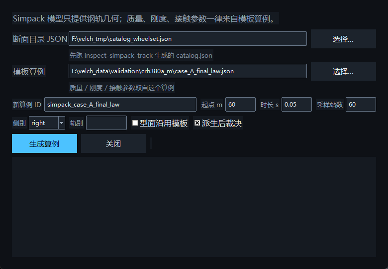

# 从 Simpack 模型算一个算例（2026-10-22）

本文件记录"软件可以读取 Simpack 的模型进行计算"这件事到底做到哪一步、哪一部分没有做、以及
为什么不做。所有数字都是本机实测，命令可复现。

## 一、读到了什么

用 `velch inspect-simpack-track` 读本机的真实 Simpack 数据库
`G:\研究生\动力学\CRH380A_纯刚性模型\database\database\mbs_db_substructure\CRH380A_M_Wheelset.spck`：

| 项 | 值 |
|---|---|
| 扫描模型 | 1 个 `.spck`（186 648 B，sha256 `c6157828…`） |
| 型面引用 | **238 条**（236 条 right / 2 条 left） |
| 唯一 PRR 文件 | **233 个**（`Profile_Mileage_JBG/R5/R10/…`） |
| 缺失引用 | **0** |
| 同里程多表面 | **10 处**（道岔转辙/辙叉区，同一里程两个承载面） |
| 里程跨度 | 0 – 150 m |
| `profile_set_sha256` | `caf3625fee9d947a3f80280788fad014bb3ed2f8b905a48c7812e5aa486a4bda` |
| `geometry_readable` | **true** |

每个引用都带 `rail` / `side` / `index` / `station_m` / `path` / `sha256`，所以"哪个型面文件在哪
个里程、属于哪根轨"是可追溯的，不是猜的。

## 二、怎么把它变成一个能跑的算例

新增 `velch simpack-case`（`src/velch/simpack_case.py`）：**几何从 Simpack 来，物理从你给的
模板算例来**。

```powershell
# 1) 读模型，产出目录（只读，不改模型）
python -X utf8 -m velch inspect-simpack-track <model>.spck --model-root <database> --output catalog.json

# 2) 派生算例：里程布置从模型来，物理（质量/悬挂/接触/容差）从模板算例来
python -X utf8 -m velch simpack-case --catalog catalog.json \
    --template validation\crh380a_m\case_A_final_law.json \
    --out case_from_simpack.json --side right --x-start 60 --duration 0.05 \
    --sample 60 --keep-profiles

# 3) 跑
python -X utf8 -m velch run-vehicle case_from_simpack.json --output out_simpack --fast
```

产出两份文件：算例本身，以及 `<算例>.simpack.json` 溯源旁挂（catalog 与 template 的 sha256、
里程跨度、每个站位的型面与 sha256、`from_simpack` / `from_template` / `not_imported` 三张清单）。

### 两种模式，两次实测

| 模式 | 型面来源 | 结果 |
|---|---|---|
| `--keep-profiles`（只导入**里程布置**） | 模板算例的 JBG 断面 | **跑通**：`result_status = numerically_checked`、七项门全 true、静载 **59 680.5769 N**、侵入 **65.47 µm**、BDF nfev 116 |
| 默认（导入模型**自己的断面**） | 模型里 233 个 PRR | **在静平衡阶段失败**：`vertical preload equilibrium failed: … the lightest contact patch carries only 0.0 N while the heaviest carries 119316.3 N` |

第一种模式证明"里程布置 → 站位表 → 求解"这条链路是通的，而且它复现的正是冻结静载门
（59 680.5769 N / 65.47 µm），说明导入过程没有动到已标定的物理。

第二种模式失败是**真结论，不是待修的 bug**：模型在道岔区同一里程给出不同承载面（10 处同里程
多表面），而 Velch 的 `ProfileSeries` 每个里程只能插值一个表面；再加上轮对初始横向位置
（`y_offset_m = 0.753`）是模板给的，模型自己的横向布置没有导入，于是车轮落在承载面之外、单侧
承担两倍载荷（119 316 N ≈ 2 × 59 662 N）。要修它必须做"按站位导入横向布置 + 双体（基本轨/尖轨）
交接"，这是已知未做的下一层，不是本次能顺手带过的。

`ProfileSeries` 的单表面限制在派生时被显式计数：`dropped_duplicate_stations = 10` 写进旁挂，
不悄悄丢掉。

## 三、明确不导入的东西

Simpack 侧的数**只能作对照值**（reference, not adopted），写进算例的数只能由人显式给出：

- 轴重、簧下质量、转动惯量（决定静载门 59 680.5769 N）
- 赫兹 `E*`、`R*`、接触刚度、蠕滑系数、摩擦上界（决定 65.47 µm 与 `friction_bound`）
- 一系/二系刚度阻尼、止挡间隙、`maximum_penetration_m`（决定 89.68 / 170.61 kN 峰值）
- 模态频率/阻尼比/振型 MAT、`Phi` 归一化与截断频率
- 预载与初始平衡、`rtol`/`atol`/`output_step_s`
- 任何从 `.spck` 文本里"推断"出来的数

旁挂里的 `not_imported` 清单就是这条规则的机器可读版本：
`rigid body dynamics`、`flexible (modal) track`、`solver settings`、`measured or reference results`。

## 四、派生时的两条硬规矩

1. **里程不位移**。早期实现把模型里程平移到 `--x-start`，结果右轨只覆盖 13.5–163.5 m，第一个
   车轮位置就在覆盖之外，静平衡报"单侧 119 357 N"。现在里程按模型原样导入，`--x-start` 必须
   落在模型自身跨度内（含 `travel_speed × duration` 的行程余量），否则直接拒绝并打印跨度。
2. **拒绝而不是猜**。catalog 不可读、型面文件消失、模板里该侧是分体结构、`x_start` 越界——四种
   情况都给 `SimpackCaseError` 与一句能照着改的话，绝不写半个算例出去。

## 五、断面下沉判据：先说清楚"这段模型断面比模板低多少"

> **更正（2026-10-22 深夜，两次量错）。** 本节最初那套"断面下沉 + 3/8 mm 两级阈值"是错的，
> 现已删除。两个错误都在**量法**里，不在结论里：
>
> 1. **量错了横向位置。** 旧代码在固定横向位置 `y = 0.753 m` 处取轨顶高度，而模板断面载入后的
>    测量包络是 `y ∈ [−0.790, −0.717] m`、冠部在 `y = −0.7896 m`——`y = 0.753` 落在**轨顶侧面**
>    （flank）上，比冠部高约 **+29.86 mm**。于是"下沉 5.18 mm / 11.24 mm"记录的实际是
>    **冠部横向漂移 × 侧面坡度**，与垂直下沉无关。按冠部重测：226 个右轨站位的冠部高度差全部在
>    **0.000–0.155 mm** 之内；真正在变的是**冠部横向位置**（0.714–0.868 m，相对模板最多漂移
>    **103 mm**）。
> 2. **窗口只向后看了 2 m。** 后轴在 `x_start` 之后 **10 m**（`bogie_half_spacing_m + wheelbase_m/2`），
>    旧窗口 `[x_start − 2, x_start + 车速×时长 + 2]` 里根本没有后轴要压的断面，于是导入的站位表
>    缺了后轴下面那段——**静平衡报"单侧脱空、最重接触 119 315 N"的原因是后轴没有钢轨，不是道岔
>    几何坐不住**。把窗口改成整车足迹 `[x_start − 10, x_start + 车速×时长]` 之后，同一个 60 m 窗口
>    **能坐也能跑**：`seats: true`、`residual_n = 1.1e-07`、`axle1_right = 59.68 kN`、
>    `run-vehicle --fast` → `numerically_checked`、`nfev 116`、`max_penetration 65.466 µm`
>    （正是冻结静载门）。
>
> **所以现在的口径是两条**，都不再拒绝几何：
>
> - **冠部高度差**（`crown_delta_mm`）只作**报告**：> `CROWN_WARN_MM = 0.5 mm` 时写一条 warning，
>   "the run may seat, but say so before quoting it"。它**不是**拒绝阈值——实测证明它分不出能不能坐。
> - **静平衡是唯一裁决者**：`simpack-case` 派生完就真跑一次 `_static_vertical_equilibrium`（`seat_report`），
>   坐得住 → 退出码 0 并打印八接触载荷；坐不住 → 退出码 2，打印原因、冠部差、整车足迹，以及一句
>   **不推荐窗口**的建议（`Crown heights do not predict this …`）。不想跑这一步就显式 `--no-seat-check`。
>
> 下面那张表保留原样，但它的"结果"列是**旧窗口（后轴脱轨）**下的观测，不能当"道岔区坐不住"的证据。

导入模型自己的断面时，道岔区（尤其 55–65 m 的转辙器与翼轨段）的断面比平板模板低，车一落上去
就偏载。最早的表象是一句很难读的静平衡报错：

```
the lightest contact patch carries only 0.0 N while the heaviest carries 119357.0 N
```

这句话没错，但它不告诉你"为什么"。所以 `simpack-case` 在派生之前先量一件事：
**模型断面在车轮实际会经过的那段里程上，比模板低多少。**

### 量法与两个实测边界

- 逐站在算例的横向口径下（`y_sign` × `y_offset_m`、`z_sign`）求轨顶高度，与模板同里程同位置相减，取绝对差值的最大值与该站里程。
- 只在**行驶窗口**上量：`[x_start − 2 m, x_start + 车速 × 时长 + 2 m]`。全模型最深的 −15.85 mm 在
  56.642 m，82 m 起跑的算例一辈子开不到那儿，不该被它否决。
- 实测边界（本机、CRH380A_M 算例对 `Profile_Mileage_*` 断面）：

行驶窗口内的实测（模型 236 站，右边的断面逐站不同，左边沿用模板）：

> 下表是旧窗口 `[x_start − 2, x_start + 车速×时长 + 2]` 下的观测，仅供追溯；`60/65/70 m` 三行的
> "静平衡失败"已由上面的更正解释（后轴无钢轨），不是转辙区几何的结论。

| 起点 | 行驶窗口 | 窗口内站数 | 窗口内最大下沉 | 结果 |
|---|---|---|---|---|
| 60.0 m | 58.0–66.9 m | 25 | **0.09 mm** @ 58.317 m | 断面几乎对齐，**但静平衡仍失败**（`the lightest contact patch carries only 0.0 N while the heaviest carries 119315.0 N`） |
| 65.0 m | 63.0–71.9 m | 19 | 0.01 mm | 同上：断面平了，不等于能坐住 |
| 70.0 m | 68.0–76.9 m | 21 | −0.01 mm | 同上 |
| 75.0 m | 73.0–81.9 m | 85 | **11.24 mm** @ 79.867 m | 被拒（> 8 mm） |
| 80.0 m | 78.0–86.9 m | 86 | **11.24 mm** @ 79.867 m | 被拒 |
| 82.0 m | 80.0–88.9 m | 37 | **5.18 mm** @ 80.004 m | 跑通：`numerically_checked`、七门全 true、八接触峰值 60.59–71.89 kN、最大侵入 88.63 µm、BDF `nfev 1094` |

**这张表推翻了一个想当然的因果**：60–70 m 三档的轨顶高度与模板几乎一致（≤0.1 mm），却仍然坐不住；
所以"冠部高度差"是**必要但不充分**的条件。转辙区的断面**形状**（承载面宽度、圆角、轨距面位置）逐站
在变，冠部在 `y = ±0.753 m` 处对齐并不代表车轮能找到同一个承载面。判据因此只负责"把明显不可能的窗口
挡在积分器之前"，它不承诺"剩下的窗口一定跑得通"——跑不通时仍然要回到那句话：
**先看结果，再引用数字。**

全模型统计：236 站中 **200 站在 2 mm 以内**，最长连续 ≤2 mm 的段落是 80.217–150.000 m（69.78 m）。

### 两级阈值（为什么不是一个数）

一个数只能满足一半：设 6 mm 会漏掉 11.91 mm 那种必失败的，设 4 mm 会把 5.18 mm 那种实际能跑的挡掉。
所以 `SURFACE_DROP_WARN_MM = 3.0` 是"值得说一句"的线，`--max-surface-drop`（默认 **8.0 mm**）是"直接拦"的线：

| 窗口内最大下沉 | 行为 |
|---|---|
| ≤ 3 mm | 静默通过 |
| 3–8 mm | 构建成功，旁挂 `surface_drop_warning` 与终端提示"能跑，但引用数字前先说清来源" |
| > 8 mm | `SimpackCaseError`，消息里带上实测下沉量、里程、阈值与三条出路 |
| 量不到（型面包络不覆盖该横向位置） | 记 `surface_delta_mm: null`——**"没量到"不等于"没下沉"** |

阈值只是把已知不可能的情形挡在前面：**11.24 mm 那两档被拒是对的，5.18 mm 那档跑通了也是真的，
但 0.09 mm 那档照样能失败**（见上表）。所以这个判据既不声称充分，也不替用户做"这段模型能不能算"的结论。

三条出路写在报错里，而且**第一条会给一个具体里程**——派生时会扫一遍模型的站位，找最近的、
窗口内下沉不超过 3 mm 的起点，直接写进消息：

```
… beyond the 8.0 mm this run can plausibly seat (measured here: 5.18 mm seated, 11.91 mm did not).
The nearest start that measures within 3 mm is 72.7 m (worst 1.24 mm). Or use --keep-profiles, …
```

它只是建议，不会替你换窗口；如果整个模型没有这样的窗口，消息会明说
`No window in this model measures within 3 mm of the template`。**注意"量的结果干净"不等于"一定跑得通"**——
60–70 m 三档就是反例，见上表。

三条出路还有：换一段断面与模板相符的窗口；`--keep-profiles` 只用模型的里程布置；或
`--allow-surface-drop` 强制放行并自己读一遍结果（放行会记 `surface_drop_allowed: true`）。

旁挂 `*.simpack.json` 的字段：

```json
"surface_delta_mm": {"max_abs": 5.182, "at_m": 80.004, "measured_stations": 35,
                     "ride_window_m": [80.0, 88.861]},
"surface_drop_allowed": false,
"surface_drop_warning": "imported surface sits +5.18 mm against the template's at 80.004 m; ..."
```

### 这一层也不导入物理

判据只是把"几何差异有多大"量出来并说清楚，它不改变任何力。`physics_validation_status` 仍是
`unvalidated_against_measurement_or_Simpack`：5.18 mm 能跑通说明数值上坐住了，不说明这段断面就是
真实线路的断面。

## 六、测试

`tests/test_simpack_case.py`（10 项）：schema 不符、`geometry_readable=false`、按 side 过滤与排序、
同里程去重计数、里程不被位移、越界拒绝、`--keep-profiles` 的型面来源、旁挂的
`from_*`/`not_imported`、型面文件缺失、以及真实模型在 `VELCH_SIMPACK_MODEL` 下可读（未设置则 skip）。

## 七、下一步（按价值排序）

1. 按站位导入**横向布置**（模型里每根轨的 y 基准），这是默认模式能跑起来的前提。
2. 双体交接（基本轨 / 尖轨、翼轨 / 心轨），需要 `rail_templates[*].bodies` 与 `y_window_m` 的映射。
3. 结果对照：把 Simpack 的 `RS_result` 通道与 Velch 的 `history.csv` 按同一里程窗对齐，出
   `docs/SIMPACK_COMPARE_<date>.md`——只描述差异，不调参。

## 八、在界面里做同样的事（0.4.6）

① 算例屏底部新增 **「从 Simpack 模型派生算例…」**：选断面目录 JSON、选模板算例、填起点/时长/采样站数，
点「生成算例」就写一个新算例，并当场告诉你静平衡坐不坐得住。



界面本身不算仿真、也不读几何：它把**和命令行完全相同的一条命令**交给 `velch.launcher` 起子进程，
再把命令的输出原样贴回来。这样有三个好处：

- 冻结成 exe 之后这条路径仍然可用（走 `velch-cli.exe`，不依赖 `-X utf8 -m velch`）；
- 界面能做的一切，命令行都能做、能复现、能被测试钉住；
- 裁决失败时界面上看到的就是命令行那一句建议，不会出现"界面说行、命令行说不行"。

派生失败（静平衡坐不住）时退出码为 2，界面**不会**把它当成功去刷新列表——这一点有测试
（`tests/test_ui_simpack_dialog.py::test_derive_does_not_swallow_a_failing_command`）。

## 九、横向布置：试了一次，被自己的量测挡下来了（0.4.8）

O008 说"冠部横向漂移最多 103 mm，而横向布置尚未导入"。这一轮真的把它导进去，结论是**不能这样导**。

### 做法

`simpack-case --import-lateral` 会把每个站位的冠部横向位置写进该站位自己的 `y_offset_m`
（`y_offset_from: "simpack crown"`），侧挂记录 `crown_lateral_m`（最大位移、发生里程、被改站位数）。

### 量到的事

在 80–90 m 窗口量两侧冠部相对模板的横向差：

| 侧 | 有站位 | 横向修正范围 |
|---|---|---|
| 右轨 | 38 个 | **−73.78 mm … +102.99 mm**（相邻站位来回跳） |
| 左轨 | **0 个** | 无数据 |

### 为什么必须拒绝

只改一侧的横向位置，**不是布置修正，而是轨距修正**：右侧 +103 mm、左侧 +0 mm，等于把轨距拉宽
103 mm。第一次实跑就是这样——`seats: false`，一侧四个接触全部脱空（
`the lightest contact patch carries only 0.0 N while the heaviest carries 119330.9 N`）。

所以新加两道：`build_case(..., import_lateral=..., allow_gauge_change=...)` 先量**两侧**在该里程上的
横向差，只要 `|右 − 左| > LATERAL_GAUGE_LIMIT_MM`（5 mm）就抛错并报出数字：

```
importing this side's crown lateral positions changes the gauge by +103.0 mm at 80.911 m
(this side +103.0 mm, other side +0.0 mm), beyond the 5 mm a run can absorb: on one side a
placement correction is a gauge change and rolls the vehicle onto one rail. Import both sides
in one go, or pass --allow-gauge-change to say you mean it.
```

`--allow-gauge-change` 可以放行（侧挂留下 `lateral_gauge_mm`），用于"我就是要看 103 mm 轨距差会怎样"
这种研究。默认不放行。

### 还没解决的问题（记在 O008）

1. 同一里程上有**两个不同表面**（`coincident_stations`，本模型 10 处）——"这一站的冠部"到底是基本轨
   还是尖轨，catalog 不回答，需要双体交接（基本轨/尖轨各自一个 body）。0.4.8 的单侧修正之所以在
   80.278 m 出现两个不同值（+81.69 mm 两次），就是这两个表面。
2. 左轨在该窗口根本没有站位数据，所以"两侧同时导入"在当前模型上做不到。

结论：横向布置**不是一条可以顺路补上的活**，它是双体交接的一部分。这一轮把它从"未做"变成"做了、
被量测挡住、并装上了拒绝"，这才是诚实的进度。
