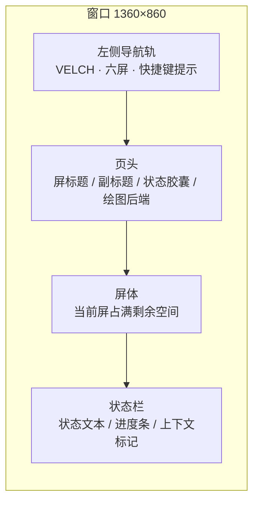
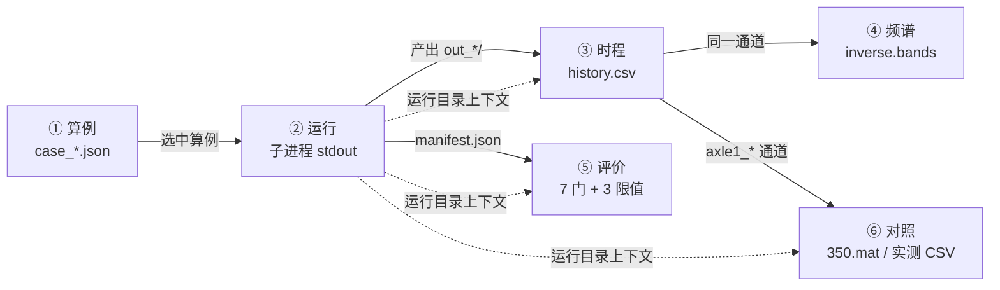
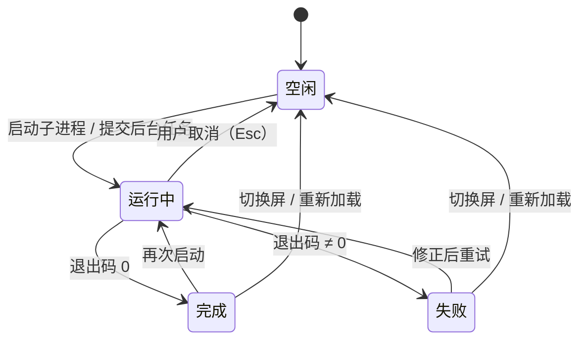

# Velch 桌面工作台 UI 规范

**版本**：1.0 · **日期**：2026-10-21 · **目标程序**：`python -X utf8 -m velch.ui`（Velch 0.4.0）
**取代**：v0.3 单屏工作台 `python -m velch.gui`（保留可运行、不改动）
**实现目录**：`src/velch/ui/` · **可运行证据**：`python -X utf8 -m velch.ui --selftest`

---

## 0. 一句话定位

这是一个**只读运行产物的六屏工作台**：算例 → 运行 → 时程 → 频谱 → 评价 → 对照。
它不实现任何数值算法，只做四件事——**把已有的 CLI 用起来、把已有的产物读出来、把已有的
口径（7 项门 / 3 项限值 / 1/3 倍频程）原样呈现、把 Velch 与 Simpack 放在同一根里程轴上**。

界面的一切数字都必须能追到一个文件字段或一个公开函数；追不到的数字不进界面。

---

## 1. 目标、边界与硬约束

| 类别 | 约束 | 在实现中的落点 |
| --- | --- | --- |
| 数值代码 | **一行不改** | `ui/` 只 `import` 公开 API（`velch.inverse.bands`、`velch.metrics.assess_history`、`velch.case.spec`）与执行 CLI 子进程 |
| 依赖 | 不新增第三方包 | 仅 Tkinter + 标准库 + numpy/scipy/matplotlib（matplotlib 只用于内嵌画布） |
| Matplotlib 缺失 | 必须可用 | `widgets.Chart` 同一套 API 下退化为 `tk.Canvas` 手绘折线/柱状 + 滚轮缩放 + 拖拽平移 |
| Simpack 不可读 | 必须可用 | `store.simpack_available()` 返回 `(False, 原因)`，对照屏自动切到「实测 CSV」源并显示原因 |
| 无显示环境 | 必须不崩 | `--selftest` 捕获 `TclError` → 打印原因 → 转纯数据自检 → **退出码 0** |
| 旧界面 | 不破坏 | `src/velch/gui.py` 与 `tests/test_gui_support.py` 未改动；`启动Velch界面.cmd` 改为指向新入口 |
| 文案/注释 | 中文界面、英文注释 | 全部 UI 字符串中文；所有 docstring/注释英文 |

---

## 2. 信息架构

### 2.1 外壳结构



- 左侧轨固定宽度，导航按钮 6 个（`① 算例` … `⑥ 对照`），当前屏高亮为 `ACCENT`。
- 页头右上角常驻两个读数：**状态胶囊**（空闲/运行中/失败/完成）与**绘图后端**（`matplotlib` / `tk-canvas`）。
- 状态栏右侧常驻**跨屏上下文**：`算例 xxx.json · 运行 out_xxx`，让任何一屏都能回答"我现在看的是哪次运行"。

### 2.2 六屏职责与上下文流向



| # | 屏 | 唯一职责 | 主要数据源 | 允许的写操作 |
| --- | --- | --- | --- | --- |
| ① | 算例 | 挑算例、看规格、派生子算例 | `validation/crh380a_m/case_*.json` | 只在用户点「另存派生」时新建 case 文件 |
| ② | 运行 | 起 CLI、看日志、取消、批量 | 子进程 stdout/stderr；`out_*/` 目录 | 只在用户指定的输出目录写产物（由 CLI 写，UI 不写） |
| ③ | 时程 | 多通道曲线、纵轴按单位分组、缩放平移 | `out_*/history.csv` | 无（导出 PNG 除外） |
| ④ | 频谱 | 1/3 倍频程柱状 + 带宽 RMS | 同上，经 `band_metrics`/`third_octave_levels` | 无 |
| ⑤ | 评价 | 7 项门逐项 + 3 项限值对比条 | `manifest.json` + `metrics.assess_history` | 无 |
| ⑥ | 对照 | 与 Simpack/实测同里程轴叠画 + 峰值/RMS 差 | `350.mat` 或实测 CSV + `history.csv` | 无 |

---

## 3. 全局状态机



| 状态 | 胶囊文案 | 颜色 | 进度条 | 状态栏示例 |
| --- | --- | --- | --- | --- |
| 空闲 | `● 空闲` | `#1C232C` 底 / `#9BA9B8` 字 | 隐藏 | `就绪` |
| 运行中 | `● 运行中` | `#F2B134` 底 / `#1A0605` 字 | 显示并滚动 | `CLI 运行中 · 已用 128.4 s` |
| 完成 | `● 完成` | `#46C46A` 底 / `#04170A` 字 | 隐藏 | `子进程完成 · 用时 1629.0 s` |
| 失败 | `● 失败` | `#FF6B5E` 底 / `#1A0605` 字 | 隐藏 | `子进程失败（退出码 2）` |

**降级矩阵**（同一屏在不同环境下的行为，全部有明确可见反馈，无静默失败）：

| 缺失能力 | 表现 | 用户可见提示 |
| --- | --- | --- |
| Matplotlib | `Chart` 用 `tk.Canvas` 手绘；页头显示 `绘图后端 tk-canvas` | 导出 PNG 时提示"当前后端不支持 PNG 导出" |
| h5py / 350.mat | 对照屏 Simpack 单选项禁用，自动切到实测 CSV | 单选下方直接写原因（如"缺少 h5py…"） |
| Tk 本身 | `--selftest` 走纯数据模式 | `[velch.ui] 未能构造 Tk 窗口：…` + 数据面读数 + 退出码 0 |
| 某屏模块异常 | 该屏替换为占位屏，其余五屏正常 | 占位屏大字写明 `该屏加载失败：<异常>` |
| 采样率过低 | 频带上限自动收到 `0.49×fs` | 频谱屏注明"上限频带自动收到 xxx Hz（Nyquist 之下）" |

---

## 4. 设计 Token（深色工业风）

### 4.1 色彩

底色接近炭黑（#0E1116），面板比底色高一档，卡片再高一档——**用明度台阶表达层级，不用边框堆叠**；
边框只做 1px 装饰线（`#2A3341`），从不用于文字。

| Token | 十六进制 | 用途 | 对比度 |
| --- | --- | --- | --- |
| `BG` | `#0E1116` | 窗口底色、导航轨 | — |
| `SURFACE` | `#151A21` | 面板、表格底 | — |
| `RAISED` | `#1C232C` | 卡片、输入框、悬停行 | — |
| `OVERLAY` | `#222A34` | 选中行、菜单、提示 | — |
| `BORDER` | `#2A3341` | 1px 分隔线 | 装饰，不承载文字 |
| `BORDER_STRONG` | `#3A4657` | 按下/聚焦边框 | 装饰 |
| `INK` | `#E6EDF3` | 主文字 | 16.00:1 on BG |
| `INK_MUTED` | `#9BA9B8` | 次要文字、列头 | 7.29:1 on SURFACE |
| `INK_DIM` | `#7D8B9C` | 三级文字、禁用 | 5.03:1 on SURFACE |
| `ACCENT` | `#4CC2FF` | 交互色、聚焦环、当前屏 | 9.43:1 on BG |
| `ACCENT_INK` | `#06121B` | 强调底上的文字 | 9.43:1 |
| `AMBER` | `#F2B134` | 运行中、对照侧曲线 B | 10.01:1 on BG |
| `PASS` | `#46C46A` | 门通过、完成 | 7.79:1 on SURFACE |
| `FAIL` | `#FF6B5E` | 门失败、错误 | 6.26:1 on SURFACE |
| `WARN` | `#E0A33A` | 接近限值、口径提示 | 7.88:1 on SURFACE |
| `INFO` | `#6FB2FF` | 中性强调 | 7.90:1 on SURFACE |

**曲线色序**（色盲安全、红绿不相邻）：`#4CC2FF` → `#F2B134` → `#B48EFF` → `#46C46A` → `#FF8FA3` → `#7DE2D1` → `#FFC978` → `#8CB8FF`。
两侧对照固定：**Velch = `#4CC2FF`，对照 = `#F2B134`**，不随曲线数变化。

### 4.2 字号与行高

Windows 中文界面按 **pt** 设定，实际像素约为 pt×1.33（96 dpi）。

| Token | 字号 | 行高 | 用途 |
| --- | --- | --- | --- |
| `micro` | 9 pt | 14 px | 表格元信息、轴刻度、单位后缀 |
| `tiny` | 10 pt | 16 px | 密集表格、按钮、单选项 |
| `body` | 11 pt | 18 px | 默认正文 |
| `body_lg` | 12 pt | — | 强调正文、卡片标题 |
| `section` | 14 pt | 22 px | 大数字、区块标题 |
| `title` | 18 pt | 26 px | 屏标题 |
| `display` | 24 pt | — | 英雄数字（评价屏关键值） |

字体族：**Microsoft YaHei UI**（界面）/ **Consolas**（数字、哈希、日志）；等宽表格行高 26 px。

### 4.3 间距与尺寸

4 px 基准：`4 / 8 / 12 / 16 / 24 / 32 / 48`（`SPACE["1".."12"]`）。
面板内边距 16 px，屏体外边距 24 px，控件内间隙 8 px，圆角 6 px。
控件最小高度 28 px（Tk 真实密度下 28 px 可稳定点击；这是对"44 px 触控目标"的桌面化收敛，
键盘全覆盖可弥补鼠标精度）。

---

## 5. 组件清单

都实现于 `src/velch/ui/widgets.py`，同一套风格 token，**状态齐全**（默认/悬停/按下/聚焦/禁用）。

| 组件 | 类 | 关键 API | 状态 |
| --- | --- | --- | --- |
| 卡片 | `Card` | `Card(parent, title)` → `.body()` | 静态容器，1px 边线 + `SURFACE` 底 |
| 状态胶囊 | `Chip` | `.set(text, tone)` | `idle/run/pass/fail/warn/info/accent` 七色 |
| 指标卡 | `MetricCard` | `.set(value, unit, tone)` | 数值变化时颜色随判定切换 |
| 限值对比条 | `LimitBar` | `.set(value, limit, passed, caption)` | 填充比 = value/limit；>80% 转 `WARN`；超限转 `FAIL` 并标"超限" |
| 门列表 | `GateList` | `.build(entries)` / `.set(key, passed, detail)` | 通过=绿勾，失败=红叉，未知=灰问号；每项右侧带数值 |
| 数据表 | `ListPanel` | `.columns(spec)` / `.clear()` / `.tree` | 交替行、选中 `OVERLAY`、列头可排序 |
| 曲线图 | `Chart` | `.set_series(series, ylabel, xlabel)` / `.clear()` / `.reset_view()` / `.zoom_x()` / `.pan_x()` / `.export_png()` | 空态提示语；滚轮缩放；左键拖拽平移；双击复位 |
| 按钮 | `Ghost/Primary/Danger/Amber.TButton` | ttk style | 主操作 `ACCENT`，破坏性 `FAIL`，运行中 `AMBER` |
| 输入 | `Field.TEntry` / `TCombobox` / `TSpinbox` / `TScale` | ttk style | 聚焦时边框转 `ACCENT` |
| 树（通道/算例） | `ttk.Treeview` (`Data.Treeview`) | 单位分组为父节点 | 父节点展开、子节点多选 |

---

## 6. 六屏规格

### ① 算例 `Ctrl+1`

```
┌──────────────────────────────────────────────────────────────────────────────┐
│ ① 算例 · 算例库                    ● 空闲            绘图后端 matplotlib      │
│ 选择、检视与派生算例                                                          │
├──────────────────────────────────────────────────────────────────────────────┤
│ [278 个算例] [总大小 33.7 MB] [35 自由度×186] [51×74] [67×12] [83×2] [crh380a_m]│
│ ┌─ 算例清单 ──────────────────────────────┐ ┌─ 算例身份 ──────────────────────┐ │
│ │ 筛选 [frog_____________________]        │ │ 算例 ID     case_frog_05_frog…  │ │
│ │ ┌─────────────────────────────────────┐ │ │ schema      velch-vehicle-v2    │ │
│ │ │ 算例 ID          时长  自由度 哈希  │ │ │ 目的        engineering        │ │
│ │ │ A_final_law      1.200 35    ed42…  │ │ │ 时长        1.200 s             │ │
│ │ │ S_hc_e0.15…frog  0.050 35    019a…  │ │ │ 自由度      35（initial_state.q）│ │
│ │ │ …                …     …      …     │ │ │ 起始里程    13.50 m             │ │
│ │ └─────────────────────────────────────┘ │ │ 输出步长    0.0005 s            │ │
│ └─────────────────────────────────────────┘ │ 文件大小    128.4 kB            │ │
│                                             │ sha256      8e01996d9767…       │ │
│                                             │ 文件路径    validation/…        │ │
│                                             │ ── 复制派生 ─────────────────── │ │
│                                             │ 新算例 ID [                 ]   │ │
│                                             │ 时长覆盖  [                 ]   │ │
│                                             │ 步长覆盖  [                 ]   │ │
│                                             │ [派生新算例][复制路径][复制命令]│ │
│                                             │ [在「运行」屏打开][刷新列表]    │ │
│                                             └─────────────────────────────────┘ │
├──────────────────────────────────────────────────────────────────────────────┤
│ 已选 1 个算例 · 33.7 MB · 含故障 0                    Ctrl+L 筛选 Ctrl+R 运行 │
└──────────────────────────────────────────────────────────────────────────────┘
```

- 列表列：`算例 ID / 时长 s / 自由度 / 起始里程 m / 输出步长 s / sha256 前 12 位`；实测行数 **278**。
- 顶部概览 chip：算例数、总大小、自由度直方图（按 `len(initial_state.q)` 分桶）、扫描目录名。
- 「自由度」直接取 `len(initial_state.q)`（与 `manifest.total_dof` 一致，无需运行即可显示）。
- 「派生新算例」只写一个新的 `case_*.json`（改 `case_id`、可选覆盖 `duration_s`/`output_step_s`），
  **不碰数值字段、不改原文件**；派生后自动重扫列表。
- 「复制命令」把 `python -X utf8 -m velch run-vehicle … --output …` 放入剪贴板；「在「运行」屏打开」设上下文并跳②。

### ② 运行 `Ctrl+2`

```
┌──────────────────────────────────────────────────────────────────────────────┐
│ ② 运行 · 启动 CLI 与日志             ● 运行中            绘图后端 matplotlib  │
│ 选算例 → 设输出目录 → 启动 CLI 子进程，实时查看 stdout 与耗时；可取消、可批量  │
├──────────────────────────────────────┬───────────────────────────────────────┤
│ ┌─ 运行配置 ──────────────────────┐  │ ┌─ 实时输出 ──────────────────────────┐ │
│ │ 算例（多选即批量）              │  │ │ [状态 运行中][耗时 128.4 s]         │ │
│ │ ┌────────────────────────────┐  │  │ │ [输出行 412][退出码 —]  [清空日志]  │ │
│ │ │ 算例 ID          时长 自由度│  │  │ │ ┌─────────────────────────────────┐ │ │
│ │ │ A_final_law      1.200 35   │  │  │ │ │ [velch] case_frog_05 nfev=8124  │ │ │
│ │ │ S_hc_e0.15_v0.5  1.200 35   │  │  │ │ │ [velch] step 2400/2400 done     │ │ │
│ │ │ …                …     …    │  │  │ │ │ …（自动滚到底）                 │ │ │
│ │ └────────────────────────────┘  │  │ │ └─────────────────────────────────┘ │ │
│ │ 输出目录 [out_ui_run        ][浏览]│ │ [查看时程 →][查看评价 →] [刷新运行目录]│ │
│ │ 并行 --jobs [1 ⌃]  ☑ 自动滚动日志 │  │ └─────────────────────────────────────┘ │
│ │ [启动单次运行][批量运行][取消][打开输出目录]│                                   │
│ │ 命令行预览  python -X utf8 -m velch …│                                   │
│ └─────────────────────────────────┘  │                                       │
└──────────────────────────────────────┴───────────────────────────────────────┘
```

- 左列权重 3、右列权重 5；算例列表为多选（批量运行的输入），选中项即启动单次运行的输入。
- 单算例：`python -X utf8 -m velch run-vehicle <case> --output <dir>`（`sys.executable` + `-X utf8`）；
  批量：`run-vehicle-batch <case...> --output-root <dir> --jobs N`。窗口内没有 `--workers` 开关
  （那是 CLI 的并行细节，界面不重复暴露）。
- 日志来自 `Popen(stdout=PIPE, stderr=STDOUT)` 的逐行读取，经 `queue.Queue` 回到 Tk 线程；
  **工作线程绝不碰控件**。日志上限 4000 行（超出丢弃最旧行）。
- 取消 = `proc.terminate()`，状态回「空闲」并标注「已取消」；未启动时「取消」按钮为 disabled。
- 退出码 0 → 自动把该输出目录设为全局上下文，并在日志下方给「看时程 / 评价」跳转。
- 实测：子进程流式通路自检收到 **3 行**日志、退出码 0、用时 0.05 s。

### ③ 时程 `Ctrl+3`

```
┌──────────────────────────────────────────────────────────────────────────────┐
│ ③ 时程 · 时程曲线                   ● 完成                绘图后端 matplotlib  │
├──────────────────┬───────────────────────────────────────────────────────────┤
│ 运行目录 [out_…▾]│ ┌─ 接触力 [N] ──────────────────────────────────────────┐ │
│ ┌─ 通道（按单位）┐│ │      ╱╲        ╱╲      axle1_right_normal_n          │ │
│ │▾ 接触力 [N] 8  ││ │  ╱╲╱  ╲╱╲╱╲╱  ╲     axle1_left_normal_n           │ │
│ │  ☑ axle1_right ││ │ ╱                      ╲                          │ │
│ │  ☑ axle1_left  ││ └───────────────────────────────────────────────────────┘ │
│ │▾ 位移 [m]   24 ││ ┌─ 位移 [m] ────────────────────────────────────────────┐ │
│ │  ☑ axle1_z_m   ││ │ ～～～～～～～～～～～～～～～～～～  axle1_z_m           │ │
│ │▾ 侵入量 [m] 8  ││ └───────────────────────────────────────────────────────┘ │
│ └────────────────┘│ ┌─ 侵入量 [m] ──────────────────────────────────────────┐ │
│ 预设 [接触力▾]   │ │  ╱╲                                                    │ │
│ 最大点数 [2000]  │ └───────────────────────────────────────────────────────┘ │
│ 采样 2401 ·2000Hz│ 155 通道可选 → 已选 3 → 3 个纵轴组 / 3 条曲线              │
└──────────────────┴───────────────────────────────────────────────────────────┘
```

- 通道树按**单位分组**（接触力 N / 位移 m / 侵入量 m / 速度 m·s⁻¹ / 转角 rad / 轨道位移 / 接触状态），
  实测最宽一次运行 **187 列**、最长 **2401 行**、采样 2000 Hz。
- 每个单位组一张图，纵轴标签写单位，多组**共享同一 x 窗口**（缩放任一图，其余跟随）。
- 抽稀用**保极值**分块（每块保留 min/max），不是简单抽点——力尖峰只有 1–2 个采样宽，等距抽点会把它吃掉。
- 预设：`接触力 / 位移 / 侵入量`（三组常用通道一键勾选）。

### ④ 频谱 `Ctrl+4`

```
┌──────────────────────────────────────────────────────────────────────────────┐
│ ④ 频谱 · 1/3 倍频程                 ● 完成                绘图后端 matplotlib  │
├──────────────────────────────────────────────────────────────────────────────┤
│ 运行 [out_…▾]  通道 [axle1_right_normal_n ▾]  频带 [5]–[1000] Hz [计算频谱]    │
│ ┌─ 1/3 倍频程带宽 RMS ──────────────────────────────────────────────────────┐ │
│ │  ▁▂▃▅█▇▅▄▃▂▂▁▁ … ▁▂▃▅                                        22 根柱     │ │
│ │  6.2 7.8 9.8 … 39.4 … 630 794 980              中心频率 [Hz]（对数等宽）  │ │
│ └───────────────────────────────────────────────────────────────────────────┘ │
│ ┌─ 指标 ──────────────┐ ┌─ 频带表 ─────────────────────────────────────────┐ │
│ │ 峰值      9.42e5 N  │ │ 中心 Hz   带宽 Hz    RMS       占比              │ │
│ │ 峰峰值    1.83e6 N  │ │ 5.0       4.5        1.2e3     42.1 %            │ │
│ │ RMS       2.86e3 N  │ │ 6.3       1.5        8.9e2     31.2 %            │ │
│ │ 主导频带  39 Hz     │ │ …                                                │ │
│ └─────────────────────┘ └──────────────────────────────────────────────────┘ │
└──────────────────────────────────────────────────────────────────────────────┘
```

- 计算全部委托 `velch.inverse.bands`：`third_octave_centres(low, min(high, 0.49·fs))`、
  `third_octave_levels(...)`、`band_metrics(...)`；**界面不做二次滤波、不做自己的 FFT**。
- 默认限带 5–1000 Hz，实际会被收到 `0.49·fs = 980 Hz`（2000 Hz 采样）。实测：5–980 Hz 得 **22 个**
  1/3 倍频程带，主导 **39.37 Hz**，整体 RMS **2856.133**（通道 `axle1_right_normal_n`）。
- 非有限样本在送进滤波器前剔除；有效样本 < 8 时给出"有效样本不足"的空态而不是异常。

### ⑤ 评价 `Ctrl+5`

```
┌──────────────────────────────────────────────────────────────────────────────┐
│ ⑤ 评价 · 数值门与运用限值           ● 完成                绘图后端 matplotlib  │
│ manifest 七项数值门逐项判定 + assess 三项限值对比（脱轨系数 / 减载率 / 轮轴横向力）│
├──────────────────┬───────────────────────────────────────────────────────────┤
│ ┌─ 评价对象 ────┐│ [总判定 通过][样本 2401][静态轴重 119368 N][manifest 门 7/7]│
│ │ 运行目录 [▾]  ││ ┌─ 七项数值门 ──────────┐ ┌─ 三项限值 ──────────────────┐ │
│ │ 静态轴重 [0 ] ││ │ ✅ 求解器收敛完成      │ │ 脱轨系数 Q/P      0.06499/0.8│ │
│ │ [重新评价]    ││ │ ✅ 状态与力全部有限    │ │ ▓░░░░░░░░░░░ ▏              │ │
│ │ [运行 velch   ││ │ ✅ 垂向预载残差 1.4e-7 │ │ 限值 0.80 (GB/T 5599 客车)   │ │
│ │  assess]      ││ │ ✅ 侵入量在限值内 5.5e-4│ │ 轮重减载率 ΔP/P̄ 0.4738/0.6 │ │
│ │ ┌─ CLI 日志 ┐ ││ │ ✅ 摩擦力在摩擦界内 0 N│ │ ▓▓▓▓▓▓▓▓▓▓░░ ▏            │ │
│ │ │（空/输出）│ ││ │ ✅ 无边缘限幅接触 0 采样│ │ 限值 0.60                    │ │
│ │ └───────────┘ ││ │ ✅ 平动作用-反力 1.7e-10│ │ 轮轴横向力 H  3895/4.979e4 N │ │
│ │ 口径说明 …    ││ └────────────────────────┘ │ 限值 10 + P₀/3 kN           │ │
│ └───────────────┘│                            │ [全部限值通过] 三项限值均在界内│
│                  │                            │ ┌─ 轴端明细表 ───────────────┐│
│                  │                            │ │ 轴 法向力范围 脱轨 减载 横向││
│                  │                            │ │ 1  58.2–61.2 / 37.2–89.7 … ││
│                  │                            │ └────────────────────────────┘│
└──────────────────┴───────────────────────────────────────────────────────────┘
```

- 门的来源是 `manifest.json` 的 `summary.gates`（7 个布尔）——**逐项显示，不折叠成"通过"**，
  每行右侧给出对应数值（`vertical_preload_max_residual_n` / `max_penetration_m` /
  `max_friction_excess_n` / `edge_limited_active_output_samples` / `max_translation_balance_error_n`）。
- 三项限值调用与 `velch assess` **完全相同的公开函数** `metrics.assess_history()` 再取 `verdict()`，
  因此界面读数与 CLI 读数逐位一致；「运行 velch assess」按钮用于核对退出码 0/2。
- 限值口径：脱轨系数 ≤ 0.80、轮重减载率 ≤ 0.60、轮轴横向力 ≤ `10 kN + P₀/3`。
- 实测样例：`out_a5_analytic12` 7 项门全通过、3 项限值全通过（脱轨 0.06499 / 减载 0.4738 /
  横向 3895 N vs 限值 49790 N）、2401 个采样。

### ⑥ 对照 `Ctrl+6`

```
┌──────────────────────────────────────────────────────────────────────────────┐
│ ⑥ 对照 · 与 Simpack / 实测同轴叠加   ● 完成                绘图后端 matplotlib  │
├──────────────────────────────────────────────────────────────────────────────┤
│ ⚠ 口径提示  非同一道岔时只作口径对照：两侧共用同一里程轴、同一通道定义与同一频带│
│             口径，力与位移的差异可以直接读，但不构成同工况验证。                │
├──────────────────────┬───────────────────────────────────────────────────────┤
│ 对照源               │ ┌─ 法向力 [kN] ───────────────────────────────────────┐ │
│ ◉ Simpack 350.mat    │ │   Velch ────   Simpack ────                          │ │
│ ○ 实测 CSV           │ │        ╱╲        ╱╲                                  │ │
│ Velch 运行 [out_…▾]  │ └──────────────────────────────────────────────────────┘ │
│ 里程窗 [ ] – [ ] m   │ ┌─ 轮对垂向位移（相对均值）[mm] ───────────────────────┐ │
│ 里程采样点 [400]     │ │   ～～～～～～～～～～～～                             │ │
│ [计算对照]           │ └──────────────────────────────────────────────────────┘ │
│                      │ ┌─ 差值统计 ────────────────────────────────────────┐ │
│                      │ │ 指标        Velch      对照       差值     相对差 │ │
│                      │ │ 峰值 force  9.4e4      8.9e4      +5.6e3   +6.3% │ │
│                      │ │ RMS force   2.86e3     2.71e3     +1.5e2   +5.5% │ │
│                      │ └──────────────────────────────────────────────────┘ │
└──────────────────────┴───────────────────────────────────────────────────────┘
```

- 里程轴 = 两侧记录**重叠区间**（可选窗口收窄），`np.interp` 重采样到同一网格；**不缩放、不平移**，
  所以"峰值差"是真的差。
- Simpack 通道映射与仓库既有对照脚本一致：`timeInt/RS_result/SRS_S_R/SRS_S_WS_F/SRS_RWP_R/`
  下 `SRS_RWP_R_Pair/ch_008`（里程，**+17.5 m** 移到轨道轴）、`SRS_RWP_R_1/ch_010`（法向力）、
  `SRS_RWP_R_1_Adv/ch_025`（侵入量）、`timeInt/bodyPosTrans/SS_F__S_WS_F__B_WS/z`（轮对垂向）。
- Velch 侧：`axle1_x_m` / `axle1_right_normal_n` / `axle1_right_penetration_m` / `axle1_z_m`。
- 实测：Simpack 可用，**4 项差值**、400 个共里程点、共里程窗 **23.50–140.17 m**、4 条曲线。
- 顶部提示条**始终可见**（含计算后），文案随数据源变化，不允许关掉。

---

## 7. 键盘快捷键

| 按键 | 动作 |
| --- | --- |
| `Ctrl+1` … `Ctrl+6` | 切换第 1–6 屏 |
| `Ctrl+L` | 跳到当前屏的筛选/搜索框 |
| `Ctrl+R` | 启动所选算例（等价于②屏「运行所选」） |
| `Esc` | 取消正在运行的子进程 |
| `F5` | 重新加载当前屏数据 |
| `Ctrl+E` | 导出当前图（仅 matplotlib 后端） |
| `F1` | 快捷键与数据口径说明 |
| `Ctrl+Q` | 退出（若有子进程先终止） |
| 鼠标滚轮 / 左键拖拽 / 双击 | 图内缩放 / 平移 / 复位 y 轴 |

所有功能都有键盘路径：算例与通道选择用树的上下键 + 空格，按钮 Tab 可达并显示 `ACCENT` 聚焦环。

---

## 8. 数据绑定表

> 每个控件 → 它读/写的**具体文件与字段**。UI 不产生任何派生数值。

### ① 算例屏

| 控件 | 读取 | 字段 / API |
| --- | --- | --- |
| 算例表（行） | `validation/crh380a_m/case_*.json` | `case_id`、`purpose`、`schema_version`、`run.duration_s`、`len(initial_state.q)`、文件大小、文件 `sha256[:12]` |
| 「类型」列 | 同上 | `schema_version`：`velch-vehicle-v2`→整车 v2；`velch-case-v1`→轮对 v1 |
| 筛选框 | 内存 | 对 `case_id`/`purpose`/文件名做子串匹配 |
| 详情面板 | 同上 | `source_evidence.*`（`simpack_model`、`wheel_profile_sha256`、`track_catalog_sha256`）、`run.output_step_s`、`run.maximum_penetration_m`、`contact/*`、`vehicle/*` |
| 派生复制 | 写新文件 | `gui_support.relocated_case` + `write_case` → `case_<id>_derived.json` |
| 双击行 | 上下文 | `app.set_context(case=…)` → 跳② |

### ② 运行屏

| 控件 | 读取/写入 | 字段 / API |
| --- | --- | --- |
| 算例列表 | `case_*.json` | 同①（可多选） |
| 输出目录输入 | 写 | 透传给 CLI `--output`（单）/ `--output-root`（批） |
| `jobs` 数字框 | 写 | 透传 `--jobs` |
| 运行按钮 | 执行 | `python -X utf8 -m velch run-vehicle <case> --output <dir>` |
| 批量按钮 | 执行 | `python -X utf8 -m velch run-vehicle-batch <case...> --output-root <dir> --jobs N` |
| 实时日志 | 读 | 子进程 `stdout`+`stderr` 合流逐行 |
| 已用时间 | 读 | `ProcessJob.elapsed`（单调时钟） |
| 取消 | 动作 | `Popen.terminate()` |
| 完成后跳转 | 上下文 | `app.set_context(run=<输出目录>)` |

### ③ 时程屏

| 控件 | 读取 | 字段 / API |
| --- | --- | --- |
| 运行目录下拉 | `out_*/manifest.json` | `summary.case_id`、`result_status`、`total_dof`；缺 manifest 时退回目录名 |
| 通道树 | `out_*/history.csv` 表头 | 列名；单位/分组由后缀规则推断（`_normal_n`→N/接触力，`_penetration_m`→m/侵入量，`_m_per_s`→m·s⁻¹/速度，`_rad`→rad/转角，`_active`→无量纲/接触状态 …） |
| 曲线 | `history.csv` | `time_s` + 选中列，保极值抽稀到「最大点数」 |
| 采样率 | 同上 | 由 `time_s` 差分中位数推算（实测 2000 Hz） |
| 预设 | 常量 | `PRESETS`（接触力 / 垂向位移 / 侵入量） |
| `Ctrl+E` 导出 | 写 | `Figure.savefig(<png>)` |

### ④ 频谱屏

| 控件 | 读取 | 字段 / API |
| --- | --- | --- |
| 通道下拉 | `history.csv` 数值列 | 列名 |
| 频带下限/上限 | 输入 | `low_hz`、`high_hz`（上限自动 `min(high, 0.49·fs)`） |
| 柱状图 | 计算 | `third_octave_centres(low, high)` → `third_octave_levels(values, fs, centres)` |
| 指标卡 | 计算 | `band_metrics(values, fs, low, high)`：`peak`、`peak_to_peak`、`rms`、`median_abs`、`p999_abs`、`dominant_band_hz` |
| 频带表 | 计算 | `levels.items()` 排序 + 各带 RMS 占比 |

### ⑤ 评价屏

| 控件 | 读取 | 字段 / API |
| --- | --- | --- |
| 运行下拉 | `out_*/manifest.json` | `summary.result_status`、`total_dof`、`case_sha256` |
| 七项门 | `manifest.json` | `summary.gates.{solver_completed, finite_states_and_forces, vertical_preload_residual, penetration_within_case_limit, friction_bound, no_edge_limited_active_contact, translational_action_reaction}` |
| 门右侧数值 | `manifest.json` | `summary.{vertical_preload_max_residual_n, max_penetration_m, max_friction_excess_n, edge_limited_active_output_samples, max_translation_balance_error_n}` |
| 静态轴重 | 输入 → API | `assess_history(path, static_axle_load_n=…)` |
| 三项限值条 | 计算 | `Assessment.verdict()["checks"]`：`derailment_coefficient`(0.80)、`wheel_load_reduction`(0.60)、`axle_lateral_force_n`(10 kN + P₀/3) |
| 总判定 | 计算 | `verdict["pass"]`；CLI 路径 `velch assess <dir>` 退出码 0/2 用于交叉核对 |
| 峰值法向力 | `manifest.json` | `summary.peak_normal_force_n`（按轴端） |
| 能量变化 | `manifest.json` | `summary.initial_mechanical_energy_j` / `final_mechanical_energy_j` / `energy_change_j` |

### ⑥ 对照屏

| 控件 | 读取 | 字段 / API |
| --- | --- | --- |
| 对照源单选 | `simpack_available()` | 350.mat 存在性 + `h5py` 可导入性（不可用时给原因并禁用） |
| Simpack 里程 | HDF5 | `…/SRS_RWP_R/SRS_RWP_R_Pair/ch_008["values"] + 17.5 m` |
| Simpack 法向力 | HDF5 | `…/SRS_RWP_R/SRS_RWP_R_1/ch_010["values"]` |
| Simpack 侵入量 | HDF5 | `…/SRS_RWP_R/SRS_RWP_R_1_Adv/ch_025["values"]` |
| Simpack 轮对垂向 | HDF5 | `timeInt/bodyPosTrans/SS_F__S_WS_F__B_WS/z["values"]` |
| 实测 CSV | 用户文件 | 任选「里程列」+「力列」+ 单位系数（CSV→N） |
| Velch 侧 | `history.csv` | `axle1_x_m`、`axle1_right_normal_n`、`axle1_right_penetration_m`、`axle1_z_m` |
| 里程窗 / 采样点 | 输入 | `np.linspace(重叠区间, 点数)` + `np.interp` |
| 差值表 | 计算 | 两侧峰值力、RMS 力、峰值轮对垂向（mm）、RMS 轮对垂向 及差值/相对差 |
| 顶部提示 | 常量 | 口径声明文案（计算后由结果对象再补一份同样的声明） |

---

## 9. 无障碍与可用性

- **对比度**：主文字 16.00:1、次要 7.29:1、三级 5.03:1、强调 9.43:1 —— 全部 ≥ WCAG AA 的 4.5:1（`theme.MIN_TEXT_CONTRAST = 4.5`，写在代码里可断言）。
- **颜色不是唯一编码**：门用 ✅/❌ + 文字；限值条除颜色外有数值与"超限"字样；对照两侧除颜色外有图例文字。
- **键盘全覆盖**：六屏切换、筛选、运行、取消、导出、说明都有快捷键；焦点环 2 px `ACCENT`。
- **状态可读**：状态胶囊文案是文字（空闲/运行中/失败/完成），不依赖动画；进度条只是补充。
- **失败可解释**：错误信息带异常类型与原因，缺依赖时给出"缺什么 + 怎么办"（如缺 h5py 提示改实测 CSV）。
- **不遮挡**：所有说明文字用 `wraplength` 换行，窗口 1360×860 下无横向滚动；字体不含小于 9 pt 的字号。
- **动画敏感**：无自动播放动画，进度条为系统 indeterminate，无闪烁。

---

## 10. 实现与文件清单

| 文件 | 行数量级 | 作用 |
| --- | --- | --- |
| `src/velch/ui/__init__.py` | 20 | 惰性 `main()`，保持 `import velch.ui` 无副作用 |
| `src/velch/ui/__main__.py` | 3 | `python -X utf8 -m velch.ui` 入口 |
| `src/velch/ui/app.py` | 614 | 外壳、主题注入、导航、状态机、`ProcessJob`、队列泵 |
| `src/velch/ui/theme.py` | 78 | 全部 token（颜色/字号/间距/对比度/曲线色序） |
| `src/velch/ui/widgets.py` | 629 | 9 个组件，`Chart` 的 mpl + Tk Canvas 双后端 |
| `src/velch/ui/screen.py` | 118 | 屏契约：懒加载、`reload`、`stats()`、占位屏 |
| `src/velch/ui/store.py` | 741 | 只读数据层：算例/运行/通道/抽稀/频谱/评价/对照 |
| `src/velch/ui/screen_cases.py` | ~330 | ① |
| `src/velch/ui/screen_run.py` | ~330 | ② |
| `src/velch/ui/screen_timeseries.py` | 315 | ③ |
| `src/velch/ui/screen_spectrum.py` | ~240 | ④ |
| `src/velch/ui/screen_assess.py` | ~330 | ⑤ |
| `src/velch/ui/screen_compare.py` | ~330 | ⑥ |
| `src/velch/ui/selftest.py` | ~330 | `--selftest`：逐屏加载 + 数字上报 + 无 Tk 降级 |

`启动Velch界面.cmd` 现在执行 `python -X utf8 -m velch.ui`，失败时提示先跑 `--selftest`；
`src/velch/gui.py`（v0.3）保持原样，命令 `python -X utf8 -m velch.gui` 仍可用。

---

## 11. 自检证据（2026-10-21 实跑）

命令：`python -X utf8 -m velch.ui --selftest`（无显示器交互，构造并隐藏窗口）

| 屏 | 控件数 | 数据行 | 说明 |
| --- | --- | --- | --- |
| `cases` ① | 63 | 278 | 278 个算例 · 33.7 MB · 含故障 0 |
| `run` ② | 58 | 278 | 278 个可选算例 |
| `timeseries` ③ | 39 | 2401 | 155 通道可选 → 已选 3 → 3 个纵轴组 / 3 条曲线 |
| `spectrum` ④ | 55 | 22 | 22 个频带 · 主导 39 Hz |
| `assess` ⑤ | 88 | 147 | 147 个运行目录可评价 |
| `compare` ⑥ | 49 | 8 | 4 项差值 · 4 条曲线 · 里程窗 23.50–140.17 m |
| **合计** | **352** | **3134** | 6 屏 / 0 个屏报错 / 全程 3.38 s |

数据面读数：算例 278（purpose/自由度/sha256 各 278，解析失败 0）；运行目录 147（manifest 126、
history.csv 126、最宽 187 列、7 项门 126 个可用）；时程（最新运行 `out_a5_ms5e-4`）154 通道 /
7 个单位分组 / 2401 行 / 2000 Hz；频谱 16 个 1/3 倍频程带（5–200 Hz）、主导 39.3725 Hz、
整体 RMS 2856.133；评价 3 项限值全通过 + 7 项门全通过（2401 采样）；对照 Simpack 可用、4 项差值、
400 个共里程点；子进程流式通路收到 3 行日志、退出码 0、用时 0.05 s。

> 注：本表是某一次自检的快照。算例数从 276 涨到 279、运行目录从 145 涨到 148（仓库里还有别的进程
> 在持续产出 `case_*.json` 与 `out_*`，时程选中的"最新运行"也随之变化），数据行总数因此在
> 3129→3137 之间浮动。**控件数 352 是稳定的**（六个屏的布局在代码里固定）；数据行数每次启动重新扫描，
> 按当日产物统计。

无 Tk 分支实测输出（模拟 `TclError: no display name`）：打印原因 + 同样一份数据面读数 + `退出码 0`。

测试回归：`python -X utf8 -m pytest tests -q --basetemp F:\velch_tmp\pytest` → **233 passed**，0 失败，
本 UI 未改动任何被测代码。

---

## 12. 已知体验缺口（按影响排序）

1. **运行期没有真实进度**：CLI 只打印里程碑行，没有百分比。界面只能给"已用时间 + 日志行数"，
   一次整程 1.2 s 工况要跑约 27 min，用户无法判断"是不是卡住了"。建议让 CLI 在 stderr 打
   `progress <step>/<total>`，UI 即可画出真进度条——这需要改 CLI，属于数值/接口改动，本次不做。
2. **147 个运行目录靠下拉选，没有搜索**：`out_*` 目录多且名字相近（`out_frog_05_*`、`out_full12_*`），
   下拉列表在 147 项时很难定位。应改成可筛选的列表（带 `case_id`/日期/状态列），与②屏共用一次扫描结果。
3. **门/限值不落盘、不跨运行比较**：评价屏每次只呈现一个运行目录的 7 门 3 限值，看 60 个算例要来回切。
   建议加一条"全量评价表"（每个 out_* 一行，直接读 manifest + assess），才能支撑"哪个参数区间不安全"这类问题。
